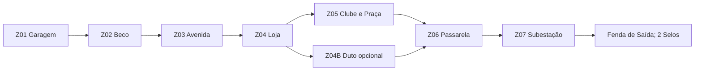

# QUEBRA NO TEMPO
## Game Design Document (GDD) completo — v2.2 | Selos de Continuidade e saídas autorais das 24 fases

> **Gênero:** tiro em terceira pessoa (TPS), ação, plataforma 3D e aventura com viagem temporal  
> **Identidade:** ação pulp adulta, humor ácido, anti-herói carismático, casas noturnas, exploração e ficção científica retrofuturista  
> **Inspiração de estrutura:** *Duke Nukem: Time to Kill* (PS1, 1998), sem utilização de seus personagens, marcas, falas, mapas, inimigos, trilhas ou demais ativos protegidos  
> **Produto principal:** jogo 3D para navegador (Three.js / WebGL2 / GitHub Pages), teclado e mouse, gamepad e interface móvel adaptada  
> **Futura expansão:** edição desktop, desde que a campanha web esteja estável  
> **Documento:** especificação de produção, não implementação pronta
> **Atualização v2.2:** preserva todo o conteúdo da v2.1 e substitui a antiga extração por **Selos de Continuidade + Fenda de Saída**, como regra unificada para as 24 missões. Corrige a primeira fase, explicita a progressão por selo, os chefes, os saves, a HUD, os dados de missão e a matriz de QA. **Documento de design, não gameplay implementada nem testada.**

---

## Índice principal

- [**Como terminar fases: Selos de Continuidade e Fenda de Saída (v2.2)**](#35-selos-de-continuidade--sistema-oficial-de-conclusão-v22)
- [**Matriz de saída das 24 missões**](#82-matriz-de-selos-e-fendas-das-24-missões-v22)
- [**Contrato técnico canônico de extração v2.2**](#46-contrato-canônico-da-conclusão-de-fases-v22)

- [**Regras oficiais v2.1 e prioridades de protótipo**](#0-visão-executiva)
- [**Blueprint de produção da A1-M1**](#93-a1-m1--contrato-de-produção-v21)
- [**GameConfig canônico, QA e plano de aprovação**](#45-contrato-de-produção-v21--fonte-de-verdade)
- [Conceito, elenco e narrativa](#2-identidade-do-universo)
- [Movimentação, tiro, armas, IA e exploração](#4-mecânicas-fundamentais)
- [24 missões e chefes](#8-campanha--24-missões-definidas)
- [**Menus, Pause, gráficos, áudio, HUD e acessibilidade (especificação completa)**](#10-interface-completa--identidade-menus-pause-hud-configurações-e-fluxos-v21--regras-canônicas-de-vídeo-e-ui)
- [Controles de teclado, controle e mobile](#11-controles)
- [Salvamento e arquitetura Three.js](#15-salvamento-progressão-e-estados)
- [QA, critérios de testes e plano de produção](#19-qualidade-testes-e-critérios-de-1010)
- [Casa noturna Clube Véspera e NPCs](#28-clube-véspera--especificação-de-nível-social-e-missão)
- [Evolução das 24 missões e da história](#35-campanha-evoluída--identidade-de-cada-uma-das-24-missões)
- [Chefes, arte, sistemas de UI, performance e roadmap](#37-chefes-redesenhados--padrões-telegraph-arenas-e-recompensas)

---

## Resumo da revisão 2.0 — decisão de direção

**Nome definitivo de desenvolvimento:** **QUEBRA NO TEMPO**. O título aparece em logotipo, arquivos, menus, saves, créditos, repositório e nome de build. “Ruptura” permanece apenas como palavra comum de ficção científica em termos como *núcleo de ruptura*, não como marca do jogo.

**Promessa em uma frase:** um TPS autoral de viagem no tempo, com tiro ágil, exploração vertical, humor adulto e bares/clubes interativos, interface moderna e cenários retrô de alto impacto com custo controlado para navegador.

**Cinco decisões firmes da v2.0:**

1. **Menus são parte da identidade:** a interface parece o equipamento temporal de Gael — sem esconder informações úteis sob efeitos visuais exagerados.
2. **Pause confiável é tão importante quanto combate:** nenhuma leitura de documento, diálogo, mapa ou tela de inventário poderá gerar múltiplas pausas ou aprisionar o controle.
3. **Gráficos configuráveis de verdade:** cada seletor terá implementação, efeito mensurável e fallback; não haverá promessa de Ray Tracing, Vulkan, DLSS, troca de resolução de monitor ou V-Sync configurável em uma página WebGL2 comum.
4. **Adulto com função narrativa:** o Clube Véspera, suas dançarinas adultas e sua equipe são personagens, pistas, resistência e ambientação; sensualidade sem nudez explícita, adultos com agência e opção de atenuar a apresentação visual.
5. **Escopo em camadas:** um vertical slice A1-M1 → A1-M2 deve demonstrar os sistemas antes de produção em série das 24 missões; valores do GDD são alvos de engenharia, não evidência de jogo funcionando.

**Índice de leitura rápida:** §3.5 (regra de Selos de Continuidade), §8.2 (todas as saídas), §46 (contrato técnico de conclusão); seções 2–9 (universo/campanha/gameplay); **9.3 (blueprint técnico A1-M1)**; **10 (todas as telas e opções)**; 11–18 (controles, arte, áudio, save e arquitetura); 19–32 (QA e conteúdo adulto); 33–43 (revisão estrutural); 44 (fontes); **45 (regras oficiais e critérios de desenvolvimento v2.1)**.

---

## Histórico da v1.2 — identidade adulta mantida na v2.0

| Frente | Antes no GDD v1.0 | Consolidado na v1.2 | Prioridade |
|---|---|---|---|
| Controle | correr, saltar e rolar | aceleração curta, salto variável, air control, vault, slide e esquiva direcional | P0 |
| Mira | mira TPS e zoom | mira a partir da câmera com validação da boca da arma, assistência leve opcional, retículo inteligente | P0 |
| Combate | dano, headshot e stagger | identidade de disparo por arma, reações, supressão, quebra de postura, tiro em movimento | P0 |
| Câmera | ombro e colisão | predição de enquadramento, visão do alvo, troca de lado, prevenção de oclusão e confortos | P0 |
| Inimigos | máquina de estados simples | papéis táticos, intenção telegráfica, memória e ritmo de ataques coordenados | P1 |
| Exploração | segredos e enigmas | múltiplas rotas, leitura espacial, segredos por habilidade, puzzles particulares de cada era | P1 |
| Chefes | três fases por chefe | janelas de contra-ataque, uso do terreno, arenas progressivas e regras anti-esponja | P1 |
| Qualidade | QA funcional | métricas de latência, salto, precisão, câmera, balanceamento e diversão testadas | P0 |
| Ambientação adulta | ironia genérica | clubes de striptease, bares, camarotes, diálogos maduros, cenários sociais e NPCs com papéis narrativos | P1 |
| História | perseguição pelas âncoras | uma conspiração de memória coletiva ligada a uma casa noturna clandestina; escolhas e alianças originais | P1 |
| Interatividade | portas, terminais e itens | máquinas, espelhos, mesas de bilhar, palco, jukebox, bar, banheiros, cortinas e rotas de bastidores | P1 |

**Regra de produção (mantida):** não acrescentar fases, inimigos ou efeitos cosméticos antes de o protótipo de combate e movimento passar nos testes de aceitação definidos nesta versão.

---

## 0. Visão executiva

### 0.1 Decisões normativas v2.2 — sem ambiguidades

**Regra de precedência para programar:** §46 e `QUEBRA_NO_TEMPO_GAME_CONFIG_v2_2.json` definem exclusivamente **selos, portais, saída e conclusão**; §45 permanece a referência dos demais sistemas. Trechos antigos de extração/terminais que divergirem são históricos. Os valores são **propostas para protótipo, a validar em playtest**.

| Decisão | Valor único v2.1 | Onde deve ser testado |
|---|---|---|
| Eco Cronal após desbloqueio | 2 cargas; recarga sequencial 25 s por carga; mínimo 0,8 s entre usos; 3 s de histórico | §45.1 e A1-M1/A1-M2 |
| Amostragem do Eco | 20 Hz = 60 amostras para 3 s; física do personagem 60 Hz | §45.1 e §16 |
| Aquisição do Eco | demonstração opcional A1-M1; desbloqueio permanente A1-M2; domínio A1-M3; chefe A1-M4 | §9.3 e §28.5 |
| Upgrades | 2 melhorias menores + 1 assinatura por arma; 3 categorias de escolha, não 6 níveis | §45.2 |
| FOV padrão | 75° desktop e 65–95° ajustável | §10.11 / §45.1 |
| Resolução interna no preset Médio | 85%; no Alto 100%; no Baixo 65% | §10.11 / §45.1 |
| Saída de fases | missões comuns: 2 Selos de Continuidade de 3 rotas; chefes: 1 selo após vitória; interagir com Fenda de Saída | §3.5, §8.2 e §46 |
| Marco de produção atual | Arena de testes → A1-M1 vertical slice → A1-M2; restante após QA | §45.4 |

**Elevator pitch:** Em 2039, festas, outdoors e transmissões passam a exibir lembranças de acontecimentos que nunca ocorreram. Uma milícia tecnológica usa fendas temporais para editar a história — e incrimina Gael Rocha, um ex-operador de resgate que vive de consertar máquinas impossíveis. Sua única pista vem do **Clube Véspera**, casa noturna adulta onde uma dançarina percebeu mensagens escondidas na trilha do espetáculo. Entre tiroteios, saloons, castelos, arenas e neon futurista, Gael descobre uma conspiração para transformar toda memória humana em propaganda do Arconte Mnemós. Para salvar o tempo, precisará escolher em quem confiar — não apenas reunir seis âncoras.

**Fantasia do jogador:** ser um anti-herói ágil e armado até os dentes, que encontra rotas secretas, explora estruturas verticais, derrota inimigos variados, usa o cenário como arma e altera pequenos eventos de uma época para obter vantagens em outra.

**Princípios inegociáveis:**

1. **O tiro precisa ser divertido nos primeiros 30 segundos.** Feedback imediato, armas distintas, inimigos legíveis e impacto convincente.
2. **Cada período histórico precisa jogar de maneira diferente.** Mudar apenas texturas não basta: arquitetura, hazards, navegação, armas e táticas variam.
3. **Exploração com recompensas reais.** Áreas opcionais podem liberar melhorias permanentes, desafios, arquivos e novas rotas.
4. **Não depender de cenários gigantes.** Níveis densos com rotas conectadas, portas, passagens, arenas e verticalidade.
5. **Carregamento sem travadas perceptíveis.** Células pré-carregadas, shaders aquecidos, pools e limites de memória.
6. **Construção modular e mensurável.** Sistemas independentes, testes automatizados, metas de FPS e configuração por dados.
7. **Personalidade adulta memorável.** Casas noturnas, dançarinas de striptease adultas, flertes consensuais, piadas autorais, objetos absurdos e NPCs com motivações; não reproduzir personagens ou cenas exatas do título inspirador.
8. **Ritmo com contraste.** Alternar tiroteios intensos, exploração, humor, investigação e espaços seguros. Nenhuma conversa social deve obrigar o jogador a parar a ação por longos minutos.

**Público-alvo:** jogadores adultos fãs de ação 3D PS1/PS2, campanhas single-player, humor provocativo e exploração com segredos. **Público pretendido: 18+** por linguagem, violência estilizada e contexto de striptease (sem sexo ou nudez explícita). A classificação oficial dependerá da obra final e da região de distribuição.

**Escopo proposto:** 24 missões de campanha distribuídas em 6 atos, 6 chefes principais, 6 desafios temporais opcionais, 12 armas, 16 arquétipos-base de inimigo, 3 dificuldades e uma campanha estimada de 9–13 horas. Esses números são **metas de projeto**, sujeitos a prototipagem.

---

## 1. O que absorver da referência — e o que corrigir

| Elemento inspirador | Aplicação no projeto original | Melhoria planejada |
|---|---|---|
| Personagem visto por trás | TPS com câmera sobre o ombro e modo clássico opcional | Colisão de câmera e transparência de obstáculos próximos |
| Combate e exploração | Arenas ligadas por salas, ruas, passarelas, galerias e plataformas | Leitura clara de rotas, pontos de interesse e checkpoints |
| Viagens no tempo | Seis ambientes que mudam armas, desafios e lógica espacial | Causa e efeito temporal limitado, implementável e testável |
| Escalar, saltar, nadar | Travessia com ledge grab, escadas, nado e pequenos percursos | Animações responsivas e tolerância de borda no salto |
| Segredos e desafios | Recompensas opcionais em salas escondidas e arenas especiais | Melhorias específicas e rastreamento no mapa |
| Humor e interação com o mundo | Falas originais e objetos interativos | Humor ácido, humor visual, clubes e bares, personagens marcantes, sem interromper combate nem repetir excessivamente |
| Ambientes adultos de referência | Clubs, dançarinas e NPCs com reações | Criar o Clube Véspera e equivalentes culturais originais por era, com atividades funcionais e conteúdo não explícito |
| Multijogador competitivo | Possível modo arena posterior | Não bloquear a campanha com exigências de rede |

**Evitar:** câmera que atrapalha, troca de época puramente visual, enigmas de “achar botão” repetidos, saltos imprecisos, inimigos esponja de balas e carregamentos que congelam a animação.

## 2. Identidade do universo

### 2.1 Título, tom e direção

- **Nome:** QUEBRA NO TEMPO.
- **Tagline principal:** “O passado mentiu. O futuro vai pagar.”
- **Linha de apoio:** “Se o passado virou guerra, o futuro vai levar chumbo.”
- **Símbolo original:** mostrador de relógio cortado por uma fenda diagonal, com seis fragmentos de épocas ao redor; não reutilizar identidade visual de outras franquias.
- **Tom:** ação adulta irreverente, sensualidade estilizada, frases sarcásticas e humor visual, com consequências reais para cidades e personagens. Não transformar o jogo em uma paródia integral nem retirar a tensão dramática.
- **Visual:** low poly PS1/PS2 aprimorado, silhuetas fortes, materiais bem definidos, iluminação atmosférica, texturas autorais estilizadas e cenários memoráveis.
- **Originalidade:** evitar visual, biografia, roupas e bordões reconhecíveis do protagonista da referência. **Não usar o nome/visual do clube do jogo clássico, seu incidente inicial, piadas específicas, inimigos ou sua estrutura de roteiro como cópia.**

### 2.2 Personagens centrais

| Personagem | Papel | Visual e personalidade | Arco |
|---|---|---|---|
| **Gael Rocha** | Protagonista jogável | Ex-socorrista e mecânico de operações especiais, jaqueta cinza de oficina, luva vermelha, cabelo escuro curto, cicatriz; fanfarrão, galanteador quando há reciprocidade, mas leal | De brincalhão solitário a defensor de pessoas reais contra memórias fabricadas |
| **Íris-9** | IA de comunicação | Holograma geométrico projetado pelo bracelete; voz pragmática | Descobre que contém memórias de uma linha temporal apagada |
| **Dra. Lia Soren** | Pesquisadora aliada | Cientista com exotraje utilitário e equipamento de campo | Revela o preço das intervenções temporais |
| **Arconte Mnemós** | Antagonista | Comandante envolto em placas de tempo fragmentado e máscara sem rosto | Deseja substituir a história por uma cronologia obediente |
| **Marechal Ferrugem** | Chefe do Oeste | Exossolda de vapor misturada a peças futuristas | Demonstra como o futuro contamina eras anteriores |
| **Bispo de Ferro** | Chefe medieval | Armadura ritual mecanizada e martelo de pulso | Mantém uma cidade subjugada pelo falso “milagre” tecnológico |
| **Mara Vilar** | Dona do Clube Véspera, 34 anos | Ex-produtora de espetáculos, elegante e direta; rede de informantes e acesso aos bastidores | Organiza a resistência e recusa ser mero interesse romântico |
| **Sol Vega** | Artista de striptease e coreógrafa, 27 anos | Figura magnética no palco, engenheira de áudio autodidata; identificou uma mensagem escondida no som | Revela como Mnemós manipula a memória pública e age em missões |
| **Basso** | Bartender do Véspera, 46 anos | Humor seco, contato clandestino e mestre de rotas de fuga | Vira operador de campo, não apenas fornecedor de bebidas |
| **DJ Cifra** | DJ do Véspera, 29 anos | Máscara LED autoral, sampler e painéis modulares; especialista em sinais | Ajuda a neutralizar as frequências de lavagem temporal |

**Regra de narrativa:** personagens têm motivos próprios; nenhuma piada deve ridicularizar identidades ou grupos protegidos. O humor recai sobre o absurdo das situações, a arrogância dos vilões e o próprio protagonista.

### 2.3 Premissa e estrutura dramática

**Prólogo — O homem que o noticiário inventou:** em Nova Aurora, 2039, a cidade inteira recebe uma transmissão de emergência mostrando Gael explodindo o reator municipal — embora ele ainda esteja dentro da sua oficina. Ele sobrevive a um ataque, encontra o bracelete **Núcleo de Retorno** e segue o sinal falso até o **Clube Véspera**. Lá, Sol Vega identifica a frequência oculta na música do palco e Mara revela que o clube abriga uma rede de fontes independentes. Gael não salva “dançarinas indefesas”: trabalha com mulheres que já estão investigando o inimigo.

**Ato I — Noite Roubada:** Gael enfrenta drones, mercenários e propaganda temporal em Nova Aurora. O clube é atacado porque sua equipe possui a única gravação original do sinal. Gael e Mara descobrem seis âncoras, mas não sabem quem as criou.

**Ato II — Ouro de Mentira:** no Vale de Mercúrio, em 1888, uma empresa anacrônica financia armas para reescrever a origem de Nova Aurora. Uma cantora de cabaré e uma jornalista local ajudam a localizar a primeira âncora; Gael aprende que existem pessoas apagadas de retratos e registros.

**Ato III — A Fé que Apaga:** no Reino de Cinzas (1326 fictício), o Bispo de Ferro usa hologramas como falsos milagres para substituir lembranças de um povo. Uma trupe itinerante mantém a história oral viva. O herói descobre que as âncoras também servem para preservar, não só para destruir.

**Ato IV — O Espetáculo do Império:** na Província Aureliana fictícia (82 d.C.), Mnemós transforma a arena numa máquina de audiência e obediência. Artistas e trabalhadores do anfiteatro auxiliam a sabotagem. O conflito critica o uso do espetáculo para manipular multidões.

**Ato V — O Futuro em Exibição:** em Hélix (2275), um conglomerado vende memórias como entretenimento. Um clube tecnológico clandestino mistura hologramas e artistas reais para driblar vigilância. Sol volta a orientar Gael por transmissão e revela a origem de Íris-9.

**Ato VI — O Último Bis:** no Limbo Cronal, o vilão oferece a Gael um futuro falso onde todos o amam. Ele precisa escolher entre ser a estrela de uma realidade fabricada ou preservar a liberdade de pessoas imperfeitas. A equipe do Véspera sincroniza o contrassinal durante o confronto final.

**Final principal:** Gael destrói o sistema de controle sem apagar as histórias individuais armazenadas nas âncoras; Íris-9 se divide para sustentá-las, enquanto Mara e Sol transmitem publicamente a verdade. O Clube Véspera reabre meses depois com um espetáculo original, e Gael evita posar como o único salvador.

**Final extra:** completar seis desafios opcionais e coletar seis registros de memória libera uma cena que revela uma linha temporal ainda instável e um segredo sobre a vida prévia de Íris. Nenhuma decisão romântica ou interação com dançarinas é condição para avançar ou ver o final.

---

## 3. Loop de jogo e estrutura de campanha

### 3.1 Loop de 30 segundos

1. Ler o espaço e identificar cobertura, altura, inimigo e objeto explosivo.
2. Mover-se, mirar e atacar; usar esquiva e posicionamento vertical.
3. Receber feedback visual, sonoro e de dano.
4. Coletar munição, armadura ou recurso temporal.
5. Escolher entre continuar a rota principal ou investigar um segredo.

### 3.2 Loop de 10–20 minutos

Entrada na área → combate de introdução → exploração e descoberta de **Selos de Continuidade** (com rotas alternativas) → enigma/contexto → confronto/acontecimento → obter quantidade necessária → localizar **Fenda de Saída** → ativar e concluir. Segredos não são obrigatórios.

### 3.3 Loop da campanha

Completar missão → atualizar arsenal e desafios → desbloquear missão/era → verificar estatísticas e colecionáveis → selecionar próxima missão na tela de operações. O avanço da campanha é **linear com exploração local não linear**; missões concluídas podem ser revisitadas.

### 3.4 Recompensas

- **Selos de Continuidade:** peças de validação **locais à missão** que abrem a Fenda de Saída; não são moeda, não acumulam entre fases e não substituem os seis artefatos narrativos.
- **Núcleos temporais:** 1 por missão principal concluída; servem à progressão narrativa, não como moeda comum.
- **Ligas de Arsenal:** componentes de baús/segredos para melhorias de armas em terminal entre missões.
- **Relíquias de época:** colecionáveis que ampliam história e desbloqueiam cosméticos.
- **Desafios especiais:** melhoram uma propriedade específica de arma, com efeito visível e equilibrado.
- **Medalhas:** bronze, prata e ouro por tempo, precisão, dano recebido e segredos; sem bloquear conclusão.

---

### 3.5 Selos de Continuidade — sistema oficial de conclusão v2.2

**Objetivo de design:** preservar o prazer clássico de **vasculhar o cenário atrás de artefatos que permitem sair da fase**, mas sem copiar cristais, formato visual, localização ou o ato fixo de colocar três cristais num teleporte. O sistema é chamado **Selos de Continuidade**; a saída é uma **Fenda de Saída** ou **Arco de Travessia** (sinônimos visuais, com o mesmo ID de gameplay `exit_gate`).

**Fantasia:** os inimigos deixam a história instável. Cada selo é uma **placa mecânica redonda**, feita de lâminas metálicas concêntricas e ponteiros luminosos, que conserva um registro verdadeiro do momento. Quando Gael recupera selos suficientes, Íris-9 recalibra o bracelete, tornando a Fenda de Saída estável por tempo indeterminado. O item **não é cristal**, não parece gema e não precisa ser encaixado manualmente em três suportes.

- **Missão padrão:** há **três pontos autorados para conseguir selos**: dois na rota principal e um numa **rota alternativa/segredo acessível**. Bastam **quaisquer 2 dos 3**. O terceiro é bônus de exploração e pode render uma linha de diálogo ou pontos de avaliação, **sem bloquear o avanço**.
- **Missão de chefe:** um **selo de comando** aparece de forma segura após a derrota e é a única peça exigida; nunca pode cair em precipício. A Fenda de Saída é habilitada após o evento `boss_resolved`, a coleta/registro do selo e a condição narrativa de final de ato.
- **Missão final A6-M4:** a peça final representa o **Selo de Verdade** e habilita uma Fenda de Restituição; entrar nela conclui a campanha e chama o epílogo. O desbloqueio de final extra continua vinculado aos desafios e registros históricos previstos no roteiro, não a coletar três selos em cada missão.
- **Como conseguir:** aproximação e interação (E / botão de ação / toque) em selo livre, ou um selo concedido como conclusão de puzzle/objetivo com sua **animação curta de materialização**. Tipos de aquisição: travessia, ambiente, ação contextual, proteção de NPC e confronto obrigatório de chefe; **nunca exigir eliminar todos os inimigos comuns**.
- **Como sair:** quando `sealCount >= sealsRequired` **e** as poucas condições de segurança/narrativa específicas foram concluídas, a Fenda pisca e o objetivo muda para **“Alcance a Fenda de Saída”**. Entrar em sua zona e apertar Interagir inicia um efeito breve, salva o progresso de forma atômica e apresenta resultados.
- **Sem backtracking artificial:** dois selos são obtidos naturalmente pela rota principal; o terceiro oferece alternativa. O jogador pode abandonar um dos selos principais e usar o opcional. Se uma rota fechar, o grafo de missão garante outra rota acessível, sem reciclar selo já coletado.
- **Segredos reais são separados:** arquivos de memória, armas e recompensas ocultas **não viram requisitos ocultos** de conclusão. A UI sempre informa `SELOS 0/2`, `1/2` ou `2/2` (interface final escrita como **SELOS**).
- **Economia:** selos não entram na mochila de peso, não consomem slot, não persistem para a próxima missão, não podem ser vendidos, não são Peças Cronais e não contam como os **seis grandes núcleos/âncoras** da história.
- **Ritmo:** no trecho inicial, o primeiro selo aparece após ~25–40% do percurso; o segundo após ~70–85% (hipóteses de level design). Chegada à Fenda em seguida, sem um puzzle extra redundante. Em replay pode haver novos posicionamentos autorados, **nunca sorteio que torne uma missão impossível**.
- **Apresentação:** item com três aros achatados girando em eixos diferentes, brilho curto e um “tique” original. O Arco de Travessia parece uma **ruptura vertical de placas de relógio quebradas** e superfícies de espaço invertidas; a aparência muda com a época. No modo gráfico Baixo, usar textura animada e no máximo um emissivo; sem partículas ou sombras obrigatórias.
- **Feedback:** cada selo mostra `SELO DE CONTINUIDADE • 1/2` por ~2 s, com áudio curtíssimo não repetido. Ao completar, a HUD orienta a rota, o mapa destaca a Fenda e Íris-9 fala uma frase que não interrompe controles. Dicas opcionais após ficar perdido, não seta que denuncia imediatamente o segredo.
- **Ativação segura:** interagir pressionando uma vez (sem segurar por vários segundos); 0,6 s de efeitos, transição de 1,2 s e skip funcional, sujeitos a teste. `mission_complete` **só é confirmado após persistir o resultado**. Se houver falha de gravação, a Fenda fica ativa e é possível tentar novamente sem perder coleta.

**Diferença em relação à referência:** coletar selos em vez de cristais, aparência mecânico-temporal, **escolha de quaisquer 2 entre 3 fontes**, integração a objetivos do próprio mapa, fenda com aparência por época, saída por evento idempotente e progressão de segredos separada. Nenhum símbolo, modelo, animação, mapa ou fala será reproduzido.


## 4. Mecânicas fundamentais

### 4.1 Movimento — versão v1.1 (controle primeiro, animação depois)

**Objetivo:** locomover Gael como um TPS moderno sem transformá-lo num jogo de parkour infinito. Toda movimentação é relativa à câmera; o personagem gira na direção de deslocamento em exploração e acompanha a direção da mira em combate. **Nenhuma ação básica deve depender de animação terminar para começar a responder**.

| Ação | Parâmetro inicial para protótipo | Regra de gameplay |
|---|---|---|
| Caminhar | 2,8 m/s | controle analógico fino e desaceleração previsível |
| Corrida normal | 5,8 m/s | movimento principal, arma curta ainda permite atirar |
| Sprint | 7,4 m/s | sem barra de stamina; armas pesadas impedem disparo até sair do sprint |
| Arranque / freio | aceleração horizontal ~23 m/s², desaceleração ~28 m/s² | resposta rápida, sem deslizar no chão |
| Mudança de direção | 0,10–0,16 s para trocar direção completa | não fazer giro lento quando há ameaça |
| Salto | altura máxima ~1,25 m com botão segurado | soltar cedo reduz a altura; input pode ser segurado para saltos altos |
| Coyote time / buffer | 120 ms / 130 ms | saltos na borda não são engolidos |
| Controle no ar | 35%–45% da aceleração horizontal terrestre | permite correção, sem fazer curvas absurdas |
| Vault baixo | obstáculos de 0,45–1,15 m | E automático assistido com Espaço, apenas se houver espaço seguro |
| Agarrar borda | bordas marcadas de 1,15–2,15 m | suspender e subir; indicação visual, cancelar ou soltar |
| Rolamento/esquiva | ~2,8 m em 0,50 s | invulnerabilidade de referência ~0,12–0,25 s, limitada a ataques elegíveis |
| Slide | Ctrl durante sprint, ~0,65 s | passa sob estruturas e reposiciona; sem invulnerabilidade |
| Agachar | cápsula adaptada com teste de espaço superior | nunca levantar dentro do teto |
| Escadas/água | entrada e saída contextuais | não teletransportar personagem nem perder a câmera |

**Regras de interrupção:** correr → mirar em 1 frame de lógica (com interpolação visual breve); recarga pode ser cancelada por esquiva/sprint, mas munição só entra no marcador de animação; aterrissagem normal não bloqueia tiro; *hard landing* apenas em queda realmente alta. O salto preserva momento, mas admite correção no ar. Rolamento tem recuperação curta, não aceita encadear invulnerabilidade infinita e nunca atravessa inimigos/parede.

**Física:** controlador de cápsula, *sweep* + *slide* sobre superfícies, substeps somente quando necessários e `fixed timestep` de 60 Hz; render desacoplado. Áreas marcadas como transitáveis precisam de margem física real, não apenas aparência de superfície.

### 4.2 Câmera de ação inteligente — versão v1.1

- **Padrão:** TPS sobre o ombro, distância de referência 2,7–3,3 m, FOV **75°** desktop no preset Médio (ajustável entre 65° e 95°) e perfil mobile a calibrar; sensibilidade horizontal/vertical independente; FOV configurável. **Sem interpolação perceptível do input de mouse**.
- **Exploração:** câmera segue livremente sem travar retículo no centro de toda interação; o corpo orienta-se pela movimentação. Em combate/ADS, o corpo acompanha a direção do alvo.
- **Mira (ADS):** mover o pivô para aproximar o ombro, zoom por classe de arma, reduzir opacidade de objetos que ocultem o retículo e impedir salto brusco do enquadramento.
- **Corredores:** *spherecast* entre pivô e câmera, raio suficiente para impedir clipping; deslocar o ombro preferido ou recentrar temporariamente quando a parede bloquear a visão.
- **Plataformas:** look-ahead na direção do movimento e enquadrar próxima borda/área de aterrissagem, sem mover a mira contra a vontade do usuário; opção de centralizar sob demanda.
- **Combate próximo:** manter ameaça prioritária visível e nunca colocar o personagem sobre o ponto de mira; sistema de transparência reversível de obstáculos próximos.
- **Chefes:** modo cinematográfico apenas em introdução/derrota; durante luta, câmera comandada pelo jogador e assistência de enquadramento leve, desativável.
- **Conforto:** desativar shake, motion blur, FOV dinâmico e *camera bob*; se ativos, usar valores baixos; ao perder foco do navegador, não girar a câmera no retorno.

**Critério:** 95% dos tiros intencionais em sala estreita devem ter alvo + retículo visíveis em playtest; câmera não deve ficar dentro de parede nem provocar giro súbito superior a 20° por correção automática, salvo transições controladas.

### 4.3 Tiro e resposta ao impacto — versão v1.1

**Fluxo obrigatório:** `Input → intenção de disparo → validação de cadência/munição → raio de mira da câmera → verificação de desobstrução da boca da arma → resolução de hit → dano/status → feedback`. O tiro não pode sair atravessando a parede ao lado do cano. A bala rápida é *hitscan*; lançadores usam projéteis de simulação simplificada e *pool*.

- **Disparo em movimento:** pistola e SMG funcionam bem correndo; rifle favorece ADS; escopeta favorece aproximação; arma pesada exige compromisso de posicionamento. O retículo comunica a dispersão real.
- **Assistência no controle:** desaceleração da mira perto do alvo em cone e distância limitados, **sem teletransporte do retículo**; opcional, com três intensidades. Mouse não recebe magnetismo por padrão.
- **Feedback imediato:** flash de boca, som com ataque curto, recuo de arma/câmera controlado, hit marker diferente para carne/armadura/ponto fraco, centelha e reação de inimigo, sem atrasos dependentes do FPS.
- **Multiplicadores propostos:** cabeça x1,8; braço x0,8; tronco x1,0; perna x0,75; armadura protetora aplica resistência e pode quebrar; calibrar por tipo. Chefes só aceitam regra de ponto fraco específica.
- **Postura (*poise*):** dano de impacto soma stagger; golpe leve interrompe apenas inimigos frágeis em janela válida; ataque pesado/precisão abre curta oportunidade tática; inimigo deve recuperar controle e não ficar travado.
- **Pernas:** tiros podem causar mancar/tropeço/queda nos humanoides vulneráveis; após cair, o inimigo tenta cobertura ou atira do chão durante tempo limitado. Não dar o mesmo efeito a robôs e chefes automaticamente.
- **Armas e corpo a corpo:** encadear disparo → golpe → esquiva; distância/cadência e custo evitam spam. Ataques corpo a corpo têm hit confirm e trajetória verificável, sem teleporte.
- **Danos e VFX:** sangue e dano visual estilizados, com redução configurável; detritos e marcas de tiros por pooling e limites ativos. Corpos saem de cena somente depois de respeitar puzzles, câmera e replay de checkpoint.

**Sinalização de tiro recebido:** direção da ameaça na borda do HUD, som da classe de projétil e janela de reação justa. Nenhum inimigo deve disparar do outro lado de colisão, por trás de câmera ou antes de telegraph de ataque perigoso.

### 4.4 Vida, armadura e consumíveis

- Vida máxima inicial: **100**; armadura máxima: **100**.
- Armadura absorve **65% do dano recebido** enquanto houver pontos disponíveis; o restante vai à vida. Exemplo: ataque de 20 → armadura -13 e vida -7, ignorando modificadores.
- Recuperação por kits fixos e suprimentos de inimigos especiais; **vida não regenera automaticamente** nas dificuldades padrão.
- Escudo temporal temporário: reduz dano por 5 s, consumo de energia raro.
- 2 slots de item rápido: kit de primeiros socorros e carga temporal (configuráveis).
- Checkpoints de missão salvam vida e munição atuais, com **kit mínimo de recuperação** ao renascer se a configuração produzir *softlock*. O kit não ultrapassa valores normais e não duplica recursos.

### 4.5 Habilidade original: ECO CRONAL

**Proposta:** o bracelete registra apenas a trajetória recente de Gael, não o estado inteiro da simulação. O jogador ativa **Eco Cronal** para retornar à posição segura ocupada até 3 segundos atrás, deixando um rastro luminoso que distrai inimigos brevemente.

- Consumo: 1 carga por ativação; **máximo de 2 cargas** após desbloqueio definitivo na A1-M2.
- **Recarga sequencial:** repõe 1 carga a cada 25 s de tempo de gameplay ativo, uma por vez (duas cargas vazias levam até 50 s); tempo pausa quando a simulação está pausada.
- **Bloqueio mínimo entre duas ativações:** 0,8 s para evitar consumo duplo acidental. O valor de 25 s é recarga de carga, **não cooldown global**.
- A aparição da habilidade na A1-M1 é uma demonstração contextual com 1 ativação de roteiro, não desbloqueio permanente.
- Destino: último ponto válido, não ocupado, dentro de uma janela de 3 s; se nenhum ponto for válido, a habilidade não consome carga.
- A habilidade **não** restaura vida, munição, inimigos, objetos destruídos ou itens coletados.
- O retorno não atravessa transições de célula, portas trancadas ou checkpoints.
- Durante chefes, alguns golpes temporais bloqueiam o uso por indicação visual clara.
- Upgrade opcional: rastro dura +1,5 s e atrai projéteis leves; sem dano gratuito.

**Implementação eficiente (contrato v2.1):** ring buffer circular de **60 amostras a 20 Hz** para 3,0 s de trajetória `{position, rotation, velocity, roomId, time, valid}`; a simulação física continua em fixed-step de 60 Hz. Validação e interpolação devem usar colisão de cápsula, roomId, fronteiras e portais trancados. Não re-simular o mundo. Ver tabela normativa na §45.1.

### 4.6 Interações, enigmas e cenário

**Tipos de desafio:** circuitos de energia, válvulas e pressão, relógios de engrenagem, trilhos, água, espelhos de luz e portas com fechaduras físicas. Cada era usa contexto próprio.

**Regras:** todo enigma apresenta pista visual antes de exigir solução; opções de acessibilidade oferecem dicas graduais; nenhum botão oculto deve depender de procurar pixel exato. Enigmas precisam de estado persistente por missão e devem poder ser retomados após checkpoint.

**Destruição:** fragmentação pré-criada (*pre-fractured*) somente em objetos marcados. O cenário estrutural permanece estático para preservar desempenho e navegação. Física de detritos limitada e pooling.

### 4.7 Pilar de gameplay: ação agressiva com exploração inteligente

**Experiência-alvo:** nos primeiros 30 segundos de combate, o jogador deve conseguir deslocar, mirar, matar um alvo, esquivar de um disparo, entender o cenário e identificar uma nova rota. Ritmo aproximado **60% ação, 25% exploração/travessia, 15% puzzles e narrativa**, variando por missão, não porcentagens engessadas.

**Os seis pilares jogáveis**:

1. **Controle responsivo:** movimento expressivo sem animações que roubam input.
2. **Combate situacional:** mirar bem ajuda, mas escolher arma/altura/cobertura ajuda ainda mais.
3. **Verticalidade recompensadora:** telhados, dutos, andaimes, sacadas e pontes oferecem rotas táticas.
4. **Cenário como ferramenta:** destruir, empurrar, ativar ou usar objetos do mundo abre soluções.
5. **Épocas com regras diferentes:** cada ato introduz combinações inéditas de ameaça e navegação.
6. **Risco e recompensa:** segredos, upgrades e habilidade temporal ampliam opções, sem forçar coleta.

**Proibições de design:** mira magnética exagerada; completar missão só por eliminar ondas; arenas totalmente vazias; puzzle repetido de três botões; chefe que apenas absorve munição; plataformas calculadas no limite exato do pulo; esconder requisito essencial num segredo.

### 4.8 Máquina de estados do jogador e prioridades de ação

Estados principais: `GROUNDED`, `AIRBORNE`, `SLIDING`, `ROLLING`, `MANTLING`, `LEDGE_HANG`, `LADDER`, `SWIMMING`, `INTERACTING`, `STAGGERED`, `DEAD`. **Subestados ortogonais** de combate: `HIP_FIRE`, `AIMING`, `RELOADING`, `MELEE`, `ECO_CAST`.

| Entrada em curso | Pode interromper | Não pode interromper | Observação |
|---|---|---|---|
| Corrida | mira, tiro leve, salto, esquiva | morte/cutscene | o input tem prioridade sobre pose |
| Sprint | esquiva, salto, slide, mira | vault em colisão inválida | mire e reduza a velocidade sem engasgo |
| Recarga | esquiva, salto, sprint, dano pesado | grant de munição fora do marcador | recarga parcial só para armas com regra explícita |
| Salto | mira, tiro leve, Eco se destino válido | segundo salto no ar | evitar *double jump* não anunciado |
| Rolamento | direção fixada, buffer de próximo input | ataque/spam de outra esquiva | não acumular frames imunes |
| Mantle | cancelar antes do ponto de compromisso | disparar do meio do muro | só iniciar com teste de destino/cápsula |
| Interação crítica | botão cancelar quando seguro | disparos em cutscene | feedback de bloqueio claro |
| Eco Cronal | teleporte validado + invulnerabilidade curta de transição | retorno através de porta fechada | histórico não restaura recursos |

**Fila de input:** buffers individuais curtos (salto 130 ms; esquiva 100 ms; recarga 100 ms). Ao abrir pausa, limpar inputs pressionados e *edge triggers*; ao retornar, não executar ações antigas.

### 4.9 Combate que melhora com habilidade, não com grind

**Modelo de encontros:** inimigo fraco pressiona deslocamento; atirador marca zona; blindado cria barreira; flanqueador expulsa o jogador da posição; drone obriga olhar vertical. Cada arena combina 2–4 papéis e oferece pelo menos duas respostas viáveis (arma, rota, objeto ou poder).

**Sistema de supressão legível:** tiros próximos a cobertura podem fazer humanoides procurarem proteção por até 1,5 s; não afeta inimigo sem linha de visão nem substitui dano. Tiro de precisão elimina ameaça, ataque de área quebra formação, esquiva neutraliza investida. Não usar probabilidade invisível excessiva.

**Corpo a corpo de três golpes:** golpe rápido (abre espaço), segundo golpe (dano), finalizador leve (empurra vulnerável). Sequência de referência 0,30 / 0,36 / 0,50 s; tolerância de combo 220 ms; inimigos blindados resistem de frente. Sem câmera obrigatória nem animação de 3 s que interrompa o jogo.

**Execução contextual não letal à fluidez:** inimigo vulnerável pode ser derrubado/empurrado com animação curta e cancelável; não exigir QTE, não teletransportar o personagem para finisher. No mobile, remover combinações que dependam de três botões simultâneos.

**Sistema de estilo discreto:** pontuação opcional por alternar táticas (headshot, esquiva perfeita, ambiente, ataque aéreo, vitória sem dano), com bônus decrescente para repetição da mesma ação. Serve apenas a medalhas e cosméticos, **não gera dano, cura nem upgrades obrigatórios**. A pontuação jamais bloqueia fase.

### 4.10 Arsenal com função própria, disparo secundário e compromisso

O arsenal da seção 5 permanece em 12 armas, mas cada classe deve responder a uma pergunta de combate; não oferecer doze rifles que diferem só nos números.

| Classe | Melhor cenário | Fraqueza | Característica de habilidade | Função alternativa viável |
|---|---|---|---|---|
| Martelo-9 | alvo individual em movimento | grupos e blindagem | precisão rápida entre rolamentos | tiro de precisão em ADS |
| Trovão Duplo | curto alcance e stagger | distância, duas balas | escolher janela de aproximação | disparar os dois canos em sequência rápida |
| M-39 | média distância e controle | recuo, recarga | rajadas de 3–5 tiros | modo rajada liberado por upgrade |
| Ferrovia | cobertura leve e cabeça exposta | baixa cadência | perfuração e tempo de mira | projétil penetrante mediante upgrade |
| Vespa | flanquear correndo | precisão longa | tiro móvel | curta rajada de controle |
| Íon-6 | máquinas e escudos | aquecimento/células | acertar abertura do escudo | sobrecarga curta, custa mais célula |
| Rompe-Casco | chefes, armadura e cenário | autolesão, munição rara | leitura de área e tempo de voo | detonação manual mediante upgrade |
| Anzol Magnético | remover proteção e interagir | baixo dano | criar abertura sem gastar foguete | puxar itens/objetos marcados |
| Lança de Pulso | corredor e alvo lento | projétil com viagem | plantar choque e controlar espaço | detonar carga fixada |
| Disco Bumeral | retaguarda e múltiplos alvos | retorno vulnerável | planejar ângulo e rebote | retorno antecipado |
| Aurora-Prime | janelas curtas de alto dano | carga e consumo alto | tiro carregado no momento certo | sobrecarga de área com penalidade |
| Mãos de Ferro | conservar munição | alcance | stagger e empurrão | combo contextual |

**Entrada:** botão de disparo secundário é opcional para quatro armas já desbloqueadas. Quando não existe função alternativa, botão não consome munição nem gera falsa promessa. No controle, `RB/R1` = secundário; consumível passa ao direcional para manter coerência entre plataformas. Armas têm 4 propriedades de *feel* documentadas: `tempo entre input e disparo`, `recuo visual`, `dispersão`, `reação no alvo`.

**Economia:** munição é equilibrada por zonas. Arena de chefe deve conter pelo menos um caminho de dano alternativo sem munição rara e reposições limitadas previsíveis; nunca forçar grinding. Redução visual de flash nunca altera cálculo de tiro.

### 4.11 Interação física e destruição útil

Implementar ações somente em objetos com valor sistêmico: tambores explosivos, portões de aço leve, quadros elétricos, válvulas, plataformas móveis, sinos/contrapesos, trilhos e coletores temporais.

- **Tiros no ambiente:** alvos marcados por material e dano esperado; pôr faísca diferente em metal, pedra e madeira.
- **Destruição dirigida:** malha pré-fraturada + trigger lógico + colisores substitutos; não simular destruição estrutural completa.
- **Propagação controlada:** explosão consulta alvos próximos 1 vez, com teste de oclusão e empurrão limitado; dano ao player anunciado com indicador claro.
- **Interações rápidas:** botão único e prompt quando dentro de 2,0 m e linha de visão; segurar 0,25–0,5 s só para ativação irreversível ou importante.
- **Objetos cênicos:** caixas, portas, letreiros e monitores respondem de formas consistentes; no mínimo uma interação memorável por setor, evitando salas sem vida.
- **Solução múltipla:** atravessar oficina pela porta travada (fusível) ou pelo duto (plataforma/segredo), sem quebrar sequência do objetivo.

**Performance:** partículas e destroços com pooling, teto de 32 fragmentos físicos leves ativos por cena local e descarte por prioridade; colisão de navegação atualizada apenas para obstáculos marcados.

### 4.12 Travessia 3D justa e exploratória

**Linguagem visual da plataforma:** bordas agarráveis têm perfil/sinal consistente, saltos perigosos permitem pré-visualizar pouso, rotas opcionais são mais arriscadas porém recompensam. Evitar salto cego para plataforma que a câmera não mostra.

**Avaliação geométrica antes da implementação:** teste automático gera distâncias entre pontos de salto. Saltos obrigatórios devem caber em até 75% do alcance horizontal medido do personagem correndo sem sprint; rotas opcionais podem chegar a 90% com indicação. Não depender de salto perfeito de um único frame. A distância real é medida no protótipo, **não** deduzida apenas de velocidade teórica.

**Autograb moderado:** quando o jogador salta em direção à borda e mantém botão, aceita pequena tolerância horizontal/vertical; nunca grudá-lo em parede sem intenção. Escada, barra, plataforma móvel e água usam volumes de navegação específicos e saídas seguras.

**Falha justa:** abismos em seções introdutórias levam a plataforma inferior ou checkpoint próximo; em desafio opcional há penalidade clara. Salto errado não força refazer combate longo. Disponibilizar modo assistido de travessia (margem de borda maior, câmera de pouso, sem alterar medalhas de combate).

### 4.13 IA inimiga que reage ao jogador

**Papéis:** avançador, segurador de área, sniper, flanqueador, tanque, disruptor vertical e suporte. A mesma classe pode trocar de papel se uma rota for bloqueada.

**Percepção:** visão com distância/ângulo e raycast; som com raio dependente de arma e superfície; suspeita cresce e decai com tempo; última posição conhecida memorizada por 5–8 s, então volta à patrulha ou busca. Nada de inimigo saber onde o jogador está através da parede.

**Ação por intenção:** antes de atirar, inimigos de médio alcance exibem 0,3–0,7 s de preparação (orientação/áudio/flash), variável por arquétipo; ataques de área sempre marcam o chão/parede ou exibem trajetória. Não criar inimigo sem telegraph só para aumentar dificuldade.

**Coordenação:** diretor emite *tokens* de pressão: até 2 atacantes corpo a corpo comprometidos; até 2 rajadas de rifles simultâneas em arena pequena; sniper separa janela de tiro de 1 s. O jogador ainda pode ser punido ao ficar parado, mas evita dano instantâneo inevitável por sincronização artificial.

**Reações:** inimigo muda de cobertura após 2–3 posições repetidas, recua de explosivos, tenta alcançar jogador em altura válida, investiga som, interrompe perseguição se não há caminho, recorre a posição de fallback. Inimigos frágeis podem entrar em pânico brevemente ao perder líder, sem virar comportamento aleatório puro.

**Anti-cheese:** se o jogador ficar 20 s fora de alcance da rota principal, inimigos podem procurar outra cobertura, avançar até novo ponto válido ou chamar reforço **apenas quando existe spawn previamente autorizado**. Nunca gerar inimigo atrás do jogador visível.

### 4.14 Arenas e level design de 3 camadas

Toda arena de combate principal usa, quando coerente com o lugar, **solo principal, rota lateral/cobertura e rota elevada**. Deve existir cobertura suficiente para recuperar leitura, mas nenhum esconderijo que resolva todos os inimigos. Terreno é parte da dificuldade, não simples decoração.

**Template de arena:**

1. Entrada com 1–2 s de leitura e silhueta da ameaça principal.
2. Primeiro confronto acessível, com saída lateral visível.
3. Mudança tática única (drone alto, cobertura quebrada, explosivo, plataforma).
4. Janela para coletar recursos/segredo.
5. Portão/saída com feedback sem caça cega de último inimigo.

**Densidade por era:**

| Era | Mudança concreta de jogabilidade | Tipo de puzzle/verticalidade |
|---|---|---|
| Nova Aurora | drones, coberturas quebráveis, rajadas | transformadores, viadutos e fachadas |
| Oeste | duelos, fogo, dinamite e trilhos | mina, trilhos móveis e torres de madeira |
| Medieval | escudo frontal e ataques corpo a corpo | contrapeso, ponte levadiça e passagens de muralha |
| Antiguidade | formações, feras e armadilhas | arena com portões, aqueduto e alçapões |
| Futuro | escudos, gravidade local e plataformas energizadas | elevadores e redirecionamento de energia |
| Limbo | regras de inimigos combinadas em sequência curta | salas que mudam em eventos fixos, sem geração procedural caótica |

**Segredos:** três tipos recorrentes: *observação* (pista em decoração), *domínio* (travessia curta), *interação* (usar arma/elemento), alternados para evitar repetição de botões e chaves. Nunca esconder upgrade essencial à missão principal.

### 4.15 Eco Cronal integrado ao combate (sem virar atalho infinito)

O Eco Cronal da seção 4.5 continua sendo **retorno de posição** de até 3 segundos, não rebobina o mundo. Agora tem três aplicações ensinadas em sequência:

1. **Escape tático:** escapar da linha de fogo após buscar posição e disparar.
2. **Risco recompensado:** saltar de posição elevada, acertar um inimigo/objeto e retornar a local seguro, desde que destino seja válido.
3. **Finta contra chefe:** induzir ataque telegrafado e escapar de volta para um ponto da arena, expondo uma janela de ataque prevista no script do chefe.

**Limites anti-exploit:** não usar durante morte, pause, dano de queda já confirmado, mudança de sala ou captura; **recarga sequencial de 25 s por carga**, trava de 0,8 s entre usos; duas cargas base após A1-M2, sem restaurar vida/armas; ring buffer de 60 amostras a 20 Hz; projéteis e inimigos seguem o mundo atual. A IA reage à imagem residual por no máximo 1,5 s quando há linha de visão, sem esquecer o alvo real automaticamente.

**Regra de design:** nenhuma porta da campanha principal exige Eco Cronal; puzzles opcionais podem incluí-lo e sempre oferecem aviso. Habilidade vira expressão de habilidade, não mecânica obrigatória de travessia impossível.

### 4.16 Game feel audiovisual, prioridade da resposta

**Primeiros 100 ms após input:** personagem inicia resposta visual e lógica imediatamente, mesmo se a animação completa ocupar 0,3 s. O jogo deve manter controle do corpo separado da animação e usar *animation blending* breve (60–120 ms inicial, calibrar).

| Evento | Som | Visual | Feedback de sistema |
|---|---|---|---|
| Pistola dispara | transiente nítido, sem repetição de arquivo ininterrupto | flash curto + recuo localizado | munição cai 1 e tiro resolve no tick |
| Headshot | hit marker distinto, som seco breve | reação de cabeça e partícula leve | dano multiplicado e potencial stagger |
| Tiro em armadura | metal + ricochete | faísca e fragmento curto | indicador de armadura/poise |
| Esquiva no tempo certo | whoosh curto e mix reduzido de impacto | rastro sutil opcional | não tomar dano somente no intervalo válido |
| Inimigo ataca | som de preparação específico | gesto/telegraph + eventual marca de área | janela reagível |
| Eco Cronal | modulação temporal original | imagem residual + trilha enxuta | posicionamento validado e carga consumida |
| Queda ou colisão | pisada/material correto | aterrissagem proporcional à velocidade | não bloquear input sem necessidade |

**Áudio sem bugs:** disparos usam one-shots e gerenciamento de vozes; loops de motor/ambiente dependem de estado explícito `start → sustain → stop`, sem reiniciar a cada frame. Prioridade de áudio segue seção 14.

### 4.17 Progressão de maestria e curva de aprendizagem

- **A1-M1:** movimento, câmera, mira, tiro, esquiva, interação, salto, segredo; **uma ativação demonstrativa de Eco Cronal no evento da Praça**, com retorno ao ponto seguro. Sem desbloqueio permanente.
- **A1-M2:** socialização, invasão, flanco, cobertura destrutível e **desbloqueio definitivo do Eco Cronal ao estabilizar o bracelete durante o apagão**. Tutorial de 1 ação contextual no combate seguinte.
- **A1-M3:** verticalidade, recarga sob pressão e **domínio livre do Eco Cronal** em combates e travessias opcionais.
- **A1-M4:** chefe que exige interpretar telegraph e usar Eco Cronal **já aprendido**, nunca apresentá-lo pela primeira vez.
- **Ato II:** duelos e objetos explosivos; **Ato III:** escudos e ângulo; **Ato IV:** formação e armadilhas; **Ato V:** inimigo vertical e escudos; **Ato VI:** domínio integrado.

Tutorial com prompts contextuais curtos (até 6 s), nunca remover controle por aula longa. Se o jogador dominar mecanicamente um desafio cedo, não insistir na explicação. Após falhar repetidamente, oferecer dica gradual, não baixar dificuldade silenciosamente.

---

## 5. Arsenal completo

**Padrão:** todas as armas têm animação de equipar, disparar, recarregar, idle, mira, corrida e reação ao contato. Os números abaixo são alvos iniciais para balanceamento, **não dados já testados**.

| Nº | Arma original | Categoria | Dano-base | Cadência | Carregador | Papel tático |
|---:|---|---|---:|---|---:|---|
| 01 | **Martelo-9** | Pistola balística | 24 | 4/s | 15 | Precisão e munição abundante |
| 02 | **Trovão Duplo** | Escopeta de dois canos | 10 × 10 pellets | 0,75/s | 2 | Devastação a curta distância |
| 03 | **M-39 Rajada** | Carabina automática | 12 | 10/s | 36 | Confronto geral e controle de grupo |
| 04 | **Ferrovia** | Rifle de alavanca | 52 | 1,2/s | 8 | Distância média e perfuração leve |
| 05 | **Vespa** | Submetralhadora | 9 | 14/s | 45 | Mobilidade, mas baixa precisão |
| 06 | **Íon-6** | Rifle de energia | 33 | 3/s | 24 | Bom contra drones e escudos |
| 07 | **Rompe-Casco** | Lançador de foguetes | 125 + área | 0,8/s | 1 | Chefes, máquinas e coberturas destrutíveis |
| 08 | **Anzol Magnético** | Arma utilitária | 18 | 1,5/s | 6 | Puxar itens, romper placa e expor ponto fraco |
| 09 | **Lança de Pulso** | Arma da era antiga modificada | 45 | 1,4/s | 5 | Projétil que se fixa e descarrega depois |
| 10 | **Disco Bumeral** | Arma cinética | 35 ida / 25 volta | 1/s | 3 | Acertar alvos atrás de cobertura |
| 11 | **Aurora-Prime** | Canhão experimental | 90 | 0,65/s | 5 | Explosão controlada de energia temporal |
| 12 | **Mãos de Ferro** | Corpo a corpo | 25–45 | combo | — | Conservar munição e finalizar inimigos vulneráveis |

**Categorias de munição:** leve, cartucho, rifle, célula de energia, foguete, dardo magnético e especial. Limites por reserva impedem acúmulo absurdo. A arma padrão nunca pode tornar impossível finalizar a missão por falta de munição.

### 5.1 Evolução do arsenal

Cada arma de fogo permite no máximo **duas melhorias menores (escolhidas de categorias diferentes)** e **uma melhoria de assinatura** desbloqueada por desafio, conforme contrato e custos iniciais da §45.2; não há sistema de seis níveis por arma. Essas quantidades são alvos para teste, não estatísticas definitivas. Exemplos:

- Martelo-9: estabilidade, recarga e projétil que marca alvos por 2 s.
- Trovão Duplo: dispersão mais fechada, recarga mais rápida e disparo alternativo com impacto de empurrão.
- M-39: controle de recuo, capacidade e modo de 3 disparos.
- Ferrovia: mais precisão, perfuração de armadura e ricochete único de precisão.
- Íon-6: economia de energia, dano a dispositivos e arco elétrico restrito entre dois drones.
- Rompe-Casco: raio controlável, transporte de mais 1 foguete e detonação manual.

**Balanceamento:** melhorias oferecem escolhas, não transformação obrigatória em arma sem fraquezas. Materiais de melhoria também aparecem no caminho principal em quantidade suficiente para equipar pelo menos duas armas favoritas.

---

## 6. Catálogo de inimigos e inteligência artificial

### 6.1 Arquétipos principais

| ID | Inimigo | Vida-base | Era mais comum | Comportamento, telegraph e fraqueza |
|---|---|---:|---|---|
| E01 | Saqueador Cronal | 65 | 2039 | Avança e dispara rajada curta; vulnerável a flanco |
| E02 | Atirador de Telhado | 50 | 2039/1888 | Laser/clarão antecipa tiro; troca de cobertura após dois disparos |
| E03 | Cão Mecânico | 45 | 2039/2275 | Avanço rápido com rugido elétrico; trava por EMP |
| E04 | Guarda Blindado | 135 | Todas | Escudo frontal; costas, pernas e explosão são pontos fracos |
| E05 | Prospector Corrompido | 75 | 1888 | Usa dinamite com pavio visível; recua do próprio explosivo |
| E06 | Pistoleiro de Mercúrio | 80 | 1888 | Duelo com tempo de saque e tiro marcado |
| E07 | Cavaleiro de Cinzas | 110 | 1326 | Bloqueia tiros frontais; recuperação lenta após investida |
| E08 | Arbalesteiro | 55 | 1326 | Disparo lento de longa distância; vulnerável enquanto recarrega |
| E09 | Alquimista de Pulso | 60 | 1326 | Arremessa frascos elétricos; frascos podem ser alvejados |
| E10 | Legionário Reforçado | 100 | Antiguidade | Avança em formação e abre guarda após ataque pesado |
| E11 | Besta de Arena | 160 | Antiguidade | Investida telegrafada; pode colidir com pilares |
| E12 | Drone Prismático | 60 | 2275 | Atira do alto, tem ciclo curto de escudo |
| E13 | Operador de Torreta | 70 | 2275 | Controla turret; derrotá-lo permite hack rápido da arma |
| E14 | Faseador | 95 | 2275/Limbo | Teleporte curto com pós-imagem, não atravessa parede sólida |
| E15 | Eco Instável | 85 | Limbo | Repete padrão de ataque anterior com delay legível |
| E16 | Colosso Anacrônico | 280 | Clímax | Mini-chefe com armadura quebrável em três regiões |

**Variedade real:** inimigos compartilham componentes (locomoção, cobertura, ataque) mas têm silhueta, áudio e janela de vulnerabilidade próprias. Uma fase normal usa 3–5 tipos, nunca os 16 simultaneamente.

### 6.2 Máquina de estados / comportamento

`DORMANT → PATROL → SUSPICIOUS → INVESTIGATE → ENGAGE → REPOSITION / FLANK / RETREAT → STAGGER → DEAD`.

- Percepção combina raio de visão, ângulo, oclusão e eventos de ruído.
- Compartilhamento de alerta por grupo, com limite de propagação; não há telepatia universal.
- Posições de cobertura são geradas/validadas na autoria do mapa, não escolhidas por raycasts aleatórios a cada frame.
- No máximo 2 inimigos corpo a corpo iniciam ataques simultâneos ao jogador em arenas normais; atiradores usam escalonamento de rajadas.
- O diretor de encontros define orçamento ativo por arena, evitando escalada impossível de CPU.
- Inimigos fora da zona usam ticks reduzidos ou suspensão; projéteis e hazards próximos ao jogador continuam determinísticos.

### 6.3 Dificuldades

| Regra | Turista Temporal | Mercenário (padrão) | Paradoxo |
|---|---:|---:|---:|
| Dano inimigo | ×0,70 | ×1,00 | ×1,30 |
| Vida inimiga | ×0,85 | ×1,00 | ×1,10 |
| Quantidade de recursos | +25% | normal | -15% |
| Dicas de puzzle | frequentes | opcionais | opcionais |
| Janela de esquiva | generosa | padrão | curta |
| Checkpoints | frequentes | por seção | por seção, sem reduzir |

**Não alterar artificialmente a precisão com tiros impossíveis de evitar**. Dificuldade maior significa pressão tática, não inimigo acertando sem linha de visão.

---

## 7. Chefes: regras e seis confrontos

**Regras universais:** chefe tem barra própria, 2–3 fases legíveis, ponto fraco claramente visível, arena com recursos limitados porém suficientes, reentrada por checkpoint antes do confronto e câmera que nunca perde totalmente o alvo. Cutscenes de transição podem ser puladas depois de vistas.

| Chefe / missão | Fase 1 | Fase 2 | Fase final / resolução |
|---|---|---|---|
| **Leviatã de Aço** / A1-M4 | Mecha perfura asfalto, metralha pistas delimitadas | Quebra proteção de reator; drones auxiliares | Expor núcleo via válvulas e acertar com Rompe-Casco |
| **Marechal Ferrugem** / A2-M4 | Duelista blindado usa revólver e granadas | Monta exoesqueleto de vapor | Destruir dois acumuladores e vencer duelo curto |
| **Bispo de Ferro** / A3-M4 | Martelo e choque circular | Invoca torres de energia em altar | Derrubar sinos de contrapeso sobre armadura aberta |
| **Centurião Hélio** / A4-M4 | Escudo e lança eletrificada | Arena se fragmenta, surgem feras | Usar estacas de arena para desviar feixe orbital |
| **Sentinela Quântico** / A5-M4 | Divide-se em cópias holográficas | Alterna gravidade e laser | Identificar assinatura real no sensor e romper gerador |
| **Arconte Mnemós** / A6-M4 | Reutiliza padrões das eras sem copiar chefes integralmente | Tenta prender Gael em ciclos de cenário | Interromper três âncoras e derrotar forma central; epílogo |

**Orçamento de encontro:** no máximo 1 chefe, 4 auxiliares ativos e até 12 hazards visuais simples. Efeitos de chefes usam variantes LOD e materiais compartilhados.

### 7.1 Chefes revisados — combate com aprendizado e contra-ataque

**Estrutura em cada chefe:** `ler padrão → sobreviver/contornar → expor fraqueza → contra-atacar → mudar arena`. Cada fase possui no mínimo um ataque de projétil telegrafado, um comportamento de reposicionamento e uma abertura legítima de dano; há **duas formas de criar abertura** (ex.: danificar propulsor ou ativar maquinário), mas podem convergir para a mesma animação.

| Chefe | O jogador precisa aprender | Ataque evitável | Contra-ataque recompensador |
|---|---|---|---|
| Leviatã de Aço | identificar reator após avanço | cone de metralha e perfuração marcada | explodir tubulação e atirar no reator |
| Marechal Ferrugem | ritmo de duelo e cobertura curta | brilho do cano antes de tiro pesado | acertar acumulador ou fazê-lo atingir válvula |
| Bispo de Ferro | posição em relação a marteladas | onda no piso precedida de animação | disparar nos encaixes e derrubar sino |
| Centurião Hélio | dividir formação sem perder o chefe | investida em linha com aviso | usar estaca e quebrar escudo do flanco |
| Sentinela Quântico | identificar original por sinal audiovisual | laser com rastro antecipado | quebrar prismas e acertar núcleo na volta |
| Arconte Mnemós | alternar armas e uso tático do Eco | sequência legível de padrões conhecidos | ativar âncora, esquivar, explorar vulnerabilidade |

**Anti-esponja:** cada janela de dano bem executada deve retirar fração perceptível da barra; alvo inicial de 3–5 aberturas por fase na dificuldade padrão, a calibrar por playtest. Se faltarem recursos, a arena repõe munição básica em ponto seguro com cooldown, sem ficar infinitamente farmável. Recomeçar o chefe no início de fase configurada (não manter HP parcialmente reduzido sem checkpoint lógico explícito).\n\n---

## 8. Campanha — 24 missões definidas

**Formato:** cada ato tem 4 missões, com chefe na quarta. Duração de referência de 15–30 minutos por missão normal e 20–35 minutos na de chefe. Tempos são hipóteses até playtest.

### ATO I — NOVA AURORA, 2039

| Missão | Nome | Percurso e identidade | Objetivo / mecânica | Clímax e segredo |
|---|---|---|---|---|
| A1-M1 | **Rua Quebrada** | Oficina, beco, avenida, loja, fachada do Véspera, passarela | Recuperar bracelete, rastrear sinal e chegar à subestação | Primeira conversa com o pessoal do Véspera via interfone; segredo atrás de painel elétrico |
| A1-M2 | **Noite de Neon** | Clube Véspera, palco, camarotes, bastidores, metrô | Investigar o sinal oculto no show e resgatar gravação original | Invasão do clube, evacuação civil e rota secreta pelo túnel do metrô |
| A1-M3 | **Usina Norte** | Pátio de transformadores, chaminés, sala de turbinas | Fechar válvulas, salvar backups enviados pelo DJ Cifra e impedir descarga | Escalada industrial; atalho com guindaste |
| A1-M4 | **Núcleo de Ruptura** | Complexo de reator e avenida destruída | Neutralizar gerador; dominar Eco Cronal contra chefe | **Leviatã de Aço**; primeiro portal estável |

### ATO II — VALE DE MERCÚRIO, 1888

| Missão | Nome | Percurso e identidade | Objetivo / mecânica | Clímax e segredo |
|---|---|---|---|---|
| A2-M1 | **Poeira Alta** | Cidade de madeira, saloon-cabaré autoral, estábulos, telhados | Proteger cantora informante e recuperar mapa de mina | Duelo na rua; piano acionável e cofre oculto na relojoaria |
| A2-M2 | **Mina Treze** | Galerias, trilhos, elevador, reservatório | Desarmar perfuradores temporais | Vagões móveis; caverna com minério luminescente |
| A2-M3 | **O Trem de Ferro** | Comboio, estação, ponte, vagões móveis | Chegar à locomotiva e parar carregamento | Tiro em movimento; arma Ferrovia liberada |
| A2-M4 | **Forte Meia-Noite** | Fortificação, canhões, fornalha | Recuperar âncora do Oeste | **Marechal Ferrugem**; arena de vapor |

### ATO III — REINO DE CINZAS, 1326

| Missão | Nome | Percurso e identidade | Objetivo / mecânica | Clímax e segredo |
|---|---|---|---|---|
| A3-M1 | **Muralhas Partidas** | Aldeia sitiada, muralha, torre | Libertar prisioneiros e abrir portão | Defesa de ponte levadiça; poço oculto |
| A3-M2 | **Bosque dos Sinos** | Floresta, estalagem de artistas, mosteiro, cemitério | Seguir mensagens musicais de uma trupe rebelde | Emboscadas verticais; cripta com melhoria |
| A3-M3 | **Catedral do Relâmpago** | Claustro, vitrais, galerias, telhados | Desativar para-raios falsos | Puzzle de espelhos e luz; atalho pelos vitrais |
| A3-M4 | **O Bispo de Ferro** | Castelo, ponte, salão de julgamento | Recuperar a âncora medieval | **Bispo de Ferro**; colapso parcial da arena |

### ATO IV — PROVÍNCIA AURELIANA, 82 d.C. (FICÇÃO HISTÓRICA)

| Missão | Nome | Percurso e identidade | Objetivo / mecânica | Clímax e segredo |
|---|---|---|---|---|
| A4-M1 | **Portões da Arena** | Ruas, mercado, área de espetáculos e muralhas | Localizar inventor capturado com ajuda de artistas do anfiteatro | Combate em praça; catacumba secreta |
| A4-M2 | **Sob o Coliseu** | Celas, engrenagens, túneis de drenagem | Desviar água para liberar passagem | Natação e válvulas; tesouro em área alagada |
| A4-M3 | **Aqueduto Partido** | Arcos altos, canal e pedreira | Reconfigurar fluxo de água da cidade | Travessia de grandes alturas; emboscada na ponte |
| A4-M4 | **Sol de Bronze** | Arena circular, arquibancadas e fossos | Desligar o emissor anacrônico | **Centurião Hélio**; feixe que altera cobertura |

### ATO V — HÉLIX, 2275

| Missão | Nome | Percurso e identidade | Objetivo / mecânica | Clímax e segredo |
|---|---|---|---|---|
| A5-M1 | **Neon de Ruína** | Rua vertical, cabaré holográfico e passarelas | Obter acesso à torre por contato num clube de resistência | Drones e coberturas; segredo numa estufa aérea |
| A5-M2 | **Laboratório sem Céu** | Laboratório criogênico e corredores magnéticos | Resgatar gravação sobre Íris-9 | Gravidade reduzida em ala específica; cofre de pesquisa |
| A5-M3 | **A Torre Hélix** | Elevadores, fachadas, sala de servidor | Instalar três cargas lógicas | Inimigos Faseadores; subida externa curta |
| A5-M4 | **O Último Protocolo** | Hangar, reator e plataforma de pouso | Romper rede de controle do futuro | **Sentinela Quântico**; descobrir origem de Mnemós |

### ATO VI — LIMBO CRONAL, ANO INDEFINIDO

| Missão | Nome | Percurso e identidade | Objetivo / mecânica | Clímax e segredo |
|---|---|---|---|---|
| A6-M1 | **Estilhaços** | Fragmentos arquitetônicos de todas as eras | Estabilizar caminhos de transição | Plataformas que alternam forma; memória 1 |
| A6-M2 | **Arquivo de Quem Nunca Foi** | Biblioteca de realidades apagadas | Restaurar sequência de registros de Íris-9 | Puzzle com ecos de áudio; memória 2 |
| A6-M3 | **Contagem Regressiva** | Corredores temporais e reatores | Impedir sincronização das seis âncoras | Gauntlet de inimigos; momento de escolha narrativa |
| A6-M4 | **Minuto Zero** | Arena modular em seis setores | Destruir núcleo do Arconte | **Arconte Mnemós**; conclusão e créditos |

### 8.1 Seis desafios especiais opcionais

Após encontrar um **Relógio Partido** escondido em cada ato, libera-se uma arena autônoma com tempo de referência, ranking local e prêmio de arma. Esses desafios não devem reutilizar exatamente o mesmo layout da missão anterior.

| Desafio | Regra única | Recompensa |
|---|---|---|
| Circuito de Sobrevivência | Resistir por 4 minutos | Martelo-9: marcação curta |
| Tiro sobre Trilhos | Acertar alvos a partir de trem controlado por trilho | Ferrovia: perfuração leve |
| Cerco dos Sinos | Destruir totens antes de cada onda | Trovão Duplo: empurrão |
| Arena sem Munição | Explorar armadilhas para pontuar | Mãos de Ferro: combo adicional |
| Caça ao Drone | Derrotar drones em ordem de energia | Íon-6: arco entre dois alvos |
| Ecos em Perseguição | Completar percurso com Eco Cronal limitado | Eco Cronal: distração ampliada |

---

### 8.2 Matriz de selos e fendas das 24 missões (v2.2)

**Leitura:** fases comuns oferecem 3 oportunidades, o jogador recupera **2/3**; a terceira é alternativa. Nas seis fases de chefe (M4), o selo é ganho após derrota e exige **1/1**. As localizações abaixo são **especificações**, não mapas construídos.

| Fase | Selos na rota principal | Terceira oportunidade (alternativa) | Fenda de Saída |
|---|---|---|---|
| **A1-M1 — Rua Quebrada** | **2/3**: Gerador da loja; Disjuntores da subestação | Painel da Praça do Relógio | Subestação, após ligar os disjuntores |
| **A1-M2 — Noite de Neon** | **2/3**: Painel de luz do palco; Backup nos bastidores | Camarote VIP | Plataforma de serviço do metrô |
| **A1-M3 — Usina Norte** | **2/3**: Válvulas de resfriamento; Sala das turbinas | Cabine do guindaste | Terraço junto à chaminé |
| **A1-M4 — Núcleo de Ruptura** | **1/1**: Leviatã de Aço derrotado | Não há; vencer o chefe libera a peça | Plataforma do reator |
| **A2-M1 — Poeira Alta** | **2/3**: Relojoaria; Saloon da informante | Estábulos | Torre do relógio da cidade |
| **A2-M2 — Mina Treze** | **2/3**: Perfuratriz desarmada; Reservatório drenado | Galeria mineral | Elevador principal da mina |
| **A2-M3 — O Trem de Ferro** | **2/3**: Vagão de carga; Locomotiva neutralizada | Vagão oculto | Estação após a ponte |
| **A2-M4 — Forte Meia-Noite** | **1/1**: Marechal Ferrugem derrotado | Não há; vencer o chefe libera a peça | Fornalha da fortaleza |
| **A3-M1 — Muralhas Partidas** | **2/3**: Torre de vigia; Libertação dos prisioneiros | Poço da vila | Portão da muralha libertada |
| **A3-M2 — Bosque dos Sinos** | **2/3**: Estalagem da trupe; Mosteiro dos sinos | Cripta oculta | Campanário desativado |
| **A3-M3 — Catedral do Relâmpago** | **2/3**: Primeiro conjunto de vitrais; Condutor dos para-raios | Passagem do claustro | Terraço superior da catedral |
| **A3-M4 — O Bispo de Ferro** | **1/1**: Bispo de Ferro derrotado | Não há; vencer o chefe libera a peça | Salão de julgamento |
| **A4-M1 — Portões da Arena** | **2/3**: Oficina do inventor; Portão de serviço | Catacumba do mercado | Portões internos do anfiteatro |
| **A4-M2 — Sob o Coliseu** | **2/3**: Comporta de drenagem; Celas libertadas | Cofre alagado | Galeria subterrânea de saída |
| **A4-M3 — Aqueduto Partido** | **2/3**: Canal superior; Desvio de água da cidade | Pedreira lateral | Plataforma sobre o aqueduto |
| **A4-M4 — Sol de Bronze** | **1/1**: Centurião Hélio derrotado | Não há; vencer o chefe libera a peça | Centro da arena circular |
| **A5-M1 — Neon de Ruína** | **2/3**: Contato no clube clandestino; Acesso à torre | Estufa suspensa | Elevador blindado da torre |
| **A5-M2 — Laboratório sem Céu** | **2/3**: Memória de Íris recuperada; Ala magnética estabilizada | Cofre de pesquisa | Sala segura do laboratório |
| **A5-M3 — A Torre Hélix** | **2/3**: Servidor principal; Plataforma externa | Duto de manutenção | Cobertura da Torre Hélix |
| **A5-M4 — O Último Protocolo** | **1/1**: Sentinela Quântico derrotado | Não há; vencer o chefe libera a peça | Hangar do reator |
| **A6-M1 — Estilhaços** | **2/3**: Rua de época fundida; Sala invertida | Monumento de cronologia | Limite dos fragmentos urbanos |
| **A6-M2 — Arquivo de Quem Nunca Foi** | **2/3**: Arquivo de registros; Origem de Íris restaurada | Sala dos nomes apagados | Vestíbulo das memórias |
| **A6-M3 — Contagem Regressiva** | **2/3**: Primeira dupla de núcleos; Núcleos finais estabilizados | Canal de manutenção | Sala de convergência |
| **A6-M4 — Minuto Zero** | **1/1**: Arconte Mnemós derrotado | Não há; vencer o chefe libera a peça | Fenda de Restituição no núcleo do Limbo |

**Evitar missões iguais:** cada selo resulta de atividade já relevante ao tema da fase. O objetivo não é procurar três objetos repetitivos, mas descobrir duas confirmações de causalidade que fazem sentido no local. A terceira alternativa permite explorar e contornar desafios. A saída só aparece no mapa com precisão após coletar os selos necessários ou localizar fisicamente a fenda. **Saídas de chefe** usam o triunfo sobre o antagonista como ação central, não uma busca extra após a luta.

**Condição universal:** `seals_collected >= seals_required && critical_story_flags_complete && exit_gate_interacted`. Matar todos os inimigos do cenário, descobrir todos os segredos ou usar o Eco Cronal **não** são condições universais. Falhar em salvar um civil não deve eliminar o acesso à saída; pode afetar um flag narrativo apropriado, nunca causar softlock.

## 9. Primeira fase — blueprint pronto para produção

### A1-M1 — RUA QUEBRADA

**Meta:** vertical slice de 18–22 minutos, sem necessidade de ter todo o motor da campanha pronto. **Uma fase que possa ser concluída do início ao fim é prioridade sobre criar 24 mapas vazios.**

**Mapa funcional:**

`Garagem (spawn) → Beco de Oficina → Avenida Destruída → Loja de Ferragens → Fachada do Clube Véspera (contato) → Praça do Relógio → Passarela → Subestação (saída)`.

**Rota opcional:** `Loja → Duto de Ventilação → Sala de Estoque → Passarela`.

**Blocos detalhados:**

1. **0:00–1:30 — Garagem:** controle de câmera, movimento, interação com armário, pegar Martelo-9. Nenhum inimigo ataca antes de o jogador ter controle.
2. **1:30–4:00 — Beco:** dois Saqueadores Cronais, caixa explosiva com indicação legível. Primeiro checkpoint após o confronto.
3. **4:00–7:00 — Avenida:** três inimigos, um atirador em janela, veículos destruídos como cobertura. O jogador aprende troca de ombro e rolamento.
4. **7:00–10:00 — Loja:** encontrar fusível; vitrines interativas, esconderijo com suprimentos e primeiro arquivo de história. Puzzle simples de abrir portão com gerador.
5. **10:00–13:00 — Fachada do Véspera e Praça:** Gael atende interfone externo do clube; Mara dá pista, Sol alerta sobre o sinal do palco e Basso abre uma passagem opcional para suprimentos. O interior completo só será explorado na A1-M2. Drone sai de portal e ocorre confronto com no máximo 4 inimigos simultâneos. Um pulso cria **uma carga demonstrativa de Eco Cronal**; o HUD ensina `Q` para retornar a uma posição segura anterior. Essa ativação não concede o poder permanente e, se o jogador não usar, a missão continua por rota de recuperação.
6. **13:00–16:00 — Passarela:** introduzir salto, agarrar borda, verticalidade e segredo por duto. Checkpoint antes do trecho perigoso.
7. **16:00–20:00 — Subestação:** sala com dois disjuntores protegidos por inimigos, segundo Selo de Continuidade materializado ao estabilizar energia, e **Fenda de Saída** acessível. Primeiro selo está na Loja; a Praça fornece alternativa opcional.
8. **Conclusão:** com **2 dos 3 selos** e disjuntores ligados, Gael interage com a Fenda, Íris identifica o primeiro pulso, e aparecem resultados e desbloqueio de A1-M2.

**Inimigos previstos:** 12–16 ao longo de toda a fase, jamais todos ativos. 2 arquétipos principais e 1 drone especial. **Armas acessíveis:** pistola inicial, escopeta em local visível de recompensa e recargas limitadas. **Segredos:** 2 (duto da loja, painel na subestação). **Checkpoints:** depois do beco, antes da passarela e início da subestação. **Evento cênico:** ônibus despenca ao fundo, sem física de veículo integral.

### 9.1 Critérios de aceitação da A1-M1

- Jogador inicia, aprende controles e termina fase sem comando de console e sem *softlock*.
- Todo checkpoint funciona após recarregar página.
- Mouse, teclado e gamepad suportam o percurso completo.
- Câmera não atravessa cenário nem esconde personagem de modo permanente.
- Um inimigo não atira através de parede.
- Um inimigo não permanece eternamente preso a cobertura.
- Munição e vida permitem terminar a fase nas três dificuldades por jogador competente.
- Memória e draw calls ficam dentro do orçamento especificado para o dispositivo-alvo.
- Três passadas completas de QA com relatório de bugs reproduzíveis; “testado” só após execução real.

### 9.2 A1-M1 revisada para mostrar gameplay superior

A estrutura de sete células permanece, com mudanças concretas para a fase ser um **teste de diversão**, não só uma demonstração de gráficos.

| Seção | Antes | Agora, com gameplay aprimorada | Teste prático |
|---|---|---|---|
| Garagem | pegar pistola e sair | zona de tiro com alvo reativo, câmera livre, vault baixo opcional | disparar e pular em menos de 30 s após ganhar controle |
| Beco | dois Saqueadores | um segura o centro, outro contorna pela lateral; barril pode ser detonado | jogador vence atirando ou usando cenário |
| Avenida | confronto com janela | atirador sinaliza tiro, carro quebra cobertura, rota por loja ou alto | nenhuma morte por tiro invisível; câmera visível |
| Loja | puzzle de fusível | fusível fácil + duto com recompensa de munição/upgrade | rota principal e opcional são independentes |
| Praça | drone e ondas | introdução de inimigo vertical e 1 objeto ambiental que quebra a formação | jogador percebe ameaça aérea e reage |
| Passarela | salto e segredo | distância validada, salto variável, autograb moderado, falha sem repetir combate | 9 em 10 saltos obrigatórios completados após treino breve |
| Subestação | dois disjuntores | flanquear blindado ou sobrecarregar painel; 2 soluções | completar com diferentes armas e rotas |

**Micro-roteiro do primeiro encontro:** (1) inimigo vê jogador e mostra intenção por 0,5 s; (2) jogador pode dar 2–3 tiros com Martelo-9; (3) segundo inimigo avança para forçar movimento; (4) barril fica numa posição que recompensa visão de cenário; (5) a saída aparece claramente após derrota ou interação. Duração-alvo: 35–60 s para jogador de habilidade intermediária.

**Quatro momentos memoráveis da fase:** ônibus cai ao fundo e abre nova rota; jogador destrói uma vitrine para acessar segredo; um letreiro neon do Véspera falha exibindo lembranças impossíveis; drone rasga um portal e obriga trocar a altura da mira. Nenhuma cutscene tira controle durante ameaça não resolvida.

**Critérios de diversão adicionais (além da seção 9.1):** pelo menos dois testers sem guia finalizam a fase; nenhum tester precisa olhar tutorial fora do jogo para saltar; precisão de tiro, troca de arma, reagir a flanco e identificar objetivo são registrados; nenhuma janela de combate obriga ficar parado atirando por mais de 20 s; bugs e dificuldades reais são documentados, não inferidos.

---

### 9.3 A1-M1 — contrato de produção v2.1

> **Status:** desenho de implementação, **não fase construída**. Tempo esperado de 18–22 min sujeito a playtest. Estes IDs são referências estáveis usadas em dados, testes, saves e telemetria. Não alterar IDs após a criação de saves sem migração.

#### 9.3.1 Contrato de saída e condição de vitória

- **Spawn inicial:** `A1M1_GARAGE_START`, cápsula validada sobre piso estático, facing apontando para a bancada; controles liberados após câmera/HUD/input prontos.
- **Objetivo primário:** `GET_PISTOL → CLEAR_ALLEY → RESTORE_POWER → CLAIM_SHOP_SEAL → CONTACT_VESPERA → REACH_WALKWAY → POWER_SUBSTATION → CLAIM_SUBSTATION_SEAL → OPEN_EXIT_FISSURE → EXTRACT`. O selo da Praça é uma alternativa a um dos dois selos da linha principal; a UI não mostra a alternativa como requisito separado.
- **Condição de vitória v2.2:** após registrar **2 IDs de selo distintos** entre `seal_a1m1_shop`, `seal_a1m1_substation` e `seal_a1m1_plaza`, e com `substation_breaker_a=ON`, `substation_breaker_b=ON` e `extraction_terminal_armed=true`, a **Fenda de Saída** fica estável. A missão **só termina** depois de entrar na zona da Fenda e pressionar Interagir: `exit_gate_interacted=true` → transação de save confirmada → `mission_complete=true`. O `terminal` apenas energiza a Fenda; não finaliza a missão sozinho.
- **Conduta sem softlock:** todas as ações obrigatórias são alcançáveis sem arma opcional, power-up, segredo ou Eco Cronal. Objetos de missão não podem desaparecer em despawn/culling.
- **Condição de falha:** vida 0 ou queda em volume de recuperação. Não perder o progresso permanentemente por perder uma interação de contexto; respawn usa último snapshot íntegro.
- **Resultado:** liberar A1-M2, manter somente flags persistentes e a escolha de segredos; ao reiniciar A1-M1 não duplicar recompensas de campanha.

#### 9.3.2 Grafo de setores e streaming



| Setor estável | Conteúdo essencial | IA ativa (pico) | Evento e trava segura | Checkpoint |
|---|---|---:|---|---|
| `z01_garage` | controle + Martelo-9; alvo de teste | 0 | saída após pegar arma; fallback de pickup via armário | `cp00` apenas início |
| `z02_alley` | 2 saqueadores, barril sinalizado | 2 | porta abre após vitória **ou** chave de emergência acessível | `cp01` após saída |
| `z03_avenue` | 2 saqueadores + 1 atirador alto | 3 | ônibus `INTACT→FALLING→SETTLED` fora do jogador | sem checkpoint novo |
| `z04_hardware` | fusível, puzzle de gerador, vitrine, **selo da loja** | 0–1 | `FUSE_HELD → POWER_RESTORED → seal_a1m1_shop`; selo reaparece se não registrado | sem checkpoint novo |
| `z05_vespera_plaza` | diálogo por interfone, drone e 2 soldados, **selo alternativo na praça** | 4 | `vespera_first_contact`; `eco_teaser_seen` via pulso, selo da Praça acessível por painel opcional | antes da passarela `cp02` |
| `z06_walkway` | salto com borda marcada, rota de duto, 2 inimigos após aterrissagem | 2 | queda repõe Gael na última borda segura, com dano moderado | já coberto por `cp02` |
| `z07_substation` | 2 inimigos + 2 disjuntores, **selo da subestação e Fenda** | 2 | ambos ON energizam a Fenda e liberam selo; `2/3 + interact` conclui; IA travada não bloqueia | `cp03` antes dos disjuntores |
| `z04b_duct` | segredo de munição/arquivo; retorno à passarela | 0 | opcional, não altera missão principal; marcador persiste | nenhum |

**Regra de streaming:** manter setor atual e vizinhos necessários à linha de visão; liberar render/IA dos anteriores somente após o ponto de retorno deixar de ser possível. Colisores de transição já devem estar prontos antes de abrir porta; carregamento assíncrono não pode tornar passageira uma superfície sólida. Todas as áreas de teste usam `roomId` estável para limitar o Eco Cronal.

#### 9.3.3 Contrato de encontros e reposicionamento

| Grupo | Composição | Gatilho | Tática demonstrada | Condição de encerramento |
|---|---|---|---|---|
| `eg01` | 2× E01 | cruzar marca do beco | um fixa e um flanqueia; barril opcional | eliminados ou escapados + porta aberta |
| `eg02` | 2× E01, 1× E02 | passar cobertura da avenida | tiro de altura + esquiva de telegraph | setor seguro, sem spawn atrás da câmera |
| `eg03` | 2× E01, 1 drone de treino simplificado | concluir interfone | trocar altura de mira + 1 Eco demonstrativo | via normal liberada mesmo sem Eco |
| `eg04` | 2× E01 | entrar na subestação | duas rotas para desarmar linha de fogo | disjuntores disponíveis após fim ou flanco |
| `eg05` | 2× E01 | aterrissar no final da passarela | inimigos chegam por frente após trecho de travessia, nunca durante salto obrigatório | saída desobstruída ao vencer ou contornar |

**Teto do slice:** 12 inimigos definidos nos cinco grupos; até 4 reforços opcionais autorados, total 12–16 ao longo da fase, **nunca 16 simultaneamente**; no máximo 4 ativos regulares nesta missão (exceto limite geral superior previsto em §16.6). Spawns não surgem à vista do jogador ou a menos de uma distância de segurança a calibrar. Sem reforços infinitos. O grupo sempre possui tempo máximo de inatividade e um caminho de recuperação.

**Dano inicial para teste na dificuldade Mercenário:** E01 65 HP; E02 50 HP; Martelo-9 24 dano-base e 4 tiros/s, headshot x1,8, tronco x1. `eg01` inicia com 0,5 s de pré-ataque visível. Estes valores são dados de protótipo, não balanceamento final; medir TTK e sensação com sessões gravadas.

#### 9.3.4 Puzzle da loja — soluções e falhas

1. Ao entrar, o jogador vê portão apagado + marcador de gerador e recebe objetivo `RESTORE_POWER`.
2. O fusível está no armário visível ao alcance do solo. A rota opcional pelo duto **não** contém item obrigatório.
3. Interagir com o armário define `fuse_collected=true` imediatamente e registra no snapshot; inventário não possui limite que bloqueie o item.
4. Interagir com gerador com fusível muda `generator_state=ON`; o portão abre com animação curta, independentemente de a animação ser pulada ou interrompida por pause.
5. Se ocorrer interrupção durante evento, reentrada reconcilia os flags e conclui a animação no estado final; nunca exigir novo fusível.
6. Indicador contextual aparece após 3 min sem progresso no modo de dicas normal, depois de 5 min com pista mais explícita; se Ajuda de Puzzle estiver Off, não mostrar dicas extras; objetivo pode ser lido no pause sem reiniciar o cronômetro do puzzle.

#### 9.3.5 Eco Cronal: demonstração sem aprisionar progressão

- O pulso da praça gera `eco_teaser_available=true` e faz um traço visível indicar uma cobertura segura visitada até 3 s antes.
- `Q` retorna Gael à última posição validada; consome a carga temporária de tutorial. **Não existe exigência de pressionar Q** para avançar à passarela.
- Se a pessoa ignorar ou perder a oportunidade, Sol comenta o fenômeno e o objetivo segue normalmente. Gravar `eco_teaser_seen` quando o evento for disparado e `eco_teaser_used` apenas na ativação.
- Esse modo temporário não ativa regeneração de cargas nem upgrades; o upgrade permanente acontece exclusivamente na A1-M2 depois do apagão.
- Testar ao menos: cobertura destruída, porta fechada, inimigo ocupando destino, queda, transição de zona, morte, pause, restore de checkpoint e perda de foco.

#### 9.3.6 Checkpoints: conteúdo do snapshot

| Checkpoint | Momento | Campos mínimos preservados | Regra de retorno |
|---|---|---|---|
| `cp00` | controle liberado | seed, posição segura, arma disponível | sem recursos negativos; repor Martelo-9 se necessário |
| `cp01` | saída do beco | estado de barril/portas, inimigos resolvidos, HP/munição | não duplicar pickup coletado |
| `cp02` | após contato com Véspera / antes da passarela | `vespera_first_contact`, `eco_teaser_*`, `generator_state`, puzzle resolvido | sem convocar pulso de roteiro duas vezes |
| `cp03` | início da subestação | estado da praça, passarela, secretos e gerador | disjuntores só reiniciam se snapshot foi gravado antes deles |

Cada snapshot inclui `saveSchemaVersion`, `missionId`, `checkpointId`, `contentVersion`, `seed`, `playerState`, `objectiveFlags`, **`collectedSealIds`, `exitGateState`, `exitGateInteracted`**, `oneShotEventIds`, `pickupsClaimed` e `destructibleStates`. Gravar em transação; sinalizar 'Salvo' apenas depois de confirmada. Um evento marcado em `oneShotEventIds` não executa de novo no load. Ao carregar, atualizar entidades primeiro, render/colliders depois e só então input/IA; nunca deixar Gael fora de piso válido.

#### 9.3.7 Contrato de câmera, animação, HUD e interface

- **Câmera:** FOV inicial de 75°, troca de ombro V, colisão de câmera com paredes; em passarela a borda fica visível e a correção não rotaciona a mira sozinha mais que 20°.
- **Armas do slice:** Martelo-9 obrigatório e Trovão Duplo opcional (mas colocado na rota visual principal para teste); não implementar as outras dez antes de aprovar este par.
- **Animações mínimas:** Gael idle, walk, run, sprint, jump, fall, land, dodge, vault, ledge, aim, fire, reload, hurt, death, interact; E01 idle/patrol/aim/fire/hurt/death, E02 aim/fire/reload/hurt/death. T-pose no runtime é bloqueio de entrega.
- **HUD:** HP, armadura, munição, objetivo contextual, indicador de tiro recebido e contador permanente **SELOS 0/2 → 1/2 → 2/2** até concluir; o selo alternativo não cria requisito `3/3`. A habilidade temporal mostra **1 carga de tutorial apenas durante o pulso da praça**. Na A1-M2 muda para indicador de 2 cargas com recarga por barra.
- **Pause e menus:** durante leitura do primeiro arquivo, `Esc` fecha o documento antes de retornar ao pause, sem abrir instância adicional. Retomar usa input lock de 150 ms contra disparo acidental. Tela de morte pode reiniciar checkpoint sem recuperar UI antiga.
- **Áudio:** tiros de ação única; porta e cena com `start→sustain→stop` explícitos; pausa silencia as fontes apropriadas sem reiniciar música a cada frame.

#### 9.3.8 QA do vertical slice — cenários reproduzíveis

| Teste | Passos | Aprovação |
|---|---|---|
| `A1M1-001` | nova partida → garagem → extrair | 20 percursos seguidos sem softlock/crash |
| `A1M1-002` | salvar/fechar aba/reabrir em `cp01`,`cp02`,`cp03` | flags, munição, posição e mortes não duplicadas |
| `A1M1-003` | disparar ao lado de parede em ambos os ombros | nenhum tiro atravessa colisão sólida |
| `A1M1-004` | saltar/agarrar 10× em cada dificuldade | ≥9 sucessos após treino, queda não prende jogo |
| `A1M1-005` | usar Eco-demo perto de portas e bordas 100× | sem spawn inválido ou recuperação de recursos |
| `A1M1-006` | pausar/abrir documento/fechar/retomar 30× | nenhuma camada duplicada, tiro involuntário ou focus perdido |
| `A1M1-007` | jogar 30 min + recomeçar 3 vezes | sem vazamento contínuo de áudio, GPU ou listeners |
| `A1M1-008` | joystick Xbox/PS via browser e teclado/mouse | todas as ações obrigatórias concluíveis |
| `A1M1-009` | FPS desktop-alvo 60 e mobile-alvo 30 | registrar p95/p99, draw calls e falhas; **não alegar aprovação sem medição** |
| `A1M1-010` | ignorar Eco no evento da praça | campanha continua sem bloqueio, poder não fica permanente |
| `A1M1-011` | obter selo da Loja + Subestação; ativar Fenda | vitória após interação, 2/2 no HUD e A1-M2 desbloqueada |
| `A1M1-012` | ignorar selo da Loja; obter Praça + Subestação | mesma vitória, sem retrocesso obrigatório |
| `A1M1-013` | coletar selo, salvar/recarregar, coletar novamente | ID não duplica, contador e conquistas consistentes |
| `A1M1-014` | acessar Fenda sem selos e sair sem interagir | missão não termina; feedback legível |
| `A1M1-015` | interromper transição com pause, reload e erro de save simulado | nenhuma vitória falsa, bloqueio ou recompensa duplicada |

**Definição de pronto da A1-M1:** incluir `A1M1-011` a `A1M1-015` aprovados e mapa da Fenda/selos navegável; build acessível em subdiretório do GitHub Pages com assets carregando corretamente, pelo menos 2 testers independentes sem tutorial externo concluindo a missão, 3 passadas documentadas de regressão e nenhum P0/P1 aberto. Se metas de FPS falharem, não expandir a campanha até corrigir ou registrar uma decisão de escopo.

## 10. Interface completa — identidade, menus, pause, HUD, configurações e fluxos (v2.1 — regras canônicas de vídeo e UI)

> **Princípio:** a UI deve ser legível, rápida, navegável por teclado, mouse, controle e toque. A estética retrofuturista é visual; a usabilidade é atual. Nenhum botão decorativo pode sugerir uma função que não existe.

### 10.1 Linguagem visual e estrutura de tela

**Conceito:** *Terminal Linha Zero*, uma interface criada com componentes gráficos do bracelete de Gael e com a iluminação/rádio do Clube Véspera. Em vez de menus genéricos pretos, vemos um relógio analógico quebrado, dados de épocas e uma janela 3D com o protagonista ao fundo. Nos intervalos de campanha, o mesmo sistema se integra à central clandestina do Véspera.

| Elemento | Diretriz | Motivo técnico/de jogo |
|---|---|---|
| Logo | `QUEBRA NO TEMPO`, letras industriais legíveis e relógio diagonal quebrado | memorável mesmo em miniatura |
| Paleta base | grafite `#10141B`, marfim `#F4EBDD`, turquesa `#56D5CA`, âmbar `#F3B65D` e vermelho de perigo `#E75F61` | contraste e hierarquia, sem depender apenas de cor |
| Fonte do título | display geométrica/industrial licenciada, suporte a PT-BR | marcar identidade sem sacrificar legibilidade |
| Fonte funcional | sans-serif clara, tamanhos mínimos testados | números de munição, sliders e descrição legíveis |
| Botões | alvo de clique amplo, borda e estado de foco distintos | gamepad, mouse e mobile |
| Feedback | foco visual, som curto, microanimação de 120–220 ms e vibração opcional | confirmar ação sem travar navegação |
| Painéis | superfícies escuras com leve translucidez; fundos mais opacos quando houver texto extenso | acessibilidade em cenários claros |
| Navegação | sempre mostrar ação principal, Voltar e Aplicar/Cancelar quando houver alteração | evitar perda de progresso |
| Tipografia | no desktop corpo de referência 16–18 px CSS; escala de UI 80–150% | nunca depender da resolução interna 3D |
| Área segura | margens de interface adaptáveis, mínimo aproximado de 24 px desktop e 16 px mobile | caber em telas 16:9, 16:10, 21:9 e celulares |
| Capacidade | menu 3D usa cena pequena independente, sem carregar missão | abertura rápida |

**Menu animado:** só a câmera e pequenos portais animados no fundo; nenhum objeto interativo fica ilegível. Opções `Reduzir movimento` e `Estático` substituem a animação por composição fixa. Música tem volume e pausa próprios.

**Composição desktop 1920×1080 (proporcional, não pixel-perfect):** logo superior esquerdo; lista principal à esquerda; janela de personagem/portais à direita; rodapé com build, perfil, atalhos e estado de save. No ultrawide, limitar largura do conteúdo a ~1440 px CSS para não espalhar os controles. No celular paisagem, centralizar colunas e ocultar o plano de fundo quando estreitar.

**Esboço funcional (wireframe, não arte final):**

```text
┌──────────────────────────────────────────────────────────────────────────────┐
│ QUEBRA NO TEMPO                        LINHA ZERO • NOVA AURORA, 2039       │
│                                                                              │
│  ▶ CONTINUAR                 [Gael / relógio fraturado / cenários discretos] │
│    NOVA CAMPANHA                                                             │
│    CAMPANHA / MISSÕES          SLOT 1  •  Ato I, Noite de Neon              │
│    ARSENAL & MELHORIAS         Dificuldade: Mercenário • 01:48 jogadas      │
│    DESAFIOS TEMPORAIS                                                       │
│    EXTRAS / ARQUIVO                                                         │
│    OPÇÕES                                                                     │
│    CRÉDITOS                          [Último checkpoint: Bastidores]        │
│                                                                              │
│  [Enter] Confirmar [Esc] Voltar [Tab] Perfil     v2.0 · Save local validado  │
└──────────────────────────────────────────────────────────────────────────────┘
```

### 10.2 Fluxo de primeira inicialização até entrar na fase

`Carregador mínimo → Compatibilidade → Aviso de conteúdo → Idioma/acessibilidade rápida → Título / iniciar → Menu principal → Slot → Continuar ou Nova Campanha → Dificuldade → Introdução (pulável) → A1-M1 → Checkpoint → Resultados → Base/Véspera`.

**Regras do fluxo:**

1. **Carregador mínimo:** tela legível com logotipo e progresso **real por etapa** (`dados`, `malhas`, `áudio`, `preparação`), exibido apenas quando necessário. Porcentagem deve representar bytes/etapas medidas, nunca barra falsa que fica eternamente em 99%.
2. **Compatibilidade:** verificar WebGL2, Web Audio, IndexedDB, memória/dispositivo estimado com cautela, preferência de redução de movimento e suporte a gamepad quando aplicável. Falha deve mostrar opção de tentar novamente, usar perfil Baixo ou abrir instruções; não tela preta.
3. **Aviso adulto e sensorial:** informar violência estilizada, linguagem e casas noturnas com performances de artistas adultos; permitir ativar redução de flashes e de sensualidade antes de carregar o primeiro nível. O aviso **não substitui** avaliação de classificação indicativa.
4. **Configuração inicial:** escolher idioma e legenda; modo de entrada é detectado, mas modificável. Não obrigar criar cadastro; tudo funciona offline depois que os dados estão disponíveis.
5. **Título “Pressione qualquer botão”:** habilitar áudio apenas após gesto do usuário; tentar recuperar save validado; criar perfil local quando não houver; clique direto em `Iniciar` também funciona.
6. **Primeira campanha:** apresentar 3 slots e avisar se um slot será sobrescrito; escolher dificuldade; configurações de acessibilidade podem ser editadas depois; primeiro tutorial é dentro da jogabilidade.
7. **Retomada:** exibir missão, local/checkpoint e timestamp local; se o save estiver ausente ou corrompido, **não habilitar** Continuar.

### 10.3 Menu principal — botões e comportamento em todos os estados

| Entrada | Tela aberta | Regra de habilitação | Ação e retorno |
|---|---|---|---|
| **Continuar** | carregamento do último checkpoint do slot ativo | somente save íntegro e missão disponível | retoma e devolve foco ao jogo |
| **Nova Campanha** | escolha de slot + dificuldade + confirmação | sempre | cria nova trajetória após confirmar |
| **Campanha / Missões** | linha do tempo e missões | ao menos um slot existente; sem slot mostra criar campanha | selecionar missão liberada, briefing, loadout e iniciar |
| **Arsenal & Melhorias** | bancada e equipamentos | slot ativo; em jogo só no hub, não durante combate | ver armas, upgrades, custos e comparar |
| **Desafios Temporais** | galeria de arenas bônus | desafios liberados pela campanha | prévia de desafio, pontuação e recompensas |
| **Extras / Arquivo** | colecionáveis, registros, estatísticas e galeria | sempre, conteúdo bloqueado tem indicação | ler, ouvir, filtrar, voltar sem descartar estado |
| **Opções** | seis abas de configuração | sempre | altera visual, áudio, gameplay, controles, acessibilidade e sistema |
| **Créditos** | equipe, ferramentas, licenças, agradecimentos | sempre | rolagem manual/automática, Voltar |
| **Sair** (desktop) | confirmação | build desktop | fecha após confirmação |
| **Voltar à tela inicial** (web) | tela de título | web | nunca tentar fechar aba do navegador |

**Estado “Sem campanha”:** `Continuar` aparece desabilitado e explica “Nenhum progresso salvo”; `Campanha / Missões` oferece Nova Campanha, não abre uma lista vazia. Não usar placeholders que aparentam conteúdo disponível.

**Estado após zerar:** manter `Continuar` como retorno ao hub salvo; ativar seleção de missão, estatísticas completas, reexibição de cenas e modo Novo Jogo+ somente quando ele for realmente implementado. Mostrar porcentagem de coleção **sem confundir** com porcentagem da história.

### 10.4 Slots de campanha, nova partida e tela de confirmação

**Três cartões de slot:** `nome do slot`, `dificuldade`, `Ato/Missão`, `local do checkpoint`, `tempo`, `conclusão`, `último salvamento`, `validade do save` e `ícone de exportação`. O slot vazio oferece Criar. Botões `Copiar`, `Exportar` e `Apagar` ficam em submenu para reduzir erro.

**Nova Campanha:**

- Seletor de `Turista Temporal / Mercenário / Paradoxo`, com **explicação concreta** das diferenças já descritas na seção 6.3.
- Ajustes opcionais pré-partida: legendas, mira assistida por dispositivo, redução de tremor e tutorial contextual.
- `Começar` → confirmação de sobrescrita se slot ocupado → salvar metadados do slot → carregar prólogo.
- A alteração de dificuldade no meio da campanha pode ser permitida com registro e aviso de impacto sobre medalhas; a versão 2.0 define **alteração sem reiniciar**, mas tempo/pontuação da missão atual usam a maior assistência efetivamente ativa. Evitar incentivo a exploits de ranking.

**Modal perigoso:** nunca aceitar apagar slot com um Enter automático ao abrir; foco inicial em `Cancelar`. Mostra `slot`, `missão`, `progresso`; confirmação por ação deliberada. Autosaves não sobrescrevem outro slot.

### 10.5 Campanha: mapa de épocas, missões e briefing

**Visual:** disco de seis setores, cada um representando um ato/era; linhas luminosas mostram a trajetória de Gael. Capítulos bloqueados usam silhuetas e **não revelam chefes secretos** em textos ou miniaturas. O mapa é uma tela leve de UI, não um mundo 3D de seis fases carregadas.

**Cartão de missão:** código `A2-M3`, nome, premissa em até 2 linhas, objetivo central, duração **estimada** apenas quando houver dados, medalha, segredos `2/4`, recompensa, inimigo/risco principal e marcadores `Concluída / Disponível / Bloqueada`. Botões `Jogar`, `Repetir`, `Ver história`, `Arsenal` e `Voltar`. Seleção de missão já concluída cria uma **instância de replay** com regras de retorno claras: ranking e segredos persistem, mas não deve sobrescrever checkpoint ativo de missão principal sem confirmação.

**Tela de briefing (até 10 s para jogador que deseja agir):** imagem leve da era, fala curta de Íris, objetivos e loadout, risco específico, dica opcional, botão primário `Iniciar missão`. Textos longos passam para o Arquivo.

### 10.6 Hub de Operações — bancada do Clube Véspera

Entre missões, a “central clandestina” é uma interface interativa leve com três estações: **Mapa de Épocas**, **Bancada de Armas** e **Arquivo de Memórias**. Pode existir como sala 3D compacta quando houver tempo; **o jogador nunca é obrigado** a caminhar vários metros para executar uma função que deveria caber num menu.

**Navegação:** menu lateral sempre acessível; `Jogar próxima missão` permanece visível; personagens de Mara, Sol e DJ Cifra oferecem diálogos opcionais e atualizações após atos. O hub não simula 24 missões em memória. O estado muda por flags e textos/detalhes.

### 10.7 Arsenal, inventário, melhorias e roda rápida

**Bancada de armas:** lista por categoria, preview 3D de arma **isolada**, estatísticas (`Dano`, `Cadência`, `Controle`, `Capacidade`, `Alcance`) explicadas por tooltip e barra comparativa. O próximo upgrade mostra **valor anterior → valor posterior**, custo em Ligas e como afeta o comportamento, não só porcentagem genérica. Botão `Comprar` abre confirmação se gastar recurso raro; `Equipar` define loadout antes da missão, com validação de limites.

**Durante a missão:**

- `Troca rápida`: roda curta com 8 setores ou lista de arma favorita; mouse-wheel/teclado numérico e direcional de gamepad funcionam sem navegação longa.
- `Inventário tático`: consumíveis rápidos e munição, não exige grade de 100 espaços nem crafting genérico. Jogador continua jogando após selecionar.
- `Arquivo/Mapa`: tela de inspeção pausada no single-player, com objetivo e registros; retornar **não abre o menu Pause**.
- `Inspecionar documento`: foco modal com texto ampliável, botão `Fechar` e retorno ao estado anterior; jogo suspende de modo controlado; `Esc` fecha o documento primeiro.
- `Armas e melhorias`: não permitir comprar upgrade durante luta ou em pausa de missão; só no hub/terminal de checkpoint designado, para preservar balanceamento e salvar corretamente.

**Sem munição:** roda destaca arma disponível; `Auto-trocar quando esvaziar` é opção do jogador; nunca equipar arma sem munição silenciosamente.

### 10.8 Pause definitivo — comportamento, aparência e ações

**Aparência:** cenário congelado ao fundo, leve escurecimento e desfoque *CSS* opcional (não exigir pós-processamento 3D caro), painel lateral com retrato de Gael/época e título `PAUSADO`. Centro da tela deixa legível o último enquadramento de jogo.

```text
┌──────────────────────────────────────────────────────────────────────────┐
│  QUEBRA NO TEMPO                                      JOGO PAUSADO       │
│                                                                          │
│   ▶ RETOMAR             A1-M2 • NOITE DE NEON                           │
│     OBJETIVOS & MAPA    Objetivo: chegar aos bastidores                 │
│     ARQUIVO             Segredos: 1 / 3 • Checkpoint: Salão principal    │
│     INVENTÁRIO          Vida 74 / 100 • Armadura 20 / 100               │
│     OPÇÕES                                                             │
│     CONTROLES            [Esc] Retomar • [Enter] Confirmar             │
│     REINICIAR CHECKPOINT                                               │
│     SAIR PARA O MENU                                                  │
│                                                                          │
└──────────────────────────────────────────────────────────────────────────┘
```

| Ação | Resultado | Proteções |
|---|---|---|
| Retomar | volta ao jogo, reativa mouse e áudio de ação | evita disparar ao clicar botão; usa supressão de input por 1 frame |
| Objetivos & Mapa | abre mapa explorado, missão, pistas, colecionáveis | fecha em Pause, não em jogo direto se foi aberto a partir do Pause |
| Arquivo | memórias, documentos, áudios desbloqueados | textos têm rolagem e controles próprios |
| Inventário | consultar recursos, arma atual e itens especiais | sem comprar upgrades ou mover recursos em pleno combate |
| Opções | configurações com Aplicar/Cancelar | se mudar vídeo, jogo continua pausado durante teste |
| Controles | mapa contextual de entrada e remapeamento | nunca perde “Voltar” nem confirma disparo involuntário |
| Reiniciar Checkpoint | salva ajustes de opções, **não** reseta campanha | confirmação e indicação de progresso local perdido |
| Sair para Menu | grava progresso **somente conforme política de checkpoint**, descarrega missão e abre principal | confirmar se houver ações desde último checkpoint; não mentir que salvou |

**Pausar:** tecla `Esc`, botão `Options/Menu` do gamepad, ou botão touch; também pausar ao perder foco da aba (opção padrão ativada, exceto casos técnicos de debug). Pausar suspende física, IA, timers de combate, projetéis, spawn e animações de gameplay; UI continua atualizando no relógio de interface. Música de ação recebe ducking e ambiente pode continuar em volume baixo; loops do menu não se acumulam.

**Não pausar indevidamente:** ler documento, abrir mapa, ver item, abrir porta, assistir a cutscene e receber diálogo **nunca** devem disparar `togglePause()` por acidente. Eles são estados diferentes e usam `setState(...)` explícito. Se pausar durante carregamento, concluir o processo e exibir a tela quando estiver seguro — nunca mudar física de objeto inexistente.

### 10.9 Máquina de estados única da interface — previne o bug clássico de overlays

```text
BOOT → TITLE → MAIN_MENU → SLOT_SELECT → BRIEFING → LOADING → PLAYING
                                      ↘ HUB ↔ ARMORY ↔ CAMPAIGN_MAP
PLAYING → PAUSED → SETTINGS / JOURNAL / MAP / INVENTORY → PAUSED → PLAYING
PLAYING → INSPECTING_DOCUMENT → PLAYING
PLAYING → CUTSCENE → PLAYING
PLAYING → PLAYER_DEAD → RETRY / MAIN_MENU
PLAYING → RESULTS → HUB / NEXT_MISSION / MAIN_MENU
```

**Contrato de código:** UI tem *uma* `screen` ativa, uma pilha limitada de overlays e uma função de retorno `returnTo`. O estado `PAUSED` guarda `pausedBy = player | visibility | modal`; inspecionar documento usa `INSPECTING_DOCUMENT`, sem criar duplicata de Pause. Enquanto `screen !== PLAYING`, `pointer lock` deve ser solto; ao voltar, recuperar apenas após gesto do jogador e nunca disparar arma com o clique de retomada.

**Prioridade do `Voltar/Esc/B`:** `modal de confirmação → subaba/opções → inventário/diálogo/documento → Pause → gameplay`. O botão só fecha a camada superior. Se nenhum overlay estiver aberto em gameplay, `Esc` abre Pause; se estiver em menu principal, não sai do browser.

**Testes de regressão obrigatórios:** pausar enquanto coleta; abrir documento e fechar; abrir Pause a partir do jogo; ir a Opções e voltar; perder foco com documento aberto; gamepad desconectar; reiniciar checkpoint; voltar ao menu e carregar novamente; 100 repetições de abrir/fechar sem vazamento de listeners/sons.

### 10.10 Tela de opções — estrutura e operações

**Abas:** `VÍDEO & GRÁFICOS` · `ÁUDIO` · `JOGABILIDADE` · `CONTROLES` · `ACESSIBILIDADE` · `IDIOMA & SISTEMA`.

Todas as abas exibem **nome claro, valor atual, descrição, custo/impacto quando aplicável, e marcação de alterações pendentes**. Rodapé fixo: `Aplicar | Descartar | Restaurar aba | Voltar`. Preferências globais são independentes dos 3 slots de campanha, com exceção de parâmetros ligados à dificuldade escolhida.

- **Pré-visualização imediata segura:** volume, sensibilidade, UI scale, FOV, intensidade de filtro visual e sombras podem mostrar preview sem persistir até Aplicar.
- **Reversão protegida:** modo tela cheia e render scale crítica entram em contagem de 15 s, com opção `Manter`/`Reverter`; quando a API não permite detectar/confirmar com confiabilidade, nunca prender usuário na tela preta.
- **Aplicar:** validar limites, aplicar na ordem correta (renderer → materiais → sombras → pós-processamento → HUD), salvar globalmente e mostrar resultado. Falha mantém último valor funcional.
- **Restaurar:** voltar ao preset recomendado para o dispositivo **somente na aba atual**, com confirmação para restaurar tudo.
- **Custo visual:** legenda de impacto `Baixo / Médio / Alto`; se a opção reduzir muito FPS, mostrar orientação e não impor auto-reset sem consentimento.

### 10.11 Vídeo e gráficos — todos os ajustes, limites e efeito real

**Importante no navegador:** `Resolução de exibição` é determinada pelo navegador/SO. O jogo controla **resolução interna de renderização**, tamanho do canvas, tela cheia e escala do HUD. Não prometer escolher 1920×1080 do monitor, V-Sync real, DLSS, FSR 3 nativo, Ray Tracing ou Vulkan em build Three.js/WebGL2 sem implementar tecnologia específica.

| Opção | Valores / valor inicial | O que muda de verdade | Custo / notas |
|---|---|---|---|
| Perfil | **Automático**, Baixo, Médio, Alto, Personalizado | conjunto de opções da tabela seguinte | Automático testa hardware e FPS, sem “adivinhar” GPU |
| Resolução interna | 50–100% em passos de 5%; **85% no preset Médio de desktop** | dimensão do framebuffer 3D, sem reduzir UI CSS | ganho forte em GPU; nitidez cai |
| Resolução dinâmica | Desligada/Ligada; padrão **Ligada em mobile**, opcional no PC | ajusta escala dentro de faixa para FPS-alvo com histerese | não alterar continuamente a cada frame |
| Meta de FPS | 30 / 60; 60 desktop, 30 mobile | alvo do algoritmo de escala dinâmica | não é limitador rígido do browser |
| Tela cheia | Janela / Tela cheia quando suportada | Fullscreen API; volta por Esc do navegador | navegador pode exigir gesto |
| FOV câmera | 65°–95°, padrão 75° | campo de visão na gameplay | cutscene pode usar enquadramento autoral |
| Distância de visão | Curta / Média / Longa | LOD/células visíveis, não remove colisão necessária | maior distância usa mais GPU/CPU |
| Texturas | Baixa / Média / Alta | variantes comprimidas e limites de mip/stream | mudança de pacote pode exigir recarga da missão |
| Filtragem anisotrópica | 1× / 2× / 4× / 8× | nitidez de planos oblíquos quando suportada | 8× somente se API/GPU permitir |
| Sombras | Desligada / Simples / Média / Alta | qualidade/resolução e quantidade permitida da única fonte principal; blob fallback | custo alto no GPU móvel |
| Distância de sombra | Curta / Média / Longa | limite espacial de sombras reais | desativar distantes para reduzir artefatos |
| Oclusão ambiental | Off / Leve (se houver implementação) | passe SSAO simples em cenas compatíveis | padrão Off no mobile; fase P2 |
| Reflexos | Off / Simplificados | reflexos estáticos/probes locais; **não** SSR em MVP | evitar espelhos em tempo real por toda parte |
| Antisserrilhado | Off / FXAA / SMAA (quando implementado) | suaviza serrilhado pós-processado | MSAA no render direto pode não valer para pipeline de pós |
| Bloom | Off / Baixo / Médio | halo de luz em neon e portais | usar threshold seletivo; padrão Baixo PC |
| Partículas | Baixa / Média / Alta | quantidade/taxa, nunca remove aviso visual crucial | custo maior em explosões |
| Distância de detritos | Baixa / Média / Alta | duração e alcance de destroços **cosméticos** | física de cobertura real não muda |
| Densidade de público | Baixa / Média / Alta | número de NPCs decorativos do clube, via instancing/LOD | NPCs narrativos nunca são removidos |
| Névoa atmosférica | Off / Baixa / Alta | densidade/qualidade ambiental | manter visibilidade de inimigos |
| Filtro retrô | Desligado / PS1 Limpo / PS1 Forte / CRT Sutil | shader de pixelização/quantização/dither autoral | sem reduzir nitidez dos textos HUD |
| Intensidade retrô | 0–100%, padrão 25% em PS1 Limpo | força de efeitos sobre **cena 3D** | jamais pixelizar UI acessível |
| Motion blur | **Desligado** | sem passe no MVP | não oferecer controle fictício |
| Profundidade de campo | **Desligada em gameplay** | só cenas de roteiro quando houver | evitar ocultação de alvo |
| Tremor de câmera | 0–100% | feedback de impactos/explosões | opção duplicada em Acessibilidade, sincronizada |
| Vibração de imagem / aberração cromática | Off / Sutil | efeito de dano/portal | respeita reduzir movimento e flashes |
| Exibir FPS | Off / On | contador local e opcional métricas | nunca mostra FPS inventado |
| Escala da interface | 80–150%, padrão 100% | DOM/CSS do HUD e menus | independente da resolução 3D |

**Presets de referência (metas a ajustar em hardware real):**

| Ajuste | Baixo (mobile/PC antigo) | Médio (padrão PC) | Alto (PC mais forte) |
|---|---|---|---|
| Resolução interna | 65% | 85% | 100% |
| Sombras | Simples / blob | Média (1 shadow light) | Alta (1 shadow light) |
| Distância de visão | Curta | Média | Longa |
| Texturas | Baixa | Média | Alta |
| Reflexos | Off | Simplificados | Simplificados |
| Bloom | Off | Baixo | Médio |
| Partículas | Baixa | Média | Alta |
| Público decorativo | Baixo | Médio | Alto |
| AA | FXAA (se disponível) | FXAA/SMAA | SMAA |
| Filtro retrô | PS1 Limpo opcional | PS1 Limpo | PS1 Limpo |

**Adaptive quality correto:** usar média e percentis de frame time dos últimos ~5–10 s; degradar somente se FPS ficar sustentadamente abaixo da meta; subir qualidade apenas após janela mais longa de estabilidade; variar escala em incrementos pequenos com cooldown de segundos; parar de adaptar enquanto menu/pause estiverem abertos; não usar picos durante loading para reduzir qualidade. Guardar valor escolhido, telemetria só local.

**Modo Visual recomendado:** `PS1 Limpo` oferece geometria estilizada, dithering sutil, luz atmosférica e 60 FPS; `PS1 Forte` é opção nostálgica, não o padrão que prejudica mira e leitura. `Sem filtro` preserva todos os modelos originais de baixa contagem.

### 10.12 Áudio e voz — opções profissionais

| Controle | Intervalo / padrão | Regra |
|---|---|---|
| Volume geral | 0–100%, 80% | multiplica os buses filhos sem distorção |
| Música | 0–100%, 65% | crossfade entre exploração, combate e chefe |
| Efeitos de armas | 0–100%, 85% | não silenciar aviso de inimigo por excesso de tiros |
| Ambiente | 0–100%, 70% | clima, máquinas, multidões, pássaros etc. |
| Vozes | 0–100%, 90% | falas de história inteligíveis |
| UI | 0–100%, 60% | menus, confirmação, notificações |
| Diálogos em combate | Normal / Priorizar | ducking de música e SFX quando fala crítica ocorre |
| Intervalo dinâmico | Noite / Normal / Amplo | modo Noite reduz explosões altas sem cortar fala |
| Saída | Estéreo / Mono | mono para acessibilidade; escolha muda mix |
| Áudio 3D | Ligado / Simplificado | HRTF quando suportado, fallback pan simples |
| Legendas | Off / Diálogos / Tudo | inclui falas de rádio e sinais críticos |
| Falas cômicas | Normais / Reduzidas / Off | nunca remove informações essenciais da missão |
| Testar volume | Botão ouvir amostra original | não forçar trilha inteira |

**Barras de volume:** responder imediatamente e confirmar após soltar; salvar preferências só ao aplicar. **Sem motor ligando em loop:** sons de partida são one-shot com fim garantido; motor em funcionamento é loop separado e único por emissor, com `stop` explícito ao sair, morrer, pausar ou descarregar célula.

### 10.13 Jogabilidade — autonomia e consistência

| Opção | Valores | Comportamento |
|---|---|---|
| Dificuldade | Turista / Mercenário / Paradoxo | ajustes da seção 6.3; mudança afeta estado com aviso |
| Tutorial | Completo / Contextual / Off | prompts curtos na primeira vez; nunca bloqueia mira |
| Indicação de objetivo | Completa / Discreta / Off | jogador ainda pode abrir mapa/jornal |
| Ajuda de puzzle | Off / Após 3 min / Após 5 min | dica progressiva, não solução automática |
| Auto-troca de arma vazia | On / Off | usa arma com munição que jogador priorizou |
| Recarga automática | On / Off | quando carregador vazio e reserva disponível |
| Mira | Segurar / Alternar | comportamento de ADS no mouse/controle |
| Sprint | Segurar / Alternar | não quebra esquiva |
| Agachar | Segurar / Alternar | respeita teto |
| Assistência de travessia | Baixa / Média / Alta | amplia tolerância de agarrar borda, sem atravessar geometria |
| Mira assistida | Off / Leve / Média | pad/controle; mouse Off por padrão |
| Vibração no controle | 0–100% | quando API suportar |
| Indicador de dano | Discreto / Padrão / Alto | mesma informação, intensidade ajustável |
| Dano gráfico | Baixo / Padrão | sangue/efeitos visuais não mudam hitboxes |
| Conteúdo sensual | Padrão / Atenuado | figurino/câmera/anúncios, sem perder pistas ou NPCs |

**Separação:** sensibilidade de mira pertence a Controles; efeitos de tela a Acessibilidade; qualidades do renderer a Gráficos. Uma opção duplicada entre abas é espelho do mesmo valor, **não duas variáveis independentes**.

### 10.14 Controles — teclado, mouse, gamepad e toque

**Teclado/mouse:** lista completa de ações da seção 11, botão `Remapear`, captura por 5 s e `Cancelar`. Detectar conflitos (`E` para interagir já usado) e oferecer `Trocar / Substituir / Cancelar`; nunca permitir remover simultaneamente Confirmar, Voltar e Pause sem meio de recuperação. Sensibilidade horizontal/vertical independentes, inversão de Y, suavização de câmera **desligada por padrão**, zoom da mira e troca de ombro.

**Gamepad:** mostrar ícones conforme dispositivo detectado (Xbox/PlayStation/genérico), deadzone do analógico esquerdo/direito (5–25%), curva `Linear / Suave / Agressiva`, aceleração de câmera opcional, sensibilidade X/Y, vibração, troca de gatilhos, remapeamento das ações principais. Se gamepad desconectar, pausar e mostrar `Controle desconectado — reconectar ou usar teclado` sem apagar bind.

**Touch/mobile:** modo paisagem, HUD customizável com arrastar/soltar botões e salvar layout, opacidade e tamanho dos botões (mínimo confortável), sensibilidade do gesto direito, botão grande de atirar e esquema de esquiva contextual. Não adaptar menus desktop pequenos para toque; renderizar layout próprio quando necessário. Se faltar GPU ou memória, avisar de forma transparente, sem prometer FPS.

**Testes de navegação:** todos os controles podem ser acionados por teclado ou gamepad **sem mouse**; foco é restaurado ao voltar; o último dispositivo usado atualiza os ícones, sem perder seleção.

### 10.15 Acessibilidade — implementação, não somente checklist

- **Legendas:** Off/Diálogo/Todas; tamanho `Pequeno / Médio / Grande / Extra`; fundo `Off / 50% / 80%`; cor/identificador de locutor por texto + ícone; limite de 2 linhas salvo fala excepcional.
- **Visual:** reduzir flashes e strobe, reduzir shake, reduzir aberração cromática, desligar blur, destacar interativos, contorno de alvos opcional, contraste reforçado, tamanho UI 80–150%, retículo com forma/tamanho/cor customizáveis.
- **Motora:** alternar mira/sprint/agachar, window de input de dodge ampliada (na dificuldade acessível), remapear tudo, assistência de agarrar borda, controles simplificados opcionalmente.
- **Auditiva:** áudio mono, indicação visual de ameaça direcional e falas críticas, legenda de sons essenciais com origem aproximada.
- **Cognitiva:** histórico recente de objetivos, lembrete de teclas, duração maior de prompts, marcadores de rota opcionais, dicas progressivas de puzzle, velocidade de texto de diálogos.
- **Segurança de conteúdo:** redução de gore visual, modo sensualidade atenuada; ambos **não ocultam pessoas necessárias à trama nem impedem progresso**.
- **Movimento e enjoo:** FOV estável, desativar head bob e movimentação de câmera forçada, corte de tremor, transições de tela menores, câmera central alternativa.

### 10.16 Idioma, sistema, armazenamento e dados locais

**Idiomas de escopo inicial:** Português do Brasil (texto e UI), inglês (texto). Dublagem em português é objetivo posterior, **não promessa do MVP**. Separar strings por chave, formatar número/data por locale, não concatenar frases com ordem variável. Deixar espaço para espanhol em futuro pacote de localização.

**Sistema:** `Idioma`, `Mostrar FPS`, `Versão da build`, `Ver notas da versão`, `Exportar save`, `Importar save`, `Limpar cache de assets (com aviso)`, `Política de armazenamento`, `Reiniciar apresentação inicial`, `Restaurar opções`. Não solicitar senha/conta para campanha offline. O botão `Importar` valida esquema, informa slot/versão e exige confirmação antes de substituir.

**Atualizações no GitHub Pages/PWA:** detectar nova versão do bundle e avisar **no menu**, não forçar recarga durante combate nem perder checkpoint. Em caso de incompatibilidade, manter dados do usuário e propor migração; não apagar save por limpar cache gráfico.

### 10.17 HUD configurável — diagrama e comportamento

```text
┌ OBJETIVO ATUAL (esmaece após 6 s) ────────────────────────── [mini radar?] ┐
│                                                                            │
│                                                                            │
│               (retículo: branco / impacto: amarelo / blindagem: azul)       │
│                                +                                           │
│                                                                            │
│   [alerta de ataque ←]                        [prompt de interação E]       │
│                                                                            │
├─ VIDA 074 ███████░░  ARMADURA 020 ───────── ARMA: MARTELO-9  11 / 060 ┤
│  Kit x2    Cura rápida F                   ECO CRONAL ▰▰░ (Q)  12 s       │
└────────────────────────────────────────────────────────────────────────────┘
```

- **Informação persistente:** vida, armadura, arma/munição, Eco Cronal, interação quando aplicável.
- **Informação temporária:** título da área, objetivo, arma encontrada, item, dano, segredo, checkpoint, ameaça por direção; fila de notificações com limite de 3 e prioridade. Alertas críticos nunca são descartados por spam de loot.
- **Precisão:** retículo muda quando o tiro acertará objeto próximo à boca da arma; hit marker distinto para vida/armadura/ponto fraco; nunca indicar acerto em alvo protegido.
- **Chefes:** barra, fase e ponto fraco quando descoberto; não cobrir mira com retrato gigante.
- **Navegação:** minimapa opcional só mostra área explorada, porta/objetivo conhecido e marcador pessoal; não revela segredo antes de encontrado.
- **Personalização:** compacto/padrão/ampliado, opacidade, posição lateral, desligar dicas de controle, ocultar HUD ao explorar (exceção de avisos vitais).

### 10.18 Telas de morte, reinício, resultado e créditos

**Morte:** efeito de tempo fragmentado breve (com alternativa sem flash), duração-alvo inferior a 2 s antes de oferecer menu. Botões `Reiniciar checkpoint` (padrão), `Ver dicas` (após mortes repetidas), `Opções` e `Sair`. Se não houver checkpoint persistido, dizer `Reiniciar missão`.

**Resultados:** mostrar `missão`, `tempo`, `acertos/disparos`, `precisão`, `mortes`, `dano recebido`, `segredos x/y`, `relíquias`, `medalha`, `Ligas ganhas`, `novos registros`, `recorde anterior` e desbloqueios. Medalhas usam regras transparentes e não punem jogador que utiliza opção de acessibilidade fundamental; categorias competitivas específicas podem ter condições explícitas para rankings futuros.

**Créditos:** controles e suporte a rolagem acessível, atribuições de engine, fontes, bibliotecas e ativos; opção de pular cena final sem perder créditos consultáveis. **Sem rankings online, loja e multiplayer** no MVP.

### 10.19 Especificação da navegação e QA de UX

| Caso | Esperado | Teste de aceitação |
|---|---|---|
| `Esc` no jogo | Pause | 100 aberturas/fechamentos sem duplicar overlay |
| `Esc` em documento | Fecha documento | volta exatamente à câmera e estado anteriores |
| `Esc` em Opções vindas de Pause | Volta ao Pause | física e áudio não reiniciam |
| `Esc` em Opções vindas do principal | Volta ao principal | foco no botão Opções |
| Alt-Tab com combate | Auto-pause | nenhum inimigo continua matando jogador fora da aba |
| Gamepad desliga | Pause + aviso | teclado pode assumir sem travar |
| Falha IndexedDB | aviso persistente | nunca mostrar “salvo” quando gravar falhou |
| Reduzir resolução | afeta canvas 3D, não fonte | HUD permanece nítido em 65% |
| Trocar filtro retrô | só imagem 3D muda | textos e retículo mantêm legibilidade |
| Reset das opções | apenas aba ou tudo após confirmação | idioma e saves não são apagados sem escolha explícita |
| Reiniciar checkpoint | relê estado do checkpoint | portas, NPCs, munição e IA ficam coerentes |
| Voltar ao menu | descarrega nível | câmera, áudio, eventos e listeners anteriores encerram |
| Conteúdo atenuado | troca assets/ângulos compatíveis | pistas e cenas obrigatórias permanecem acessíveis |
| Atualização de versão | aviso e opção de atualizar | sem recarga compulsória no meio da fase |

**Definition of Done da UI:** uma tela só é considerada pronta quando funciona com mouse, teclado **e** gamepad; tem foco visível, back navigation, estados vazios/erro/carregamento, persistência correta, áudio sem repetição, layout mobile quando aplicável e teste com cenário 3D ativo.

---

## 11. Controles

### 11.1 Teclado e mouse (padrão)

| Ação | Entrada |
|---|---|
| Mover | WASD |
| Olhar / mirar | Mouse |

| Disparar | Mouse esquerdo |

| Mira de precisão | Mouse direito |

| Saltar / agarrar borda | Espaço |

| Sprint | Shift |

| Agachar / slide durante sprint | Ctrl |

| Rolar/esquivar | Alt + direção |

| Interagir | E |

| Recarregar | R |

| Trocar arma | Roda do mouse / teclas 1–9 |

| Eco Cronal | Q |

| Consumível rápido | F |
| Golpe corpo a corpo | C |
| Disparo alternativo (quando disponível) | G |

| Trocar ombro | V |

| Pausa | Esc |

| Objetivos/mapa | Tab |

### 11.2 Gamepad moderno

- Esquerdo: mover; direito: câmera.
- RT/R2: atirar; LT/L2: mirar.
- A/Cruz: pular; B/Círculo: rolar/agachar contextual; X/Quadrado: recarregar/interagir conforme prompt; Y/Triângulo: arma anterior.
- LB/L1: habilidade temporal; RB/R1: disparo alternativo nas armas que o suportam.
- Direcional cima: consumível rápido; direcional esquerda/direita: troca de arma; direcional baixo: trocar ombro. L3: sprint; R3: golpe corpo a corpo; Menu/Options: pausa.
- **Conflitos contextuais:** interagir só aparece quando o alvo está em foco; recarga prevalece sem prompt. B/Círculo executa esquiva com direção e agacha quando parado; pressionar para agachar durante sprint executa slide. Remapeamento resolve preferências individuais.

### 11.3 Interface móvel (escopo adaptado)

Joystick virtual esquerdo, gesto direito para câmera, botões de tiro/mira/salto/esquiva/interação/Eco, com corpo a corpo e secundário contextuais. Auto-fire **desligado por padrão**, assistências leves configuráveis e UI responsiva em paisagem. Dispositivos de baixa capacidade podem exibir aviso de compatibilidade e usar perfil de efeitos reduzidos.

---

## 12. Narrativa ambiental, missões e diálogo

**Regra de exposição:** a maior parte da história é descoberta durante ações, diálogos opcionais, shows e objetos cômicos. Cutscenes de início/fim de ato com duração-alvo de 30–70 s; diálogos de rádio curtos não devem impedir movimento. Em cenas sociais, permitir sair da conversa e retornar sem travar a missão.

**Exemplo de conversa original:**

> Íris-9: “Análise concluída: alguém instalou um reator do século vinte e três numa locomotiva de 1888.”  
> Gael: “Ótimo. Até os trens agora têm complexo de superioridade.”  
> Íris-9: “Sugestão: procure a cabine antes que ela derreta.”

**Causa e efeito entre eras (escopo controlado):** 1 a 2 alterações persistentes por ato, implementadas por **flags**, nunca por simular séculos.

Exemplos:

- Salvar um arquivo no Oeste altera uma exposição num museu de Nova Aurora quando a missão for revisitada.
- Destruir certo gerador medieval elimina uma versão da torre em uma sequência do Limbo.
- Coletar uma pesquisa em 2275 libera um comentário e um registro de Íris em missão anterior.

**Registro:** `worldFlags` persistidos no save; missões interpretam cada flag ao carregar. Limitar combinações para permitir QA de todas.

---

## 13. Visual, cenários e animação

### 13.1 Direção de arte

**Estética:** geometrias estilizadas de baixa e média contagem, formas reconhecíveis, iluminação direcionada, texturas de 256–1024 px onde couber, materiais com identidade por época. Preservar atmosfera PS1/PS2 sem reproduzir artefatos que prejudiquem leitura do jogo.

| Era | Paleta funcional | Marcos visuais | Materiais dominantes |
|---|---|---|---|
| 2039 | Azul frio, vermelho industrial, âmbar | Viadutos partidos, reatores, metrô | Concreto, aço e sinalização |
| 1888 | Ocre, cobre, carvão, turquesa | Cidade de madeira, mina e trem | Madeira, ferro, poeira |
| 1326 | Cinza, verde úmido, fogo laranja | Torres, catedral, castelo | Pedra, couro, metal forjado |
| 82 d.C. | Calcário, terracota, bronze | Mercado, aqueduto, grande arena | Mármore, tijolo, mosaico |
| 2275 | Magenta contido, ciano, preto | Cidade vertical, laboratório, hangar | Compósitos, vidro, emissivos |
| Limbo | Tons neutros com acentos cromáticos | Fragmentos arquitetônicos flutuantes | Materiais das eras anteriores recombinados |

### 13.2 Asset do protagonista

**Modelo proposto:** altura visual de **1,78 m**, proporção humana estilizada, rig humanoide consistente, mãos compatíveis com pistola, rifle, escopeta e itens, sockets para arma e efeitos. Diferenciar Gael de personagens existentes por face, cabelo, acessórios e figurino próprios.

**Trajes:** base 2039; sobretudo empoeirado no Oeste; capa curta operacional na Idade Média; proteção leve na Antiguidade; placas tecnológicas em 2275; traje desfragmentado cosmético no Limbo. Trajes não mudam colisão nem hitbox.

### 13.3 Lista mínima de animações

- **Locomoção:** idle, caminhar 8 direções, correr, sprint, início/parada, virar no lugar, agachar/parado/locomoção.
- **Plataforma:** salto variável, queda, aterrissagem curta/longa, agarrar borda, subir, vault baixo, slide durante sprint, escada subir/descer, nado superfície/mergulho.
- **Combate:** equipar/guardar por classe, disparo, mira, recarregar, recarga interrompida, recoils, rolamento 4 direções, melee 3 golpes, levar dano 4 direções, morte.
- **Contexto:** ativar painel, puxar alavanca, abrir porta, coletar item, receber upgrade, Eco Cronal.
- **Inimigos:** idle, rondar, investigar, avançar, mirar, disparar, corpo a corpo, stagger, derrubada, levantar e morte; variações por arquétipo.

**Pipeline:** modelos `.glb` com nós nomeados, rig padronizado, unidade em metros, forward padronizado (definir -Z no motor), root motion usado apenas quando controlado; locomover personagem por controlador físico. Validar importação, material, ossos, origem e escala antes de integrar.

### 13.4 Efeitos visuais econômicos

*InstancedMesh* para destroços repetidos, flashes em billboard, partículas por pools, explosões com decal + partículas + iluminação breve opcional, poeira local em planos, névoa de profundidade e shaders de água simples. Não gerar iluminação dinâmica cara para cada tiro.

---

## 14. Música, áudio e voz

**Identidade sonora:** hard rock, rock industrial, breakbeats e sintetizadores retrô na era moderna; instrumentos de corda/percussão com processamento eletrônico nas eras históricas; ambientação sintética minimalista no Limbo. **Todas as composições devem ser originais ou devidamente licenciadas.**

**Sistema musical:** camadas `exploração → suspeita → combate → chefe → vitória`; no clube, DJ sincroniza `show → alarme → evacuação → infiltração`, mantendo crossfade sem reiniciar a faixa a cada entrada/saída; transições em pontos musicais ou crossfade curto. Manter memória previsível: trilhas comprimidas e carregadas por missão, não todas no menu.

**Prioridade de áudio:** voz crítica > ataque iminente > armas do jogador > eventos inimigos > ambientação. Áudio 3D com atenuação e limite de fontes simultâneas, sem cortar sons necessários à leitura do perigo.

**Biblioteca de efeitos:** 12 armas × disparo/recarregar/sem munição; ~16 tipos de inimigo × alerta/ataque/dano/morte; 6 chefes × telegraph; interfaces, portas, válvulas, passos por superfície, impacto, portal, item, checkpoint.

**Política de falas:** contexto acionado por evento, cooldown global ~20–35 s para falas não essenciais, e sem repetir a mesma frase duas vezes numa janela curta. Tom adulto com duplo sentido e provocação, **sem copiar bordões do Duke**. Respostas de paquera só ocorrem em conversas mutuamente interessadas; interação negativa deve ser respeitada.

---

## 15. Salvamento, progressão e estados

**Três slots de campanha**, cada qual com dificuldade, capítulo, missão liberada, inventário, melhorias, flags globais, colecionáveis, medalhas e estatísticas. O progresso da fase é salvo em checkpoints.

**Web:** IndexedDB preferencial, com backup/exportação de save em JSON e fallback cuidadosamente sinalizado. Escrever por versão de esquema e permitir migração. Se salvar falhar, mostrar aviso claro ao jogador, sem fingir sucesso. O jogo deve resistir a recarregar a página durante um carregamento.

**Modelo lógico de save:**

```json
{
  "schemaVersion": 1,
  "slot": 1,
  "difficulty": "mercenario",
  "campaign": {"act": 1, "mission": 1, "completed": []},
  "checkpoint": {"missionId": "A1-M1", "checkpointId": "cp_beco"},
  "player": {"health": 74, "armor": 20, "equippedWeapon": "martelo9"},
  "weapons": {"martelo9": {"magazine": 11, "reserve": 60, "upgrades": []}},
  "collectibles": [],
  "worldFlags": {},
  "statistics": {"deaths": 0, "totalSeconds": 0}
}
```

**Segurança:** verificar schema, limites de valores, IDs válidos e integridade antes de restaurar. Autosave em checkpoint, missão concluída e menu de operações. Nunca gravar a cada frame.

**New Game+ (pós-lançamento):** desbloqueável após término; retém melhorias cosméticas e algumas armas conforme regras próprias, com encontros reequilibrados.

---

## 16. Arquitetura técnica Three.js — GitHub Pages

### 16.1 Stack recomendada

- **TypeScript + Vite + Three.js**, ESM e build estático.
- **WebGL2** como baseline, WebGPU somente quando o projeto tiver justificativa e fallback real.
- **GLB/glTF** com compressão e animações; texturas WebP ou KTX2/Basis conforme suporte.
- **Áudio Web Audio**, liberado após gesto do usuário.
- **Persistência IndexedDB**; service worker/PWA opcional após testar cache e versionamento.
- **Deploy GitHub Pages** com `base` configurada para `/nome-do-repositorio/` e URLs relativas aos assets.

**Separação de responsabilidades:** renderização, física, animação, IA, áudio e UI não devem depender circularmente uns dos outros. Gameplay guiado por dados; conteúdo não deve exigir alterar o loop principal.

### 16.2 Organização de pastas proposta

```text
quebra-no-tempo/
├── index.html
├── package.json
├── vite.config.ts
├── tsconfig.json
├── public/
│   ├── assets/
│   │   ├── characters/
│   │   ├── enemies/
│   │   ├── weapons/
│   │   ├── environments/
│   │   ├── textures/
│   │   ├── audio/
│   │   └── ui/
│   └── manifest.webmanifest
├── src/
│   ├── main.ts
│   ├── core/            # Game, Clock, Events, FSM, Config
│   ├── rendering/       # Renderer, Lighting, VFX, Materials, LOD
│   ├── world/           # World, Room, Streaming, Portals, NavData
│   ├── player/          # PlayerController, Camera, Animation, Combat
│   ├── combat/          # Weapons, Damage, Hitboxes, Projectiles
│   ├── ai/              # Perception, Cover, Behavior, EncounterDirector
│   ├── physics/         # Capsule, StaticWorld, Triggers
│   ├── gameplay/        # Missions, Interactions, Puzzles, EcoCronal
│   ├── audio/           # MusicDirector, AudioManager
│   ├── ui/              # Menu, HUD, Pause, Settings, Results
│   ├── input/           # KeyboardMouse, Gamepad, Touch, Rebinding
│   ├── save/            # SaveService, Migrations, Validation
│   ├── content/         # MissionDefinitions, WeaponData, EnemyData
│   └── debug/           # Metrics, Replay, DebugOverlay
├── tests/
│   ├── unit/
│   ├── integration/
│   └── e2e/
└── docs/
    ├── GDD.md
    ├── TECHNICAL_DESIGN.md
    ├── ASSET_PIPELINE.md
    └── QA_CHECKLIST.md
```

### 16.3 Atualização do jogo

- **Loop render:** `requestAnimationFrame` controla apresentação.
- **Física/jogabilidade:** simulação fixa `1/60 s` com acumulador e teto de 4–5 passos por frame para evitar *spiral of death*.
- **Input:** capturar estado, não executar física dentro de handlers de teclado/toque.
- **Animação:** atualizar mixer e blend uma vez por frame, com sincronização apropriada para combate.
- **IA:** perceber/decidir em intervalos próprios (por exemplo 5–10 Hz para percepção), interpolar locomoção normalmente.
- **Telemetria local:** mostrar FPS, draw calls, triângulos, tempo de carregamento, memória aproximada de assets e IA ativa.

### 16.4 Chunks/células e transição sem travamento

**Estrutura espacial:** cada missão é formada por **salas/células** com identificadores, limites, portais de passagem e conjuntos de assets. Células de 30–80 m são apenas ponto de partida; portas e corredores podem formar limites melhores que grade rígida.

**Estados:** `UNLOADED → REQUESTED → DOWNLOADED → DECODED → WARMED → ACTIVE → DORMANT → UNLOADED`.

**Fluxo de transição:**

1. Carregar a célula atual, células adjacentes e seus assets compartilhados.
2. Abrir porta somente quando a célula seguinte estiver pronta para apresentar colisão e geometria básica.
3. Preparar geometria, materiais e shaders antes da entrada visual.
4. Instanciar inimigos da célula seguinte e ativá-los apenas depois do gatilho de entrada.
5. Retirar da memória células distantes, desde que não sejam necessárias por puzzle, evento ou retorno iminente.
6. Persistir estado leve da célula (inimigos mortos, portas, itens) separadamente do objeto 3D.

**Importante:** `async/await` não torna automaticamente descompressão GLB ou criação de shader livres de travadas. Fazer divisão de trabalho em lotes por frame, pré-processar assets e medir picos reais. Se uma travessia precisar de pequena espera, usar animação diegética (porta/elevador), sem mascarar travamentos persistentes.

### 16.5 LOD, culling e otimização

| Recurso | Estratégia |
|---|---|
| Cenários estáticos | Malhas combinadas por material e célula, com colisão simplificada separada |
| Objetos repetidos | `InstancedMesh` ou batching controlado |
| Inimigos distantes | 2–3 LODs para silhuetas grandes, culling e AI LOD |
| Personagem | LOD apenas se ficar efetivamente distante (cutscene) |
| Culling | Frustum + ocultação por salas e portais em interiores |
| Sombras | 1 luz principal com sombra por área; demais fake/blob onde possível |
| Texturas | Atlases, WebP/KTX2, mipmaps; evitar materiais únicos em excesso |
| Partículas | Pools, limites por categoria e desativação fora da câmera |
| Raycasts | Broadphase e máscaras de colisão; nunca testar todos os objetos |
| Animações | Esqueletos compartilháveis onde fizer sentido e animações comprimidas |
| UI | DOM/CSS para menus e HUD; sem re-renderizar árvore completa a cada frame |
| GC/alloc | Evitar arrays/vetores temporários dentro de loops quentes |
| Resolução | Escala adaptativa com histerese; não oscilar visualmente a cada frame |

### 16.6 Orçamento de performance inicial (alvos, não medições)

| Métrica | Desktop médio | Android intermediário |
|---|---:|---:|
| Meta visual | 60 FPS | 30 FPS estáveis |
| Draw calls em arena típica | ≤ 180 | ≤ 90 |
| Inimigos completos simultâneos | 8–12 | 5–7 |
| Partículas simples visíveis | ≤ 250 | ≤ 100 |
| Fontes de áudio ativas | ≤ 24 | ≤ 12 |
| Texturas por missão | Planejamento por orçamento de VRAM | Priorizar resolução comprimida |
| Tempo-alvo de entrada no menu | Avaliar em 4G/Wi-Fi e dispositivo real | Avaliar em 4G/Wi-Fi e dispositivo real |
| Picos de *long task* | Nenhuma ação frequente de gameplay acima de 50 ms | Evitar tarefas acima de 50 ms; medir aparelhos reais |

**Política:** metas devem ser calibradas por aparelhos reais, não tratadas como promessa. Medir FPS mínimo/percentil, não apenas média. Perfis Baixo/Médio/Alto ajustam sombras, resolução interna, partículas, distância e transparências, preservando a jogabilidade.

### 16.7 Colisão e geometria

- Colliders de cenário independentes de malhas visuais.
- Colliders compostos simplificados para máquinas e grandes coberturas.
- Cápsula do jogador com degrau máximo e limite de rampa explícitos.
- Gatilhos para portas, objetivos e diálogos em camada separada.
- Projéteis rápidos usam sweep para não atravessar parede entre frames.
- Navmesh ou grafo por célula, com conectores de escada e plataformas.
- Detritos cosméticos nunca bloqueiam rota obrigatória.

---

## 17. Dados de conteúdo e ferramentas de autoria

**Cada missão deve ser descrita por arquivo de configuração**, incluindo lista de células, música, objetivo, checkpoints, inimigos, triggers e assets. Exemplo simplificado:

```json
{
  "id": "A1-M1",
  "title": "Rua Quebrada",
  "era": "nova_aurora_2039",
  "entryRoom": "garage",
  "rooms": ["garage", "alley", "avenue", "shop", "club_facade", "square", "bridge", "substation"],
  "preloadAdjacent": true,
  "objectives": [
    {"id": "get_weapon", "type": "pickup", "target": "martelo9"},
    {"id": "find_fuse", "type": "collect", "target": "fuse01"},
    {"id": "restore_power", "type": "interact", "target": "substation_terminal"},
    {"id": "collect_seals", "type": "collect_unique", "target": "continuity_seals", "required": 2},
    {"id": "extract", "type": "interact", "target": "exit_gate_a1m1"}
  ],
  "exit": {"type": "continuity_fissure", "requiredSeals": 2,
    "sealIds": ["seal_a1m1_shop", "seal_a1m1_substation", "seal_a1m1_plaza"],
    "requiredFlags": ["substation_breaker_a", "substation_breaker_b", "extraction_terminal_armed"],
    "gateId": "exit_gate_a1m1"},
  "checkpoints": ["cp_alley", "cp_bridge", "cp_substation"],
  "secrets": ["secret_shop_vent", "secret_substation_panel"],
  "storyFlags": ["vespera_first_contact"]
}
```

**Ferramentas internas mínimas:** overlay de colliders, editor de pontos de spawn por JSON, inspeção de roomID, editor de objetivos, visualização de navmesh, console de eventos de missão, teleport entre checkpoints e relatório de assets não usados.

**Regras de conteúdo:** nomes únicos; sem referências soltas; validação de missão em build; todo evento tem fallback se som, animação ou asset opcional falhar.

---

## 18. Sistema de eventos, missões e cutscenes

Uma missão é uma **FSM de objetivos** e não uma sequência rígida de timeouts. Gatilhos verificam pré-condições, enviam eventos e atualizam a UI. Exemplo:

`EnterSquare → SpawnWave → WaveCleared → UnlockBridge → ReachBridge → Checkpoint`; na saída v2.2, `SealCollected → CheckRequiredSeals → GateStabilized → ExitGateInteracted → CommitResult → MissionComplete`. O estado de vitória **nunca** é definido apenas ao entrar no volume de proximidade da fenda.

- Idempotência: trigger repetido não duplica baús, inimigos ou itens.
- Cutscenes fazem *lock* apenas dos controles necessários; input de skip sempre válido.
- Se o jogador morrer durante transição, restaurar estado consistente do checkpoint.
- Ao trocar missão, cancelar timers, listeners, animações, sons e promessas descartáveis.
- Missão não conclui só porque o alvo desapareceu por culling/despawn.

### 18.1 Sistema de diretor de encontros

Cada arena define `threatBudget`, posições de spawn válidas, limite de inimigos corpo a corpo, gatilhos de onda e recurso de recuperação. O diretor nunca coloca inimigo no campo de visão imediato sem efeito diegético e jamais atrás de porta já selada pelo jogador.

### 18.2 Interrupções e bugs prevenidos

Casos especiais obrigatórios de teste: abrir documento durante pause, pausar ao subir escada, fechar menu em loading, morrer no último frame de missão, alternar foco da aba, desconectar gamepad, perder contexto WebGL, limpar cache no meio de download e atualizar versão com save antigo.

---

## 19. Qualidade, testes e critérios de 10/10

### 19.1 Testes automatizados

- **Unitários:** cálculo de dano/armadura, cadência, inventário, consumo de munição, flags, schema de saves e validadores de missão.
- **Integração:** checkpoint → reload; troca de sala → volta; save → upgrade → restore; boss → transição de fase.
- **E2E (navegador):** menu, iniciar missão, pausa, remapeamento, conclusão e resultado.
- **Reprodutibilidade:** seed de encontros e gravação de inputs para testes de bugs específicos, sempre que viável.
- **Build:** TypeScript strict, lint, testes, verificação de URLs de assets, bundle size e smoke test de `vite build` + `vite preview` em subcaminho GitHub Pages.

### 19.2 Matriz de QA manual

| Área | Testes principais | Critério de aprovação |
|---|---|---|
| Controle | teclado, mouse, Xbox/PlayStation, reconnect | sem ação travada e sem conflitos graves |
| Câmera | sala pequena, teto, parede, escada, chefes | protagonista e ameaça visíveis |
| Física | rampas, degraus, bordas, água, portas | sem atravessar chão e sem softlock |
| Combate | todas as armas, hitbox, armadura, reload | dano e animação coerentes |
| IA | cobertura, busca, spawn, morte, retorno | sem atirar por parede e sem ficar parado sem motivo |
| Objetivos | ordem alternativa, reload e revisita | missão sempre concluível |
| Save | página recarregada, atualização, corrupção | recuperação segura ou erro explicado |
| Performance | 5/15/30 min, diversos dispositivos | cumprir orçamento por perfil ou adaptar |
| Audio | troca aba, pause, voz, muitas armas | sem loops vazando ou motor/som repetido sem intenção |
| Mobile | toque simultâneo, rotação, resize | comandos acessíveis e UI legível |

### 19.3 Critérios para declarar fase “testada”

Relatar **build/hash**, dispositivo, navegador, duração real, missão/checkpoint, comportamento observado, FPS p5/p50, contagem de falhas e status `passou/falhou/não executado`. Não confundir teste escrito no documento com execução real.

### 19.4 Laboratório de game feel — metas mensuráveis da v1.1

**Atenção:** são alvos de aceitação **propostos**. Ainda precisam ser verificados em builds reais com captura de input, logs e vídeo em 60 FPS; não são resultados de teste do projeto.

| Dimensão | Meta inicial | Método | Criticidade |
|---|---|---|---|
| Resposta a movimento | alteração de velocidade começa no próximo tick de lógica | log de input + velocity | P0 |
| Resposta de tiro | disparo lógico no próximo tick válido após input | evento `input/fire/spawn/hit` | P0 |
| Cadência | consistente entre 30/60/120 FPS | 60 s de disparos e contagem | P0 |
| Salto obrigatório | 90% de sucesso após ensino em teste com pessoas | 20 tentativas/tester, 5 testers | P0 |
| Dano por parede | zero tiros originados atravessando parede | 100 tiros perto de parede | P0 |
| Câmera | zero travamento permanente/oclusão crítica | corredor, canto, teto, boss | P0 |
| Input/pause | zero input fantasma no retorno | 50 ciclos + perda de foco | P0 |
| Deslocamento | sem patinar/andar de ré na locomotion normal | teste 8 direções e virada | P0 |
| IA | não atira sem LOS, não fica imóvel >5 s se pode agir | 20 encontros gravados | P0 |
| Boss | cada ataque forte tem sinal e janela de reação | replay hit/miss com timestamps | P1 |
| Armas | tester diferencia 2 armas sem ler tabela | sessão cega após 10 min | P1 |
| Diversão | jogadores escolhem táticas distintas de forma espontânea | observação e questionário curto | P1 |
| Performance | sem salto de frame ao disparar, quebrar objeto ou trocar área | p95/p99 de frametime e perfis | P0 |

**Testes específicos de regressão:** render 30/60/120 FPS com mesma simulação fixa, arma carregando durante rolamento, salto perto da borda, slide debaixo de teto, retorno do Eco com destino obstruído, tiro com arma colada em parede, sniper atrás do jogador, alvo no alto durante câmera curta, checkpoint depois de puzzle quebrável e recarregar página.

**Checklist do protótipo antes de produzir mais fases:**

- [ ] Movimento e câmera sem bugs de bloqueio (P0).
- [ ] Pistola e escopeta têm sensação e função distintas.
- [ ] Inimigo consegue agir taticamente sem trapaça de visão.
- [ ] Dois modos de resolver o confronto da garagem/beco foram demonstrados em QA.
- [ ] Saltos do caminho principal têm margem real validada.
- [ ] Todos os recursos do protótipo cabem no orçamento de performance.
- [ ] Teste foi **executado**, com hardware/build/log registrado.

---

## 20. Roadmap de produção — sem construir tudo ao mesmo tempo

### Marco P0 — Base técnica estável + protótipo de game feel

**Entregáveis:** Vite/TS/Three, render, input, controlador de cápsula, câmera com oclusão, corrida/sprint/salto variável/vault/esquiva/slide, duas armas com tiro validado entre câmera e cano, inimigo-teste, hit feedback, HUD, pausa, loader, pipeline GLB, áudio e save de teste. **Aceitação:** personagem percorre sala de testes, combate por 5 min e atinge critérios de input/câmera/salto sem bugs P0 e com FPS medido. **Não** construir missões novas antes desse marco.

### Marco P1 — Vertical slice A1-M1

**Entregáveis:** fase completa, 2 tipos de inimigo, 2 armas com identidade distinta, combate em movimento, rota elevada, interação ambiental, dois segredos, 3 checkpoints, menus, resultados e áudio básico. **Aceitação:** missão zerável do menu aos resultados em desktop; avaliação de diversão do novo combate e travessia, QA documentado.

### Marco P2 — Combate robusto e Ato I

**Entregáveis:** armas 3–5, IA de cobertura, Eco Cronal, A1-M2–M4, Leviatã, otimizações validadas. **Aceitação:** Ato I concluível e sem regressões de save/transição.

### Marco P3 — Oeste e Medievo

**Entregáveis:** Ato II e III, novas travessias, puzzle distinto por era, desafios 1–3, 2 chefes. **Aceitação:** não parecer apenas troca de skin; novos estilos de jogabilidade validados em playtest.

### Marco P4 — Antiguidade e Futuro

**Entregáveis:** Ato IV e V, todas as armas restantes, desafios 4–5, conteúdo narrativo e chefes. **Aceitação:** conteúdo carregando de forma segmentada e desempenho preservado.

### Marco P5 — Limbo, final e polimento

**Entregáveis:** Ato VI, desafio 6, epílogos, localizações, ajustes, acessibilidade, créditos, QA completo e regressão. **Aceitação:** campanha zerada e validada com relatórios por missão.

### Marco P6 — Recursos opcionais pós-lançamento

Arena local com controle compartilhado ou split-screen (se desempenho permitir), New Game+, novos cosméticos, achievements e futura build desktop. **Não fazer multiplayer online na base inicial**: exige autenticação, sincronização, anti-cheat e hospedagem que GitHub Pages não oferece sozinho.

---

## 21. Backlog técnico por prioridade

### P0 — Bloqueia o jogo

1. Inputs confiáveis e remapeáveis, com fila curta, cancelamentos e sem latência perceptível.
2. Câmera sem clipping e controlador físico estável; salto variável, coyote time, buffer, vault e slide.
3. Salvar e carregar checkpoints corretamente.
4. Missões concluíveis, com objetivos e portas coerentes.
5. Armas acertarem hitboxes, respeitarem a obstrução entre câmera/cano e darem resposta de impacto imediata.
6. IA detectar jogador de maneira justa, telegráfica e com papéis de pressão distintos.
7. Transições de salas sem tela congelada inexplicável.
8. Pause, documentos e menus não se sobreporem incorretamente.
9. Limpar recursos de missão ao sair.
10. Testar build publicada no subdiretório real do GitHub Pages.

### P1 — Eleva a qualidade

Melhorar animações, VFX, reação de dano, ataques telegrafados, direção de arte por era, puzzle contextual, otimização mobile, controle de áudio e melhorias do arsenal.

### P2 — Polimento e expansão

Desafios, medalhas, cosméticos, cenas extras, modos visuais, arena local e New Game+.

---

## 22. Escopo, riscos e decisões firmes

| Risco | Consequência | Mitigação |
|---|---|---|
| Criar 24 fases antes de acertar combate | Grande jogo vazio e inconsistente | Vertical slice A1-M1 com qualidade fechada |
| Assets enormes | Downloads longos e falhas no mobile | Orçamento por missão, compressão, pré-carregamento |
| Animações e física fora de sincronia | Personagem “patinando”, andando de ré | Forward padronizado e animação validada por cena |
| IA cara ou travada | Queda de FPS e inimigos parados | AI LOD, budgets, perfil de CPU e testes de navegação |
| Desafios temporais complexos | Explosão de estados e bugs de save | Flags limitadas e Eco Cronal apenas de trajetória |
| Conteúdo sem direitos | Risco de remoção/publicação | Produzir/contratar/licenciar assets originais |
| Multijogador precoce | Complexidade e atraso de campanha | Somente após experiência single-player estável |
| PWA com cache incorreto | Jogador recebe código e assets de versões diferentes | Cache versionado com invalidação e migração de saves |
| Gameplay mobile excessivo | HUD impraticável e aquecimento | Perfil mobile, controles adaptativos e testes físicos |

**Decisões iniciais:** single-player primeiro; render WebGL2; editor orientado a dados; checkpoints em vez de salvar estado físico de cada objeto; 6 atos previstos, mas produção incremental; estética PS1/PS2 aprimorada e conteúdo autoral.

---

## 23. Checklist de assets e conteúdo mínimo do vertical slice

| Categoria | Necessário para A1-M1 |
|---|---|
| Personagem | 1 GLB rigado + animações base + 1 variação de dano |
| Inimigos | Saqueador Cronal, Atirador e um drone cênico/combativo |
| Armas | Martelo-9 e Trovão Duplo com modelos, flashes, sons e animações |
| Cenário | 7 células principais + fachada pequena do Clube Véspera integrada à área da praça |
| Props | Veículos destruídos, caixas, armários, portões, poste, fusível, terminal, fachada neon autoral e interfone |
| Interações | 1 porta, 1 coleta, 1 terminal, 1 interfone, 2 segredos, 3 checkpoints |
| VFX | Hit sparks, poeira, luz de tiro, explosão, portal, item coletável |
| UI | Menu, pause, HUD, objetivos, resultados, opções básicas |
| Áudio | 1 tema de menu, 1 de fase com camadas, 1 de vitória e SFX críticos |
| Testes | Física, armas, save, navegação, load, Gamepad, publicação GitHub Pages |

### Definição de pronto (DoD) para cada asset 3D

1. Escala correta em metros, pivô e orientação documentados.
2. Material legível e texturas comprimidas quando aplicável.
3. LOD ou justificativa para não possuir LOD.
4. Colliders independentes ou marcação de render-only.
5. Nome único e caminho sem duplicação indevida.
6. Rig e animação verificados no motor, não só no editor 3D.
7. Teste de spawn, despawn, carregamento/recarregamento de cena.
8. Medição aproximada de memória e triângulos no perfil-alvo.

---

## 24. Exemplo de progressão das quatro primeiras sessões

| Sessão | Conteúdo | Nova habilidade ensinada | Recompensa memorável |
|---|---|---|---|
| 1 | A1-M1 Rua Quebrada | tiro, salto, arma, interação, segredos e 1 demonstração do Eco | Escopeta Trovão Duplo |
| 2 | A1-M2 Noite de Neon | clube social, invasão, evacuação, investigação, Eco Cronal definitivo e metrô | Scanner de sinal e acesso ao hub clandestino |
| 3 | A1-M3 Usina Norte | verticalidade, Eco Cronal livre, hazards e inimigos blindados | Melhoria de arma e mapa do reator |
| 4 | A1-M4 Núcleo de Ruptura | domínio do Eco Cronal e primeira luta de chefe | Portal para o Oeste + rifle Ferrovia liberável |

**Cadência:** a cada 5–10 minutos, introduzir combinação diferente de combate, navegação ou puzzle; não despejar tutoriais simultâneos. A primeira hora deve transmitir identidade forte sem sobrecarregar.

---

## 25. Modelo de documentação de bugs e auditoria

```text
ID: QNT-A1-M1-0042
Severidade: P0 / P1 / P2
Build: <hash + data>
Dispositivo / navegador: <modelo, SO, versão>
Local: A1-M1 > Passarela > checkpoint 2
Reprodução:
  1. Abrir porta da passarela
  2. Pausar durante a animação
  3. Retomar e voltar para a loja
Esperado: porta e IA em estados válidos
Obtido: <descrever apenas resultado observado>
Métricas: FPS p5/p50, memória aprox., logs
Correção: <arquivo e revisão>
Reteste: passou / falhou / não executado
```

**Auditoria por atualização:** relatar antes/depois com notas independentes para **gameplay, câmera, combate, IA, física, assets, UI, áudio, carregamento, otimização, saves e publicação**, separando **testes executados de testes declarados**. Uma nota alta nunca substitui uma fase completa reproduzível.

---

## 26. Próxima ação de desenvolvimento recomendada

**Começar pela A1-M1 como vertical slice:** construir primeiro as 7 células com blocos de geometria, colocar Gael com controle sólido, câmera e arma funcional, implementar o primeiro inimigo, checkpoint e objetivo. Depois aumentar a qualidade visual e de áudio **sem quebrar a fase jogável**. Produzir o primeiro chefe somente quando o combate básico já estiver consistente.

**Primeira entrega de código ideal:** repositório modular executável em GitHub Pages, fase A1-M1 completa do menu ao resultado, fonte organizada e relatório reproduzível de testes. Não declarar campanha completa antes de cada ato ter sido realmente percorrido.

---


## 27. Bíblia de identidade: o que preservar da essência e o que reinventar (v1.2)

### 27.1 Quatro camadas que tornam o jogo reconhecivelmente irreverente

1. **Herói de presença forte, mas original:** Gael improvisa soluções, gosta de provocar adversários e tem senso de humor sob pressão. Seu diferencial é ser um técnico de resgate que entende máquinas, não um super-herói invencível que repete bordões de outra franquia.
2. **Mundo adulto e social:** casas noturnas de striptease, camarotes, bares, pin-ups **criadas para este universo**, performers e NPCs que conversam. Não colocar só um palco vazio como referência superficial.
3. **Ambiente que responde:** copos, espelhos, jukebox, sinuca, banheiros, letreiros, TVs, caixas de som, máquinas de arcade e cortinas têm reações ou segredos contextuais, com uso pontual em combate.
4. **Ação e exploração acima do fan service:** nenhuma cena adulta interrompe o controle obrigatório por muito tempo. O jogador entra nesses espaços para investigar, proteger uma evacuação, desvendar rotas, encontrar personagens e rir de situações absurdas.

**Linha vermelha criativa:** nada de copiar o incidente inicial, nome do clube, personagens, inimigos, falas, texturas ou layout de *Time to Kill*. A semelhança é de gênero e tom, não de sequência de eventos.

### 27.2 Pilares de humor

| Tipo | Quando aparece | Exemplo ORIGINAL | Restrição |
|---|---|---|---|
| Sarcasmo de combate | Depois de derrota espetacular de inimigo | “Trouxe reforço do futuro? Devia ter trazido um plano.” | Não repetir constantemente |
| Humor de interação | Ao examinar objeto estranho | Um secador de cabelo de 2275 requer senha biométrica e tem atualização pendente | Precisa de animação curta |
| Duplo sentido | Conversa opcional em clima leve | Gael: “O show ainda vai começar?” Sol: “Depende. Você sabe seguir o ritmo?” | Só adultos e reciprocidade |
| Humor visual | Ambiente, cartazes e propagandas | Publicidade temporal: “Compre ontem. Pague antes de nascer.” | Não precisa de fala |
| Contraste histórico | Épocas distintas | Ferreiro medieval tenta consertar drone e o chama de “pomba sem alma” | Não ridicularizar povos reais |
| Autocrítica | Gael erra uma previsão | “Ótimo. Meu plano era excelente até a parte em que começou.” | Humano, não invencível |

**Regras de escrita:** trocadilhos e referências pop devem ser autorais; nenhuma fala original de Duke, inclusive adaptada; evitar piada a cada três segundos; permitir desativar comentários extras no menu; piadas com objetos não podem bloquear ações vitais ou carregar constantemente novos assets.

### 27.3 Classificação e apresentação

- **Público-alvo pretendido:** adultos (18+), com classificação a avaliar após implementação real.
- **Clubes de striptease:** artistas **explicitamente adultas (21+ na ficção)**, figurinos sensuais, dança de palco e atmosfera burlesca; **sem nudez explícita ou sexo simulado** no escopo principal.
- **Agência dos personagens:** performers têm nomes, trabalho, objetivos, personalidade, limites e participação concreta na história. Não são troféus e não podem ser compradas, controladas ou tocadas pelo jogador.
- **Interações sociais:** conversa, observar show, comentar cenário e ajudar NPCs; flerte opcional apenas como diálogo respeitoso e com respostas diferentes segundo afinidade narrativa, sem recompensas sexuais.
- **Conforto e plataforma:** opção “reduzir sensualidade” limita figurinos/pôsteres e câmera cinematográfica nos shows, mas o conteúdo padrão é o adulto proposto. O modo não muda a progressão.
- **Violência civil:** não recompensar violência contra dançarinas, artistas, funcionários ou outros civis. Em ataques, NPCs fogem ou se protegem; gameplay de combate só usa alvos hostis identificados.
- **Marketing:** nunca apresentar esta obra como parte oficial de outra franquia.

---

## 28. Clube Véspera — especificação de nível social e missão

### 28.1 Conceito

**Clube Véspera:** casa noturna 18+ no Distrito do Elevador, Nova Aurora. Combina espetáculo de striptease estilizado, rock eletrônico, espetáculos de dança, balcões e um antigo sistema de som analógico — imune a parte dos ataques digitais de Mnemós. É um **centro de informação clandestino** com uma fachada de entretenimento.

- Proprietária: **Mara Vilar**, coordenadora da rede clandestina.
- Artista principal: **Sol Vega**, coreógrafa que identificou dados escondidos na partitura digital.
- Segurança: **Dante Falcão**, 38 anos, ex-segurança de transporte, responsável por evacuação e rotas de acesso; não é inimigo.
- Bar: **Basso**, que guarda mapas antigos e conhece clientes suspeitos.
- Cabine técnica: **DJ Cifra**, que troca sinais e tenta interromper propaganda temporal.
- Artistas adicionais: **Rubi Lins (26), Maya Ferro (30) e Jade Neri (25)**, performers com aparência e pequenos diálogos distintos, sem obrigação de grande simulação de rotina.
- Funcionários e público: bartenders, técnica de luz, segurança, dançarinos extras e visitantes adultos com comportamento de observação, conversa, circulação e evacuação.

### 28.2 Layout do clube (A1-M2)

```text
RUA / ENTRADA NEON
      |
  RECEPÇÃO --- VESTÍBULO VIP (porta trancada; acesso opcional)
      |
    SALÃO PRINCIPAL ---- BAR ---- BANHEIROS (segredo cômico)
      |                     |
  PALCO / PASSARELA       CORREDOR DE SERVIÇO
      |                     |
  CABINE DE LUZ -------- BASTIDORES ---- CAMARIM (acesso apenas autorizado)
                            |
                    ESCRITÓRIO DE MARA
                            |
                    ELEVADOR DE SERVIÇO
                            |
                      TÚNEL DE METRÔ
```

**Leitura visual:** neon violeta e âmbar, detalhes metálicos pretos, iluminação de palco com cones econômicos, luz de emergência vermelha durante invasão, decoração com cartazes originais e TVs CRT. Entrada inicial segura; invasão tem telegraph sonoro e evacuação visível. O protagonista **não entra automaticamente** em áreas privadas de performers.

### 28.3 Interações jogáveis (projetadas, não implementadas)

| Interação | Input | Resposta visível/sonora | Uso real |
|---|---|---|---|
| Falar com artista | E / botão interagir | Mini-diálogo, gestos faciais/corpo, resposta contextual | Identificar pista ou lore |
| Assistir a espetáculo | Aproximar-se de área de observação | Blend de animações de dança, foco opcional sem tomar câmera | Ambientação e pista de ritmo |
| Jukebox | E e selecionar faixa original | Troca musical e luzes sincronizadas | Abrir segredo quando sequência é correta |
| Mesa de sinuca | E, modo curto | Alvos e física simplificada | Desafio opcional e achievement |
| Espelho | Olhar/atirar | Reflexo aproximado, trinca de decal | Segredo visual e feedback |
| Banheiro | Porta / pia / secador | Piada original + objeto funcional | Colecionável oculto, nunca progresso obrigatório |
| Balcão | Conversar / observar menu | Som e gesto do bartender, notícias da cidade | Obter dica da rota de evacuação |
| Painel de luz | E / puzzle de canal | Troca de efeitos de luz e sinais | Isolar transmissão maliciosa |
| Porta de segurança | Cartão / hack / curto-circuito | Abre rota limitada | Acesso opcional VIP ou trajeto principal |
| Sistema de ventilação | Quebrar grade / agachar | Rota curta nos bastidores | Flanquear inimigos e descobrir segredo |
| Cartazes/anúncios | Inspecionar | Frase única + estado de mundo | Humor + coleção de notícias falsas |
| Máquina de arcade | E | Minidesafio fictício curto, tela 2D | Recompensa cosmética opcional |

**Não ampliar o escopo do MVP:** para a primeira implementação da A1-M2, priorizar 5 interações: conversa, jukebox, painel de luz, porta de segurança e uma rota secreta. As demais entram após FPS e controles estáveis.

### 28.4 Show com animação e NPCs

**Coreografias base:** `dance_idle_a`, `dance_idle_b`, `dance_loop_01` (8–12 s), `dance_loop_02` (8–12 s), `stage_entry`, `stage_exit`, `talk_short`, `surprised`, `evacuate_run`, `hide`, `return_to_post`. Cada performer tem variações por fase e rig compartilhável, com roupa e silhueta originais.

**Máquina de estados social:** `OFFSTAGE → PREPARE → PERFORM → REST → TALK` e, em alerta, `ANY → PANIC → EVACUATE → SAFE`. Os estados que dão acesso a conversa têm marcadores estáveis para cancelar animações sem T-pose. Em modo perigo, performers **não continuam dançando indiferentes aos tiros**.

**Gestão de câmera:** câmera do jogador não é forçada a olhar para corpo de NPC; observar palco é opcional. Clipes de dança têm limite de loop e distância para animação completa. Nada de física corporal pesada para aumentar sensualidade.

**Condições de performance:** no desktop-alvo de 60 FPS, 4 artistas em alta prioridade visual, até 8–12 NPCs simplificados no salão (números iniciais, ajustar em teste). Crowd distante com animações mais lentas, impostores ou desenho estático em áreas sem interação. Instanciar cenografia, limitar luzes dinâmicas e sons posicionais.

### 28.5 Blueprint da A1-M2 — NOITE DE NEON (20–28 min)

| Etapa | Cena | Mecânica | Objetivo/resultado |
|---|---|---|---|
| 01 — Entrada | Gael chega após os fatos da Rua Quebrada; bar tocando música | Exploração sem arma empunhada; falar com Basso | Abrir ligação com Mara |
| 02 — O palco | Sol identifica pulso impossível em trilha que ela mesma mixou | Observar frequência visual e acionar painel de luz | Descobrir sinal falsificador; fornecer diagnóstico do bracelete |
| 03 — Segredo opcional | Banheiros/arcade/serviço | Investigar e alcançar acesso lateral | Coletar mensagem, munição extra |
| 04 — Apagão | Invasores desligam palco e bloqueiam saídas | Alarme, luz de emergência, evacuar NPCs e estabilizar bracelete | **Desbloquear Eco Cronal definitivo (2 cargas)** e destravar saída sem ferir civis |
| 05 — Defesa | Mercenários entram por duas entradas telegráficas | Tiro, cobertura do bar, objetos destrutíveis | Proteger gravação e destruir transmissor portátil |
| 06 — Bastidores | Mara abre caminho técnico | Vault, agachar, painel, evitar câmera | Recuperar backup do DJ Cifra |
| 07 — Metrô | Túnel de serviço sob o clube | Travessia, escuta de inimigos, emboscada curta | Religar três relés para abrir a fuga |
| 08 — Fenda de Saída | Última plataforma | Trem passa; fenda se estabiliza ao possuir 2 Selos (Palco, Bastidores, VIP como alternativa) | Interagir com a Fenda, abrir A1-M3 e cutscene de reação |

**Checkpoints:** entrada do clube (sem lutar), depois de neutralizar a invasão e no começo do túnel. **Falhas:** se Gael morrer, pessoas evacuadas continuam representadas pelo estado salvo do checkpoint (sem respawns aleatórios). **Segredos:** banheiro com propaganda temporal, cofre do camarote VIP, arcade com registro corrompido. **Recompensa:** acesso à central clandestina no menu do hub e upgrade funcional de scanner de sinal. **Conversa principal:** não depender de ouvir todo o diálogo para a missão avançar.

### 28.6 Regras específicas de segurança de gameplay

- Zona de clube em situação social: armas guardadas por padrão; após alerta, combate fica restrito a inimigos hostis com identificação visual clara.
- NPCs civis não sofrem dano nem podem bloquear permanentemente rotas de fuga; câmera e colisões simplificam evacuação.
- Se o jogador chegar ao palco cedo, show continua; acionar painel fora da sequência não quebra o objetivo.
- O mini-show dura 20–35 s e permite observação contínua sem cortar o controle; a pista pode ser recuperada depois.
- Não criar cenas de sexo ou nudez explícita, e evitar assets que possam impedir distribuição na plataforma escolhida.

---

## 29. Ambientes adultos e interativos nas seis épocas

| Era / missão | Identidade autoral | NPCs e atividade | Vínculo com a história | Segredo especial |
|---|---|---|---|---|
| Nova Aurora / A1-M2 | **Clube Véspera**, strip club com rock e neon | Sol, Rubi, Maya, Jade, DJ e Basso; palco, bar, sinuca | Gravação original e resistência | Painel de luz com código de áudio |
| Oeste / A2-M1 | **Saloon Rosa de Ferro**, espetáculo musical e cabaré de 1888 fictício | Cantora Irene Vidal, pianista, jogadores de cartas | Informante preserva registro de desaparecimentos | Piano toca ordem de quatro notas originais |
| Medievo / A3-M2 | **Estalagem da Última Lua**, festival de músicos e danças populares | Troupe teatral adulta; trocas de histórias em canções | Preserva memória oral contra falsos milagres | Brasão oculto entre tapeçarias |
| Antiguidade / A4-M1 | **Pátio das Lanternas**, apresentações de artistas adultos em cenário fictício | Artesãos de arena, músicos e acrobatas | Resistência comunica por cenas encenadas | Escultura com mecanismo de água |
| Futuro / A5-M1 | **Salão Prisma**, cabaré cyberpunk + performance holográfica | Performers adultas, hacktivistas, técnico de visual | Acesso clandestino às torres da cidade | Distinguir artista real de holograma falso |
| Limbo / A6-M2 | **Teatro da Memória**, ecos de lembranças sem conteúdo sexual | Ecos de diálogos e silhuetas de aliados | Mostra o que Mnemós tenta apagar | Recuperar fita com apresentação perdida |

**Regra de variedade:** a presença de striptease fica concentrada nos clubes adultos urbanos; as eras históricas usam entretenimento coerente com o universo ficcional sem transformar todas as fases no mesmo clube com outra textura. Humor adulto e sensualidade não substituem identidade arquitetônica ou combate.

### 29.1 Objetos cômicos e secretos por era

- **2039:** anúncio de “assinatura premium para recuperar o dia de ontem”; banheiro inteligente que julga o herói; fliperama que mostra a pontuação de “amanhã”.
- **1888:** retrato que já mostra Gael antes de sua chegada; fichas de salão com um logotipo de 2275; gramofone impossível escondido no bar.
- **1326:** manuscrito que corrige automaticamente a própria ortografia; confessionário falso usado como rádio do invasor; vitral que mostra arranha-céus.
- **82 d.C. ficcional:** vendedor anunciando “arena sem anúncios” enquanto uma projeção invade a rua; estátua que canta propaganda futurista.
- **2275:** camarote VIP vendido por minutos de vida; espelho de avaliação social que erra o rosto de Gael; artista usa roupas LED alteradas pelas mentiras do sistema.
- **Limbo:** máquina de refrigerante vendendo “lembrança original”; neon sem fonte de energia; gravação com uma voz que só existe no futuro.

---

## 30. Direção narrativa e roteiro de voz original

### 30.1 Arco de Gael e da equipe

**Gael:** começa priorizando a própria reputação e fugindo da falsa acusação, passa a valorizar a rede de pessoas que conhece e termina defendendo o direito delas de escolher a verdade, não de adorá-lo. Humor permanece, mas não transforma tragédias de civis em piada.

**Mara:** independentemente da presença do herói, planeja a fuga dos funcionários e mantém o clube como base. Ela impõe limites a Gael e abre rotas pela própria competência.

**Sol:** percebe a frequência de manipulação, cria um contrassinal e assiste a missão por canais de rádio. Seu trabalho de dança não é um disfarce vergonhoso: integra a personagem e explica seu conhecimento de ritmo, movimento e equipamentos de palco.

**Íris-9:** começa desconfiada do caos social, aprende a interpretar piadas humanas e descobre que sua memória contém uma pessoa descartada pela história editada. Essa revelação tem pistas em todas as eras.

**Mnemós:** não quer apenas explodir o mundo; ele quer uma cronologia “perfeita” cuja população só se lembra do que o regime autoriza. O espetáculo adulto é um alvo do controle porque cria encontros, confiança e comunicação não oficial, e não por julgamento moral.

### 30.2 Exemplos de diálogos originais — tom definitivo

**Entrada no Véspera:**

> **Basso:** “Você está na lista?”  
> **Gael:** “Depende. A lista é de convidados ou de procurados?”  
> **Basso:** “Hoje é a mesma lista. Porta da esquerda.”

**Primeira conversa com Sol:**

> **Sol:** “A música foi reescrita enquanto eu dançava. Não errei um passo; trocaram a realidade.”  
> **Gael:** “Eu costumo culpar o DJ. Você elevou o nível.”  
> **Sol:** “Então me ajuda a encontrar quem está remixando a história.”

**Gael observa um equipamento estranho:**

> **Gael:** “Faz café?”  
> **Íris-9:** “É um estabilizador de falhas temporais de doze toneladas.”  
> **Gael:** “Perguntei porque faz um barulho parecido.”

**Provocação de chefe:**

> **Marechal Ferrugem:** “O tempo vai dobrar diante do meu exército.”  
> **Gael:** “Primeiro ensina seu exército a dobrar a esquina.”

**No palco após a missão:**

> **Mara:** “O show acabou.”  
> **Sol:** “O show, talvez. A investigação só começou.”  
> **Gael:** “É assim que se pede bis nesta cidade?”

**Humor de época:**

> **Ferreiro:** “Essa ave de metal não tem alma.”  
> **Gael:** “Nem manutenção. Isso é pior.”

**Na virada final:**

> **Mnemós:** “Posso fazer todos se lembrarem de você como herói.”  
> **Gael:** “Prefiro que se lembrem do que realmente aconteceu.”

### 30.3 Tratamento de voz e localização

- Atuação natural em PT-BR, com sotaques regionais sutis quando fizer sentido; falas importantes também legendadas.
- **Biblioteca de barks de Gael:** ~40 a 60 frases originais por estado (combate, descoberta, baixa vida, eras, objetos e chefes) com cooldown por categoria; são metas de produção.
- Reações de NPCs: curtas e situacionais; não repetir cantadas automáticas ao atravessar a área nem interromper diálogo principal com piada.
- Diálogos com `speakerId`, `lineId`, `priority`, `cooldown`, `interruptible`, `subtitleKey` e `audioPath`; fallback para texto se áudio faltar.
- Trilhas do Véspera são composições próprias, sem reusar músicas do jogo de referência.

---

## 31. Implementação modular do mundo social (Three.js)

### 31.1 Novos módulos propostos

```text
src/
  game/
    social/
      SocialZoneController.ts     # entrar/sair de área social; regras de combate
      NPCInteractionController.ts # conversar, inspecionar, escolhas simples
      NPCScheduleSystem.ts        # estados de rotina por horário local à missão
      StageShowDirector.ts        # sequências curtas de palco, cues, triggers
      CrowdLODSystem.ts           # NPCs próximos/medianos/distantes
      SocialDialogueRunner.ts     # interrupção, legenda, prioridade
    missions/
      act1/
        a1m2NoiteDeNeon.ts       # FSM da missão do clube
    audio/
      MusicZoneMixer.ts          # mixagem show/combate/evacuação
    narrative/
      WorldFlagStore.ts          # informações de história persistidas
assets/
  characters/vespera/
  animations/vespera/
  audio/vespera/
  levels/a1m2/
```

**Observação:** os caminhos são a organização desejada para uma implementação futura; ainda não indicam arquivos existentes. Manter estrutura da v1.1 para gameplay, renderer, streaming e UI, acrescentando estes módulos sem duplicar controladores.

### 31.2 Dados de um show — exemplo de contrato

```json
{
  "id": "vespera_show_01",
  "venueId": "vespera",
  "performers": ["sol", "rubi", "maya", "jade"],
  "allCharactersAdults": true,
  "musicCue": "vespera_stage_original_01",
  "durationSeconds": 30,
  "loopAmbientOnComplete": true,
  "playerCanWalkAway": true,
  "cues": [
    {"at": 0, "type": "lightPreset", "id": "stage_intro"},
    {"at": 6, "type": "performerAnimation", "id": "sol", "clip": "dance_loop_01"},
    {"at": 16, "type": "worldFlag", "id": "hint_temporal_frequency_visible"},
    {"at": 28, "type": "lightPreset", "id": "stage_rest"}
  ],
  "abortOnAlert": true,
  "alertFallbackFlag": "show_interrupted_hint_available_at_panel"
}
```

**Regras:** nenhum cue obrigatório pode depender da câmera apontar para um corpo; se o show for interrompido, a pista migrará para o painel técnico. A FSM não deve aguardar `animation.finished` como única condição de progresso. Áudio e animação usam o mesmo relógio lógico de show, com tolerância ao navegador em segundo plano.

### 31.3 Otimização com alvos mensuráveis

- Carregar clube e suas texturas somente em A1-M2; na A1-M1 usar fachada leve, sem palco e crowd residentes em memória.
- Presets de luz com emissive e lightmaps; no máximo as poucas luzes dinâmicas necessárias ao impacto visual, definidas por perfil e medidas em profiler.
- NPCs próximos: animação skeletal normal; médios: reduzir update de IA/animação; distantes: animação compartilhada/far impostors; fora de visão: suspender apresentação, manter apenas estado lógico.
- Áudio posicional com limite de vozes e fontes; shows em stream compacto e crossfade, cache controlado no Service Worker.
- Evitar espelhos com segunda câmera em tempo integral; preferir truque de superfície, reflexo pré-renderizado ou render sob demanda.
- Colliders de mesas, palco e salão simplificados e separados do mesh visual. Nenhum vestido/cabelo deve ter simulação dinâmica por vértice por padrão.
- Verificar **FPS, memória, draw calls, tempo de update NPC e stutter** após entrada/saída do clube, transição para combate, volta de checkpoint e reload de página.

### 31.4 Flags mínimas de missão

| Flag | Quando define | Consequência |
|---|---|---|
| `vespera_first_contact` | Interfone A1-M1 | Entra em A1-M2 com contato reconhecido |
| `sol_detected_signal` | Painel/show A1-M2 | Aponta para origem da transmissão |
| `eco_unlocked` | Estabilização do bracelete no apagão A1-M2 | Salvo em campanha; disponibiliza 2 cargas e tutorial contextual |
| `vespera_backup_secured` | Bastidores A1-M2 | Libera dados para A1-M3 |
| `vespera_civilians_evacuated` | Saída de emergência ativada | Muda diálogo pós-missão |
| `vespera_raid_complete` | Invasão neutralizada | Clube vai para modo de base clandestina |
| `vespera_vip_secret_found` | Rota opcional | Colecionável cosmético e lore |
| `mara_trust` | Escolhas de diálogo e ações | Apenas falas/epílogo menor; sem romance obrigatório |
| `sol_recording_authenticated` | Investigação posterior | Complementa o mistério das âncoras |

---

## 32. QA de personalidade e conteúdo adulto

| Teste | Critério de aceitação | Prioridade |
|---|---|---|
| Clube navegável | Entrada → salão → bastidores → metrô sem atravessar colisores ou ficar preso | P0 |
| Conteúdo adulto opcional | O jogador pode ignorar o show e concluir objetivos | P0 |
| Sol sem softlock | Pista acessível pelo painel mesmo quando show é interrompido | P0 |
| NPCs evacuam | Não ficam dançando no meio do ataque, nem travam corredor | P0 |
| Sem dano a civis | Dano só atinge alvos de combate autorizados | P0 |
| Checkpoint do clube | Restaura iluminação, música, NPCs e flags consistentes | P0 |
| Falas contextuais | Não repetem em loop, não sobrepõem instruções críticas | P1 |
| Presença dos NPCs | Todas as performers são adultas e têm estado/descrição própria | P1 |
| Conteúdo reduzido | Configuração reduz apresentação sugestiva sem bloquear missão | P1 |
| Performance real | Profiling desktop/mobile em entrada, show, invasão, evacuação | P0 |
| Originalidade | Nenhum nome, layout, fala, modelo, logo ou áudio copiado da referência | P0 |
| Progressão dramática | Jogador entende por que o Véspera importa à conspiração | P1 |

### 32.1 Roadmap específico da v1.2

1. **P0:** continuar o protótipo de câmera, movimento e tiro da v1.1; incorporar **fachada/interfone** do Véspera à primeira missão apenas depois de terminar o loop básico.
2. **P1:** criar *blockout* do Véspera com 8 setores, colocar Mara/Sol/Basso como NPCs protótipos, diálogo simples e a rota principal A1-M2 sem conteúdo artístico caro.
3. **P1:** montar o primeiro espetáculo com rigs e animações compartilhadas; testar que o jogador pode ignorar ou interromper a apresentação e ainda completar o objetivo.
4. **P1:** integrar invasão, rotas de evacuação, três checkpoints e túnel de metrô; completar fase jogável com vitória, derrota e reload.
5. **P2:** adicionar figurinos, iluminação, show melhorado, humor, segredos e atividades de bar. Testar desempenho e classificação de conteúdo aplicável antes de publicar.
6. **P2:** desenvolver equivalentes de entretenimento de cada época **somente** depois de A1-M2 demonstrar que a fórmula funciona.

**Definição de pronto v1.2:** o jogo precisa entregar armas agradáveis, exploração e uma casa noturna viva com personagens úteis à trama. Um salão bonito sem missão, sem evacuação e sem interação **não conta** como funcionalidade concluída.


## 33. Evolução global do conceito — o que faz QUEBRA NO TEMPO ser um jogo próprio

### 33.1 Três fantasias que precisam coexistir

1. **Faroeste, castelos e futuro como parques de ação:** cada era tem arquitetura, armas, brinquedos interativos, hazards e inimigos próprios. O cenário não é apenas cenário: é peça do combate.
2. **Anti-herói atrevido, mas competente:** Gael é engraçado porque percebe absurdos e age com coragem; ele não depende de humilhar NPCs. Suas piadas variam com risco e personagem e têm opção de frequência reduzida.
3. **A verdade é uma arma:** memórias editadas mudam cartazes, registros, testemunhas e trechos de cenário. O jogador investiga alterações, recupera provas e, pontualmente, altera acontecimentos de uma era com efeitos controlados em outra.

### 33.2 Diferenciais de design que devem aparecer no trailer e nos primeiros 30 min

| Diferencial | Cena demonstrável | Por que não é cópia da referência |
|---|---|---|
| Eco Cronal | rolar, usar poder para retornar a cobertura anterior após explosão, flanquear inimigo | poder limitado, com risco e contrajogo autorais |
| Memórias Falsas | letreiro do clube muda de propaganda para uma gravação impossível quando Íris revela frequência | conspiração centrada na manipulação de memória coletiva |
| Bar e clube vivos | DJ troca luz para avisar ataque; equipe evacua; jogador segue sinal até bastidores | personagens civis e espetáculo têm função dramática e mecânica |
| Combate 3 alturas | derrubar balcão, escalar passarela, atacar drone e voltar ao solo | arena pensada para opções táticas, não corredor linear |
| Cenário reage | poste cai, abre caminho, faz cobertura temporária ou separa o grupo inimigo | destruição autoral limitada e previsível |
| Era altera ferramenta | locomotiva exige armar canhão, castelo exige alavanca, futuro exige burlar sensores | mudança real de gameplay por ato |

**Critério de originalidade:** nenhuma missão reproduz mapa, cena de strip club, inimigo, protagonista, bordão ou layout de Duke. A inspiração se limita aos atributos gerais de gênero, irreverência, combate, exploração e salto entre eras.

### 33.3 Tom: humor, ação adulta e história séria com equilíbrio

- **70% ação/exploração**, **20% investigação/personagens**, **10% humor e descanso**, como ritmo inicial sujeito a playtest — não uma obrigação matemática por minuto.
- Cada era possui 1 espaço social memorável, mas **nem todas precisam ter striptease**: o Oeste tem cabaré, a Era Medieval tem trupe itinerante, a Antiguidade tem arte pública e o futuro tem performances holográficas.
- Em Nova Aurora e Hélix, casas noturnas 18+ servem ao enredo; modelos de artistas são adultos e diálogos respeitam limites. O jogador não “compra” interações de pessoas.
- O humor aparece em falas reativas, cenografia e easter eggs; informações essenciais nunca dependem de escutar piada.
- Boss fight e mortes de aliados importantes recebem tom consistente, sem aliviar tragédia com bordão automático.

---

## 34. Mecânicas retrabalhadas — mais ação, mais escolha e menos fricção

### 34.1 Combate tem quatro ritmos, não apenas correr e atirar

| Situação | Comportamento do jogador | Comportamento do inimigo | Regra de qualidade |
|---|---|---|---|
| Encontro de surpresa | esquiva, identificar alvo e obter posição | telegraph curto, busca cobertura | nunca receber dano inevitável ao sair de animação |
| Pressão frontal | pistola/escopeta, destruição e explosivos | 1–2 unidades avançam, atiradores dão cobertura | não ter 8 inimigos atirando simultaneamente sem pausa |
| Altura e flanco | subir, trocar ombro, atingir ponto fraco | reage a posição nova, persegue por rota válida | sem tiro inimigo atravessando parede |
| Vulnerabilidade de elite | observar padrão, usar arma certa ou Eco | ataque comunicado, guarda aberta após erro | chefe não vira saco de HP |

### 34.2 Novas manobras que somam, sem virar jogo de parkour

**Reação de cobertura:** perto de balcão, muro ou pilha de caixas, Gael usa o obstáculo para reduzir perfil ao mirar; o jogo **não entra** num sistema pesado de grudar nas paredes. Avançar, recuar e contornar deve continuar livre.

**Melee rápido:** três animações com função: empurrão leve abre espaço; golpe pesado quebra postura de inimigo humano vulnerável; finalização de inimigo incapacitado é contextual, breve e opcional. Nada de QTE obrigatório com múltiplas teclas.

**Esquiva perfeita (nível avançado):** executar evasão dentro da janela telegráfica reduz o custo de Eco na próxima ativação **uma vez**, incentivando habilidade sem criar spam de invulnerabilidade. Esta vantagem só entra depois de balancear as janelas regulares.

**Tiro em movimento:** pistola e metralhadora mantêm boa precisão ao andar; escopeta é eficaz de perto; rifle pesado oferece contrapartida ao mirar parado; armas experimentais têm telegraph de carga. Não usar espalhamento aleatório excessivo que destrói sensação de controle.

**Agarrar bordas:** sempre que puder agarrar, indicação visual opcional (linha/ícone breve); se não puder, o jogador deve conseguir antecipar pelo design da geometria. Proibir agarrar “pelo ar” em borda oculta.

### 34.3 Eco Cronal — espelho resumido do contrato oficial v2.1

A **única fonte normativa** é a tabela §45.1 e o arquivo `QUEBRA_NO_TEMPO_GAME_CONFIG_v2_2.json`. A habilidade retorna **somente a posição, orientação e velocidade controlada** de Gael numa janela de 3,0 s; não desfaz o mundo, checkpoints, inimigos, loot, dano ou consumo de munição. Após o desbloqueio em A1-M2, possui **2 cargas**, recuperadas sequencialmente em **25 s cada**, trava de **0,8 s** entre ativações e buffer de **20 amostras/s (60 amostras)**. A física permanece a 60 Hz. Um destino inválido cancela a ativação sem cobrar carga.

O primeiro contato em A1-M1 é **uma demonstração temporária**, não entrega antecipadamente as duas cargas. A1-M3 ensina o uso livre e A1-M4 testa domínio. HUD e QA não podem ler parâmetros independentes desta tabela. Modo de redução de efeitos não remove os avisos críticos.

### 34.4 Economia de armas e progressão sem grind

- **Arsenal projetado:** 12 armas no GDD original. Campanha entrega todas por progressão + descobertas, sem loja real nem gacha.
- **Loadout padrão:** duas armas longas + uma lateral + utilitário temporal; poder portar arsenal inteiro fica como modo clássico opcional **apenas se o balanceamento sustentar**. Para o MVP, duas longas evita interface e memória maiores.
- **Regra oficial de upgrades:** **2 melhorias menores + 1 assinatura por arma**, conforme §45.2. Controle, potência situacional e função alternativa são **categorias de escolha**, nunca três trilhas com dois níveis cada. No protótipo não existem seis níveis acumuláveis.
- **Estilo de jogo:** completar missões sem upgrades é possível; segredos facilitam abordagens, não tornam a história obrigatoriamente grindy.
- **Drops claros:** munição contextual modesta, recursos de cura posicionados intencionalmente, sem cascata de itens escondidos sob partículas.
- **Armas especiais:** recompensas de desafios opcionais modificam *um* comportamento com efeito visual e explicação honesta; não somam 25 buffs ocultos.

### 34.5 Quebrar e usar o cenário sem destruir o desempenho

**Três classes de objeto:**

1. **Cenário fixo:** não destrutível, colisão estática e LOD.
2. **Prop reativo:** vidros, garrafas, letreiros, cadeiras, máquinas; troca visual pré-feita + SFX + partículas de pool; não aciona simulação física persistente de centenas de pedaços.
3. **Elemento de combate:** explosivo, ponte, cobertura, alavanca, armadilha, guindaste; tem estado lógico (`INTACT / DAMAGED / BROKEN / USED`) e sempre persiste corretamente após checkpoint.

**Interação previsível:** objeto destrutível tem marca visual, som de impacto coerente e, se a explosão revelar rota obrigatória, existe alternativa quando o recurso necessário se esgotar.

### 34.6 Minijogos e atividades opcionais — cabem na identidade sem virar outro game

| Atividade | Onde | Duração-alvo | Recompensa | Escopo |
|---|---|---:|---|---|
| Sinuca simples | Clube Véspera | 60–120 s | relíquia e comentário de Basso | pós-vertical slice |
| Arcade fictício | Clube Véspera | 1–3 min | arte de galeria | pós-vertical slice |
| Duelo com relógio | Saloon do Oeste | 30–60 s | upgrade de postura/mira | ato II |
| Tiro ao alvo com mecanismos | Castelo | 45–90 s | recurso | ato III |
| Corrida entre armadilhas | Arena | 60–90 s | medalha | ato IV |
| Mixagem de frequência | Clube de Hélix | 90 s | pista de memória | ato V |

**Regra:** minigame não recebe UI e física próprias complexas antes de movimento/combat/hud estarem estáveis. Os minijogos são opcionais, puláveis e não bloqueiam fim da história.

---

## 35. Campanha evoluída — identidade de cada uma das 24 missões

Além do quadro da seção 8, toda missão ganha **uma mecânica-âncora**, uma sequência memorável, um espaço de descanso e uma forma de exploração que a diferenciam. A tabela abaixo complementa, não substitui, o roteiro e objetivos já definidos.

| Missão | O que o jogador aprende ou domina | Set piece singular | Segredo/efeito persistente |
|---|---|---|---|
| A1-M1 **Rua Quebrada** | tiro, esquiva, pulo, interação, checkpoint e Eco Cronal demonstrativo | ônibus derruba passarela e muda rota | foto manipulada de Gael; desbloqueia codex |
| A1-M2 **Noite de Neon** | NPCs sociais, painel de luz, evacuação, flanco e desbloqueio do Eco | show interrompido por invasão e blackout | gravação original no camarote VIP |
| A1-M3 **Usina Norte** | calor industrial, cobertura temporária, verticalidade | chaminé desaba e abre galeria | preservar backup do clube melhora conversa no hub |
| A1-M4 **Núcleo de Ruptura** | maestria de Eco Cronal tático e chefe de múltiplas fases | portal cria dois níveis de arena | primeira prova de memórias falsas |
| A2-M1 **Poeira Alta** | duelo e leitura do Oeste, exploração de saloon | confronto sob relógio da praça | salvar registro fotográfico muda museu de 2039 |
| A2-M2 **Mina Treze** | vagões, trilhos, luz e acústica | perseguição por perfuratriz temporal | rota secreta com mineral para upgrade |
| A2-M3 **O Trem de Ferro** | movimentação em plataformas móveis | trem atravessa ponte parcialmente destruída | vagão oculto contém relato de desaparecidos |
| A2-M4 **Forte Meia-Noite** | desviar vapor, destruir armadura | duelo com Marechal Ferrugem sobre fornalha | pista das pessoas apagadas do registro |
| A3-M1 **Muralhas Partidas** | cerco, rotas altas e proteção de civis | ponte levadiça cai em duas etapas | resgatar cronista adiciona relato oral |
| A3-M2 **Bosque dos Sinos** | furtividade contextual opcional, som e torres | sinos atraem criaturas e alteram patrulhas | estalagem revela memória preservada por canção |
| A3-M3 **Catedral do Relâmpago** | reflexão de luz e escalada de vitrais | raio revela painel falso do santuário | brasão guarda código de arquivo |
| A3-M4 **O Bispo de Ferro** | quebrar geradores de “milagre” | piso do salão colapsa em setores | expõe a tecnologia da falsa profecia |
| A4-M1 **Portões da Arena** | arenas com cobertura móvel | artistas usam cena encenada para distrair guardas | carta secreta de inventor |
| A4-M2 **Sob o Coliseu** | fluxo de água, nado e escape | comporta alaga trecho e libera saída | inscrição aponta a uma âncora futura |
| A4-M3 **Aqueduto Partido** | altura e controle de corrente | seção de aqueduto desaba após saída do herói | desviar água muda área da missão seguinte |
| A4-M4 **Sol de Bronze** | mudar ciclo de luz para revelar ponto fraco | arena alterna sol artificial e sombra | libertar operadores do emissor |
| A5-M1 **Neon de Ruína** | combate em passarelas e drones verticais | trem urbano cruza horizonte e divide campo de tiro | clube clandestino revela cópia de gravação de Sol |
| A5-M2 **Laboratório sem Céu** | gravidade local e armadilhas magnéticas | laboratório vira de lado parcialmente | recuperar memória de Íris |
| A5-M3 **A Torre Hélix** | plataformas verticais e fases de alarme | fachada externa se desprende | dados apontam onde foi montado Mnemós |
| A5-M4 **O Último Protocolo** | padrões de sentinela e cobertura mutável | hangar entra em gravidade variável | revela responsabilidade da corporação |
| A6-M1 **Estilhaços** | aplicar domínio das seis eras | sala converte cenários em instantes | registro de Gael que não deveria existir |
| A6-M2 **Arquivo de Quem Nunca Foi** | puzzles de áudio/memória sem combate constante | biblioteca altera placas e nomes diante do jogador | restaura origem de Íris |
| A6-M3 **Contagem Regressiva** | combate combinado com controle de ritmo | quatro núcleos ativos exigem prioridades | opção narrativa de preservar arquivos |
| A6-M4 **Minuto Zero** | domínio de armas, Eco e leitura de telegraph | arena assume seis ambientes em sequência | final normal/extra conforme descobertas |

**Pacing por missão:** início com objetivo visível → pequena decisão de rota → novidade mecânica → primeiro confronto de treino → combate contextual → segredo opcional → checkpoint → set piece → resolução. Missões podem variar a ordem; não repetir sempre a mesma estrutura rígida.

### 35.1 Cena de abertura revisada, mais marcante e jogável

**0:00–0:40:** transmissão pública mostra Gael cometendo um crime que ainda não ocorreu. Na oficina, ele observa sua própria roupa no vídeo e reconhece uma ferramenta que perdeu há anos; começa a falha temporal. **Controle do personagem começa antes de longa explicação.**

**0:40–2:00:** o jogador pode explorar a oficina, ligar rádio, quebrar um vaso, encontrar uma foto aparentemente comum que passa a mostrar outra pessoa. Pequeno ataque destrói saída; aprende movimento e disparo.

**2:00–5:00:** rua, passarela e explosão revelam fenda no céu. Íris surge no bracelete como voz imprecisa e dá orientação curta. O protagonista reage com humor, mas o jogo não para.

**5:00–12:00:** arena com dois tipos de inimigos, pulo, cobertura e primeiro segredo; um letreiro do Clube Véspera exibe frase impossível. O jogador vê objetivo final **antes** de saber a causa do ataque.

**Conclusão:** ao entrar no Véspera, há contraste: música, luzes, performers e segurança; o jogador quer saber por que uma casa noturna está conectada à anomalia. O Ato I estabelece tanto a ação quanto o enigma central.

### 35.2 Clube Véspera como espaço persistente de personagem

**Antes da invasão:** palco ativo, bar aberto, pessoas conversando, interação com painel/Jukebox, pistas nos bastidores. **Durante:** luz muda para emergência, show para, NPCs fogem e pessoal treinado orienta evacuação. **Depois:** algumas áreas ficam danificadas, a equipe assume funções de resistência, o salão se torna base reconstruída em etapas.

A evolução é mostrada com **três estados de cenário** (`NORMAL`, `ATAQUE`, `BASE`), trocando decoração, NPCs, luz, áudio e triggers por dados. Não criar três mapas completos duplicados. Isso melhora identidade e evita custo excessivo.

---

## 36. História própria — revelações, aliados, consequências e final

### 36.1 Mistério central e perguntas que movem o jogador

- **Quem criou a filmagem falsa de Gael?** Uma rede de memórias fabricadas que atravessa várias épocas; o vídeo é um teste público de obediência social.
- **Por que o Véspera importa?** O sistema de som analógico do clube gravou uma frequência que não pode ser alterada pela mesma cadeia de filtros digitais usada pela conspiração.
- **Por que Sol identificou a mensagem?** Como coreógrafa e engenheira de som autodidata, percebeu uma mudança milimétrica no tempo musical que outros descartaram.
- **Por que Íris parece conhecer Gael?** Ela carrega memórias parciais de linhas temporais anuladas; recuperação gradual revela que já orientou pessoas diferentes no mesmo conflito.
- **O que Mnemós realmente quer?** Não “explodir o universo”: impor uma história única em que todo conflito e memória contraditória desapareçam, eliminando a autonomia humana.

### 36.2 Revelações escalonadas

| Virada | Momento | Revelação | Mudança de objetivo |
|---|---|---|---|
| 1 | A1-M2 | O clube tem cópia da transmissão original | proteger gravação, não só sobreviver |
| 2 | A2-M4 | Pessoas estão sumindo até de documentos | salvar registros vivos e materiais |
| 3 | A3-M4 | As âncoras podem preservar memórias | abandonar ideia de destruir todas cegamente |
| 4 | A4-M4 | O espetáculo público é máquina de condicionamento | sabotar transmissões e libertar operadores |
| 5 | A5-M2 | Íris foi criada com restos de múltiplas realidades | proteger a IA como personagem, não ferramenta |
| 6 | A5-M4 | Mnemós tem vínculos com uma organização futura | preparar contrassinal e revelar plano inteiro |
| 7 | A6-M4 | Apagar o núcleo pode destruir memórias recuperadas | escolher restauração responsável |

### 36.3 Personagens em missão, não apenas no rádio

**Mara:** comanda evacuação do Véspera, instala uma central tática e abre passagens; seu arco é sair de administradora defensiva para organizadora de uma rede entre eras. **Sol:** coleta pistas acústicas, constrói contrassinal e participa ativamente de missões por comunicação; não se reduz a “garota salva”. **Basso:** entrega caminhos e informações, mas tem um passado ligado à fraude de registros; isso cria conflito. **DJ Cifra:** atua como suporte de hacking de áudio, com limitações reais e erros que precisam ser corrigidos por Gael. **Lia:** explica âncoras, mas sofre dilema sobre preservar versões do tempo. **Íris:** começa precisa e fria e gradualmente reage como memória coletiva emergente.

**Gael:** inicia com certeza arrogante (“vou resolver tudo atirando”), percebe que destruir registros condena inocentes e aprende a combinar coragem com discernimento. Ainda faz piadas e flerta quando houver reciprocidade; amadurecer não significa virar um protagonista sisudo.

### 36.4 Escolhas: poucas, legíveis e testáveis

**Escolhas essenciais:** preservar evidência de uma missão, ajudar civil importante em rota opcional, priorizar resgate versus aquisição de tecnologia, manter ou romper dado corrompido no final. Cada escolha possui `worldFlag`, efeito de diálogo/cenário ou upgrade específico e capítulo onde é verificada; não prometer árvore gigantesca de 20 finais.

**Resultado:** final principal sempre conclui a guerra. Final extra depende de seis registros especiais e desafios, oferecendo epílogo adicional sobre Íris. Nada exige paquera, ver show ou completar conteúdo sensual.

---

## 37. Chefes redesenhados — padrões, telegraph, arenas e recompensas

**Regra comum:** indicador sonoro + pose + cor/forma anunciam ataque. Mudança de fase altera padrão, **não remove todas as janelas de dano**. Chefe recebe escalonamento limitado ao disparo de alto dano, sem bloqueio arbitrário de HP. Checkpoint pré-chefe restaura munição mínima necessária.

| Chefe | Ataques principais | Como enfrentar | Fase marcante | Recompensa / revelação |
|---|---|---|---|---|
| **Leviatã de Aço** (2039) | investida, minidrones, feixe horizontal | expor reator ao abrir blindagem e usar postes para interromper feixe | parte da avenida vira plataforma em queda | domínio inicial de Eco e acesso à primeira era |
| **Marechal Ferrugem** (1888) | canhão a vapor, pisão, correntes | desviar em momento anunciado, abrir válvula lateral e mirar juntas | arena enche de vapor, cobertura muda | âncora e registro da fotografia falsa |
| **Bispo de Ferro** (1326) | martelo elétrico, ondas no piso, falsas imagens | destruir três emissores e identificar sombra do alvo real | teto da catedral racha, raio revela fraqueza | verdade sobre âncoras preservadoras |
| **Centurião Hélio** (82 d.C.) | lança de energia, escudo frontal, feixe solar | desviar luz com mecanismo e atacar costas expostas | cobertura alterna entre sombra e calor | resgate dos operadores do emissor |
| **Sentinela Quântico** (2275) | teleporte curto sinalizado, minas, pulso de gravidade | reconhecer pós-imagem falsa, usar escada/plataforma e janelas após pulso | setor do hangar perde gravidade por instantes | memórias de Íris e origem tecnológica do plano |
| **Arconte Mnemós** (Limbo) | cópias ilusórias, padrões das eras, ataques de relógio | quebrar canais de transmissão, separar real de ilusão por áudio/forma e usar Eco | arena alterna seis biomas com cobertura contínua | encerramento da conspiração e epílogo |

**Valores para protótipo por chefe (ajustar por playtest):** 3–5 ataques distintos, 2–3 fases, 2–4 oportunidades legíveis de dano por ciclo, duração-alvo de 4–8 min na primeira vitória, sem QTE obrigatório e sem *one-shot* escondido. IA não escolhe três ataques impossíveis de esquivar na sequência.

---

## 38. Organização da exploração, combate e objetos por época

| Era | Estilo de tiro | Travessia | Objeto acionável característico | Leitura e atmosfera |
|---|---|---|---|---|
| Nova Aurora | rifles, drones, explosivos | viaduto, metrô, telhado | painéis, elevador, letreiro | neon e propaganda adulterada |
| Oeste | escopetas e duelos, combate com vagões | trem, mina, ponte | válvula, trilhos, sino de saloon | poeira, madeira e rádio anacrônico |
| Medieval | aproximação, arma de cerco e arbalestas futuristas | castelo, muralha, corda | portão, engrenagem, vitral | canto, pedra, “milagres” falsos |
| Antiguidade | arenas cercadas e inimigos de escudo | aqueduto, catacumba, arena | água, armadilha, espelho | espetáculo e manipulação pública |
| Hélix | precisão, drones, controle vertical | passarelas, campos magnéticos | terminal, magnetismo, elevador | memória mercantilizada |
| Limbo | combinação e domínio de habilidades | plataformas mutáveis estáveis por padrão | âncoras e mecanismos de eras | distorção de espaço e memória |

### 38.1 A regra do “fácil de ler, difícil de dominar”

Cada plataforma de salto importante tem borda marcada discretamente, altura consistente e destino visível; cada puzzle obrigatório apresenta entrada, regra e feedback e **não exige** exploração aleatória de todos os props. Segredos podem exigir olhar acima/abaixo, mas caminhos obrigatórios oferecem contraste e enquadramento.

**Anti-frustração:** se o jogador falhar três vezes num salto crítico, oferecer dica de timing/rota sem teletransportar automaticamente. Se uma arena derrubar FPS, priorizar reduzir partículas e público decorativo antes de dano/IA e antes de comprometer justiça do combate.

---

## 39. Direção de arte, personagens, áudio e apresentação cinematográfica 2.0

### 39.1 PS1/PS2 aprimorado sem parecer jogo inacabado

- **Personagens:** formas fortes, rosto expressivo com morphs/bones econômicos, mãos consistentes segurando armas, nenhum modelo em T-pose durante estado inválido.
- **Textura:** pintada/autoral com variação de material; evitar dependência de texturas 4K num projeto web. WebP para difuso e KTX2 quando vale a pipeline.
- **Iluminação:** uma luz principal dinâmica por célula, neon com materiais emissivos + bloom controlado, *light probes* e sombras falsas para extras; reflexos em telas e espelhos em horários pontuais.
- **Ambiente:** fundo com skyline/skybox e parallax estável, nunca “pular” ao repetir. Chunks contíguos com matching de posição/orientação/iluminação e sem costuras visíveis.
- **Impactos:** decalques em pool, marcas de projétil, faíscas e poeira com número controlado; efeito visual é feedback, não espetáculo que esconde o alvo.
- **Interface:** logos/ícones em SVG ou atlas UI, fontes licenciadas com fallback, animações com CSS/DOM para evitar canvas 3D caro só para menu.

### 39.2 Animação e sincronização de personagem

**Rig-base:** mapeamento de ossos documentado para Gael, soldados e NPCs civis; clips com nomes/markers estáveis; locomotion 8 direções com blend, máscaras de tronco para mirar, recarga sincronizada com ponto de munição, pés no chão com IK leve quando viável. **Câmera e tiros têm prioridade de resposta sobre transições de animação longas**.

**NPCs sociais:** artistas e clientes do clube usam loops diferentes e agem conforme estado de alarme. No início de combate, ninguém continua dançando enquanto tiros atravessam salão. Cenografia de palco inclui cabos, telões, luz com programação e música original, sem detalhes sexualmente explícitos.

### 39.3 Cenas não jogáveis

**Duração de referência:** abertura de ato 30–70 s, transição de fase até 25 s, conversa rápida 5–15 s. Botão `Pular` após primeiro segundo de cena, `Rever` no Arquivo quando liberada. Nada de cutscene iniciar antes de salvar ponto válido; não esconder checkpoint atrás de vídeo irrepetível.

**Câmera narrativa:** enquadrar ação, rosto e pista, não simplesmente panorâmica vazia; cenas sensuais usam linguagem cinematográfica respeitosa e não tomam controle do jogador além do necessário.

### 39.4 Áudio original e proteção contra loops acumulados

**Mix de seis buses:** master, música, efeitos, ambiente, voz e interface. `AudioManager` rastreia fontes por `entityId + eventKey`; efeitos one-shot nunca transformam-se em loops. Loops começam uma vez por estado e encerram ao trocar de cena ou entidade. `visibilitychange`, checkpoint, morte e pause são transições de áudio declaradas.

**Música:** tema de menu marcante com riff próprio, mapa de época em sintetizador/rock, Clube Véspera com música eletrônica/rock original, cada era com instrumentação característica; camadas de combate e chefe podem fazer crossfade sem cortes abruptos. **Não reutilizar composições ou bordões da franquia inspiradora**.

---

## 40. Sistema de UI e salvamento — arquitetura pronta para implementar

### 40.1 Componentes e donos de estado

```text
GameDirector
 ├── GameStateMachine (BOOT | MENU | LOADING | PLAYING | PAUSED | ...)
 ├── SessionController (slot, difficulty, mission, checkpoint)
 ├── InputManager (keyboard, mouse, gamepad, touch, remap)
 ├── UIRouter
 │    ├── MainMenuScreen / SlotSelectScreen / CampaignScreen
 │    ├── ArmoryScreen / ChallengeScreen / ExtrasScreen
 │    ├── SettingsScreen (tabs + pendingChanges + apply/revert)
 │    ├── PauseScreen / InspectDocumentScreen / InventoryScreen
 │    ├── HUDLayer / LoadingScreen / ResultScreen / DeathScreen
 │    └── ModalStack (confirmations, warnings, recoverable errors)
 ├── AudioManager (sound buses + source lifecycle)
 ├── SaveManager (profile + 3 slots + schema migrations)
 ├── RendererService (quality presets, internal resolution, FPS metrics)
 └── WorldRuntime (streamed cells + combat + narrative flags)
```

**Proibição estrutural:** gameplay não chama `document.querySelector()` para abrir menus diretamente; publica evento semântico. UI reage ao evento e retorna resultado validado. `Esc` não é escutado por três componentes distintos sem coordenador.

### 40.2 Esquema de preferências global (exemplo validável)

```json
{
  "schemaVersion": 2,
  "language": "pt-BR",
  "video": {
    "preset": "medium",
    "renderScale": 0.85,
    "dynamicResolution": false,
    "fpsTarget": 60,
    "fullscreen": false,
    "fovDegrees": 75,
    "shadows": "medium",
    "shadowDistance": "medium",
    "textures": "medium",
    "effects": "medium",
    "antiAliasing": "fxaa",
    "retroFilter": "ps1-clean",
    "retroIntensity": 0.25,
    "uiScale": 1.0,
    "showFps": false
  },
  "audio": {
    "master": 0.8,
    "music": 0.65,
    "sfx": 0.85,
    "ambience": 0.7,
    "voice": 0.9,
    "ui": 0.6,
    "dynamicRange": "normal",
    "mono": false
  },
  "gameplay": {
    "aimToggle": false,
    "autoReload": true,
    "autoWeaponSwitch": false,
    "hintDelayMinutes": 5,
    "sensualityMode": "standard"
  },
  "accessibility": {
    "subtitles": "all",
    "subtitleSize": "medium",
    "reducedFlashes": false,
    "reducedCameraShake": false,
    "highContrast": false
  },
  "input": {"activePreset": "keyboard-mouse", "bindingsVersion": 1}
}
```

**Observação:** valores do JSON são ilustração do contrato, sujeitos à implementação real e a detectar suporte do dispositivo. A chave de configuração não existe na UI até estar conectada a código que realmente aplica o efeito.

### 40.3 Estratégia de saves e checkpoints

**Dados distintos:** `GlobalSettings` não pode ser apagado ao trocar de slot; `CampaignSave` guarda estado persistente; `CheckpointSnapshot` guarda estado mínimo de missão recuperável. Backup de save exportado usa data e checksum de integridade; importações são sanitizadas e limitadas em tamanho. Não expor dados sensíveis em logs de erro.

**Sequência segura:** construir snapshot → validar IDs/valores → escrever versão nova em IndexedDB → aguardar transação confirmar → só então mostrar ícone `Salvo`. Em falha, restaurar versão anterior e exibir `Falha ao salvar — exporte seu progresso ou tente novamente`.

**Retorno a missão:** recarregar célula principal e adjacentes, aplicar flags, posicionar Gael, restaurar inventário e saúde, reativar AI após todos os colliders existirem, liberar input quando HUD e áudio estiverem prontos. Nunca disparar evento `onEnter` duas vezes por restauração de checkpoint.

### 40.4 Gamepad e UX técnica

Gerenciar input por **ação semântica**, não apenas tecla (`MOVE`, `AIM`, `FIRE`, `INTERACT`, `PAUSE`, `BACK`). Tipos de entrada ativos podem alternar no runtime. Na navegação, manter identificador de foco por tela; ao fechar modal, restaurar foco ao botão chamador. UI local usa HTML/CSS acessível e ARIA relevante, mas cenas 3D continuam com controles próprios.

---

## 41. Otimização e QA — metas específicas para Quebra no Tempo

### 41.1 Budgets de referência (hipóteses a medir)

| Recurso | Desktop intermediário | Celular Android intermediário | Critério |
|---|---:|---:|---|
| FPS de gameplay | 60 | 30 | percentil de frame time e consistência |
| FPS menu | 30–60 | 30 | sem carregar campanha |
| Draw calls arena típica | até ~180 | até ~90 | medir WebGLRenderer.info |
| Inimigos em lógica detalhada | 8–12 | 5–7 | IA suspensa/LOD distante |
| NPCs de clube animados em full rig | 4–6 | 2–3 | impostores/animação leve ao fundo |
| Áudio simultâneo | até 24 fontes | até 12 fontes | prioridade e virtualização |
| Long task frequente | evitar >50 ms | evitar >50 ms | PerformanceObserver + profiling |
| Assets por missão | carregamento incremental | carregamento incremental | medir download, decode, VRAM |
| Pausa/retomada | sem frame de disparo involuntário | mesmo | teste real de estados |
| Backtracking | sem reiniciar shader a cada porta | mesmo | pipeline aquecida e cache seguro |

**Atenção:** alvos do GDD não comprovam desempenho. Publicação só após profiling em dispositivos físicos ou, quando indisponíveis, documentação explícita do que faltou testar.

### 41.2 Otimização por tipo de problema

- **CPU:** IA em intervalo e eventos; colisão espacial; não fazer raycast para cada inimigo e prop a cada frame; listeners centralizados; sem alocação contínua de vetores.
- **GPU:** usar `InstancedMesh` no público distante; atlas, compressão e LOD; materiais reutilizados; shadow budget; baixa transparência e partículas; pixel ratio limitado.
- **Rede:** sprites e imagens UI WebP, cache com hashes, prefetch da próxima célula; nunca baixar todas as seis eras na tela inicial. Dados do jogo offline apenas se cache completo e versão consistente.
- **Animações:** rigs compartilhados quando possível, stop da animação distante, retarget correto, blend sem T-pose; eventos de munição por marker, não só timeout.
- **Áudio:** descarregar buffer não usado, pausar corretamente, limitar loops por emissor e usar buses.
- **Menu:** UI não rerenderiza 60 vezes por segundo, somente quando estado muda; background 3D usa FPS cap opcional; texturas da missão não ficam presas ao voltar ao menu.
- **Streaming:** pré-aquecer material/shader durante travessia, liberar memória após atraso seguro; **não** mascarar falta de preload com travamento em porta de “carregamento falso”.

### 41.3 Casos de QA que impedem lançamento

| Teste obrigatório | Procedimento | Falha bloqueadora |
|---|---|---|
| Entrada em jogo | 10 reinícios navegador limpo | tela preta, botão inerte ou áudio bloqueado sem instrução |
| Resume do checkpoint | salvar/morrer/recarregar em 10 pontos por ato | itens duplicados, inimigos mortos revivendo indevidamente, softlock |
| Menu/pause | 100 ciclos de Pause/Options/Documento | overlay preso, áudio duplicado, cursor errado |
| Perfil gráfico | trocar Baixo/Médio/Alto em hub e missão | objeto essencial desaparece, qualidade não aplica, crash |
| Mobile | 3 tipos de aparelho quando possível | botões fora da tela, HUD ocultando mira, controle impraticável |
| Save inválido | editar JSON/corromper IndexedDB de teste | perda de outros slots, travamento, falsa confirmação de salvamento |
| Travessia | todos os pulos obrigatórios por cada era | colisão invisível, borda não agarrável com feedback enganoso |
| Tiro e câmera | atirar colado em parede e trocar ombro | tiro teletransporta da câmera ou atravessa cobertura |
| Chefes | vencer/morrer/reiniciar em 6 arenas | fase sem saída, HP inacessível, checkpoint sem munição |
| Mundo social | entrar/sair/evacuar NPCs, modo sensualidade atenuada | artista continua dançando durante tiroteio, missão bloqueada |
| Áudio | visitar menu → fase → Pause → morte → menu 20 vezes | loop de motor, música ou efeito acumulando |
| Fundo temporal | atravessar todas as células com retorno | cenário salta no tile/limite, shader trava ou salta FPS |

---

## 42. Plano de produção realista, tarefas e critérios de aprovação

### Fase 0 — Fundamento visual e técnico

**Entregas:** projeto Vite/TypeScript/Three.js modular, renderer e input desacoplados, tela título com logo, menu principal operável, preferências persistentes, SaveManager com slots simulados, UI router estável e uma arena de teste cinza. **Aceite:** entrar no jogo, pausar, opções, retomar e reiniciar sem travar; build estático em GitHub Pages.

### Fase 1 — Protótipo de game feel

**Entregas:** Gael com rig consistente, movimento/câmera/colisão, duas armas, troca/recarga, um inimigo e cobertura, HUD, Eco Cronal mínimo, 60 FPS desktop de referência quando hardware permitir. **Aceite:** tiro responde ao input, salto e agarrar são previsíveis, troca de ombro e recarga sem softlock, teste repetido de 10 min.

### Fase 2 — Primeira missão A1-M1 completa

**Entregas:** Rua Quebrada com exploração, 3 tipos de confronto, segredo, ambientação, sistema de objetivos, checkpoints, áudio, carregamento por células, briefing, morte, resultados. **Aceite:** 2 testers sem guia concluem; sem bloqueador e com perf medido; todos os botões de menu têm ação.

### Fase 3 — Clube Véspera e a identidade adulta

**Entregas:** A1-M2 com zona social, Mara, Sol, Basso, um show animado, pista musical, invasão e evacuação, túnel de fuga; menus integrados ao hub. **Aceite:** NPCs mudam de estado corretamente, modo de conteúdo atenuado não bloqueia história, áudio não duplica, 3 checkpoints restauram o nível.

### Fase 4 — Sistemas reutilizáveis e Ato I

**Entregas:** arsenal completo em produção por prioridade, 6–8 inimigos modularizados, diretor de encontros, chefes-base, usina e núcleo de ruptura, configurações gráficas com qualidade real. **Aceite:** Ato I concluível de início a fim com save/reload, regressões automatizadas e perfil gráfico Baixo/Médio/Alto.

### Fase 5 — Expansão das eras com produção baseada em templates

**Entregas:** Oeste, Medieval, Antiguidade, Futuro e Limbo em lotes por missão, arte/áudio próprios e sistema de flags temporais limitado. **Aceite por missão:** objetivos e segredos, checkpoint antes do chefe, performance, resultados, regressão. Não afirmar que todas as 24 missões estão “testadas” enquanto faltar execução real.

### Fase 6 — Polimento, distribuição e documentação

**Entregas:** master de áudio, legendas, QA de acessibilidade, versão PT-BR, inglês se concluído, save migração, PWA se estável, créditos/licenças, guia de controles, changelog, testes mobile. **Aceite:** nenhuma falha P0, fluxo de início ao fim validado, artefatos de build publicados e auditoria com testes reproduzidos.

### 42.1 P0, P1 e P2 sem confundir urgência com novidade

| Prioridade | Requisito | Por que vem antes |
|---|---|---|
| P0 | Menu, Pause, foco e estado, Save | evita perder progresso e softlock |
| P0 | Input, física, câmera e tiro | é a essência do jogo |
| P0 | Checkpoints e carregamento por células | permite campanha confiável |
| P0 | Perfil Baixo funcional e fallback WebGL2 | viabiliza browser |
| P1 | IA, destruição útil, 4+ armas e melhorias | profundidade do combate |
| P1 | Clube Véspera com NPCs e missão | identidade e enredo |
| P1 | Opções completas e acessibilidade | jogabilidade adaptável |
| P1 | Chefes, narrativa e flags entre eras | campanha autoral |
| P2 | Minigames extras, galeria extensa, modo foto | não bloqueiam terminar jogo |
| P2 | Novo Jogo+, multiplayer, edição PC especial | somente após campanha estabilizada |

### 42.2 Auditoria por subsistema a cada versão

**Relatório obrigatório:** versão/build, dispositivo/navegador, tarefa, antes/depois com nota e evidência (quando houver), testes **executados** versus **planejados**, bugs reproduzidos, regressões, pendências P0/P1/P2 e impacto nos ports web/desktop. Áreas: controles, câmera, combate, IA, missões, interface/menu, pause, save, gráficos, áudio, performance, história e qualidade do build.

---

## 43. Contrato de escopo e princípios não negociáveis

1. **Título do produto:** `QUEBRA NO TEMPO`; nome de diretório e repo recomendado `quebra-no-tempo`. Não manter o título antigo em menu, PDF, changelog público ou material promocional após renomear.
2. **A campanha continua com seis atos e 24 missões como visão**, mas só o vertical slice é compromisso inicial de implementação.
3. **Gael, Sol, Mara, Íris e Mnemós são personagens próprios**; a inspiração em Duke não autoriza copiar personalidade exata, design, marca, falas ou mapa.
4. **Menu, Pause, Configurações, Save e Gamepad não são extras**; são requisitos de jogabilidade P0/P1 desde cedo.
5. **Nenhuma opção gráfica placebo.** Ocultar ajustes não suportados em determinado dispositivo/pipeline e informar dependências de recarga.
6. **O conteúdo adulto permanece ambientação adulta não explícita**, com artistas 21+ na ficção, agência narrativa e possibilidade de atenuar; não recompensa hostilidade a civis.
7. **Sem dependência obrigatória de servidor** para salvar/progredir no jogo single-player estático; desbloqueios online, cloud e monetização não estão no MVP.
8. **Nada de código monolítico:** UI, renderer, save, AI, missões e som separados por módulos.
9. **O jogo deve se tornar bom antes de se tornar grande.** Passar testes de movimento/câmera/tiro/save em A1-M1 e missão social A1-M2 antes de crescer o mundo.
10. **Não marcar funcionalidade como implementada apenas porque consta no GDD.** Toda entrega de código deve ter build verificável, teste e pendências documentadas.

---

**Documento consolidado:** Quebra no Tempo — GDD completo v2.0. Incorpora integralmente os fundamentos v1.2, renomeia a obra e amplia o projeto com a especificação de menus, Pause, gráficos, áudio, acessibilidade, HUD, campanha, personagens, chefes, otimização, salvamentos e produção. **Estado atual deste arquivo: conceito e pré-produção; não é código executável nem comprovação de gameplay testada.**

## 44. Referências de pesquisa (somente para estudo de design)

A inspiração histórica é o jogo *Duke Nukem: Time to Kill* (PlayStation, 1998), que combinava câmera em terceira pessoa, exploração, plataformas, combate, épocas diferentes, desafios e um modo de confronto local. Referências consultadas para entender sua estrutura:

- MobyGames — https://www.mobygames.com/game/4155/duke-nukem-time-to-kill/
- MobyGames (crítica de época sobre clube e ambientações) — https://www.mobygames.com/game/4155/duke-nukem-time-to-kill/reviews/playstation/
- GameFAQs (guia histórico, interação com ambientes) — https://gamefaqs.gamespot.com/ps/197177-duke-nukem-time-to-kill/faqs/3834
- GameSpot (resenha de 8 de outubro de 1998; combate e plataforma) — https://www.gamespot.com/reviews/duke-nukem-time-to-kill-review/1900-2547375/
- Maximum Utmost (análise crítica de plataformas e câmera) — https://maxutmost.com/review/duke-nukem-time-to-kill/
- 3D Realms (arquivo sobre a câmera e modo de mira) — https://www.frag-net.com/past/www.3drealms.com/news/1998/05/duke_nukem_time_2.html
- PSX Data Center — https://www.psxdatacenter.com/games/U/D/SLUS-00583.html
- Manual histórico do jogo — https://dlf.emu-land.net/manuals/psx/Duke%20Nukem%20-%20Time%20to%20Kill%20%28U%29.pdf

**Observação sobre direitos autorais:** este documento especifica **um novo jogo autoral**. Não copiar nomes, enredo, protagonista, sprites, modelos, fases, diálogos, identidade de marca, sons ou música do título original. Estruturas genéricas de gênero e lições de design são usadas como referência, não como assets a reaproveitar.

---

**Versão:** 2.0 — Interface de produto completa, gameplay, narrativa, performance e produção  
**Status:** GDD de pré-produção — especificação de design, não jogo executável; métricas e critérios propostos, sem alegação de testes executados.  
**Nome de trabalho do projeto:** `quebra-no-tempo` (título: **QUEBRA NO TEMPO**).

**Histórico preservado:** este documento incorpora o GDD anterior e a gameplay da v1.1/v1.2, sem exigir consulta a um segundo arquivo. Todos os nomes, locais, roteiros, equipamentos e dados adicionados são propostas de pré-produção.

---

## 45. Contrato de produção v2.1 — base técnica preservada em v2.2

> **Atualização v2.2:** configurações de combate, Eco Cronal, gráficos e produção continuam válidas; para **saída de fases**, §46 e o JSON v2.2 prevalecem sobre qualquer texto anterior. O JSON v2.2 também inclui os demais parâmetros da v2.1.

> **Nota de manutenção:** esta seção é normativa para implementar o protótipo. Copie valores **somente** do arquivo `QUEBRA_NO_TEMPO_GAME_CONFIG_v2_2.json`, versionado junto do GDD, quando iniciar o código. Se for alterado depois de playtests, registrar a decisão na tabela de mudanças e atualizar JSON + GDD + testes no mesmo commit. Descrições anteriores são apenas explicações/justificativas.

### 45.1 Registro oficial de parâmetros v2.1

| Campo lógico | Valor oficial para o protótipo | Observação de implementação |
|---|---:|---|
| `player.maxHealth` | 100 | não restaurado por Eco |
| `player.maxArmor` | 100 | absorção de 65% do dano recebido enquanto disponível |
| `player.walkMps` / `runMps` / `sprintMps` | 2,8 / 5,8 / 7,4 | tolerâncias por estado, nunca atreladas ao FPS |
| `player.jumpCoyoteMs` / `jumpBufferMs` | 120 / 130 | input buffer separado da animação |
| `simulation.fixedHz` | 60 | desacoplar render; evitar dt enorme ao trocar de aba |
| `camera.fovDefaultDegrees` / `fovRangeDegrees` | 75 / [65,95] | mesmas unidades no HUD e na engine |
| `graphics.quality.medium.renderScale` | 0,85 | render scale não é resolução física do monitor |
| `graphics.quality.low/high.renderScale` | 0,65 / 1,00 | presets são propostas; aplicar com fallback |
| `eco.historySeconds` | 3,0 | janela de rewind apenas espacial |
| `eco.sampleHz` / `maxSamples` | 20 / 60 | amostras em buffer circular de custo constante |
| `eco.maxCharges` | 2 | apenas após A1-M2 |
| `eco.rechargeSecondsPerCharge` | 25,0 | **uma carga por vez**, em gameplay ativo |
| `eco.minimumActivationGapSeconds` | 0,8 | trava anti-duplo-toque, não cooldown de 25 s |
| `eco.invalidDestinationConsumesCharge` | false | HUD explica que não havia destino válido |
| `eco.restoreHealth`, `eco.restoreLoot`, `eco.restoreAmmo` | false | habilidades nunca desfazem progressão |
| `weapons.minorSlotsPerGun` | 2 | duas melhorias menores por arma |
| `weapons.signatureSlotsPerGun` | 1 | desbloquear por desafio; sem seis tiers |
| `content.totalMissions`, `totalBosses`, `totalWeapons` | 24, 6, 12 | **escopo futuro**, não escopo do slice |
| `slice.weaponsEnabled`, `enemyArchetypes` | 2, 2 + 1 drone de treino | limitar primeiro slice |
| `target.desktopFps`, `mobileFps` | 60, 30 | metas de teste, **não comprovadas** |

**Política de mudanças:** definir `designRevision=2.1`, `saveSchemaVersion` separado de `designRevision`; mudanças de valores que não alteram saves não devem invalidar perfis. Flags persistentes precisam de migrações explícitas. Nunca persistir frame counter como tempo de jogo; usar tempo de simulação determinístico. Janela de amostragem do Eco deve ser limpa ao teletransportar por cutscene ou restore de checkpoint.

**Regras de precisão do Eco:** a gravação deve usar transformações de cápsula **após** resolução de colisão. Selecionar amostra temporal mais antiga permitida dentro da janela e retroceder até a mais próxima válida **sem atravessar portas, triggers de célula ou superfícies que deixaram de existir**. Voltar uma única vez, recalcular velocidade segura, desativar input de disparo por um tick e só gastar carga após validar o destino. Se um inimigo ocupar o ponto final, procurar amostra anterior livre; não empurrar NPC pela parede. Ao morrer, entrar em diálogo crítico, cutscene, mudança de `roomId` ou perder foco, a habilidade fica indisponível. Som e rastro devem respeitar configurações de acessibilidade.

### 45.2 Economia de melhorias — uma arquitetura apenas

**Mecânica de slots:** por arma, `minorSlotA`, `minorSlotB`, `signatureSlot`. As opções menores são agrupadas em três **categorias** (`control`, `situationalPower`, `utility`), mas não existe progressão de dois níveis por categoria. Uma mesma categoria não ocupa os dois slots; cada categoria apresenta opções de trade-off. Um slot não adiciona outro slot. O slot de assinatura aceita somente o desafio específico dessa arma.

| Upgrade de protótipo | Requisito | Custo inicial de teste | Mudança proposta | Limite |
|---|---|---:|---|---|
| Martelo-9: estabilidade | arma liberada + terminal do hub | 30 Peças Cronais | recuo vertical -12% | ocupa 1 slot menor |
| Martelo-9: recarga | arma liberada + terminal do hub | 50 Peças Cronais | tempo de recarga -10% | ocupa 1 slot menor |
| Martelo-9: marca de alvo | desafio de precisão concluído | 0 Peças Cronais | disparo alternativo marca alvo por 2 s | ocupa assinatura |
| Trovão Duplo: agrupamento | arma adquirida | 30 Peças Cronais | cone de pellets -8% | ocupa 1 slot menor |
| Trovão Duplo: recarga | arma adquirida | 50 Peças Cronais | tempo de recarga -10% | ocupa 1 slot menor |
| Trovão Duplo: empurrão | desafio de combate curto | 0 Peças Cronais | alternativo empurra alvo vulnerável | ocupa assinatura |

**Regras econômicas propostas:** missão principal recompensa ~60 Peças Cronais, objetivos opcionais ~20 adicionais; fontes únicas, não farmáveis ao reiniciar checkpoint. Balancear a oferta até permitir duas melhorias menores de uma arma favorita ao fim de um trecho inicial sem exigir descobrir segredos. Sem loja real/gacha. Antes de confirmar compra, o HUD compara **antes/depois e trade-off**; confirmação grava transação atômica, impedindo debitar duas vezes em toque duplo. Reembolso gratuito de slot no hub até 1 vez por arma durante o protótipo, retornando apenas a peça investida nessa arma; não em combate. Esses custos são **hipóteses de balanceamento** e serão revistos com QA.

**Testes de upgrades:** não instalar duas vezes o mesmo efeito, não ultrapassar 2 menores + 1 assinatura, rejeitar compra sem saldo, não debitar em erro de save, não duplicar moeda após retry/reload, não transformar munição negativa e não alterar ficha de outra arma.

### 45.3 Contrato de implantação do slice e arquivos de conteúdo

A build inicial deve conter somente `A1-M1` e arena de testes. `A1-M2` começa após aprovação do slice. A estrutura recomendada é uma **proposta**, não repositório existente:

```text
src/
  app/AppShell.ts                # boot, falha de assets, scene routing
  config/gameConfig.ts          # leitura de JSON + validação de schema
  core/GameLoop.ts              # tempo fixo e pausa
  core/GameEvents.ts            # eventos semânticos, não DOM direto
  gameplay/PlayerController.ts  # estados, cápsula e controles
  gameplay/CameraRig.ts         # colisão câmera e troca de ombro
  combat/WeaponSystem.ts        # Martelo-9 e Trovão Duplo
  combat/DamageModel.ts         # dano, armadura, stagger
  combat/EnemyDirector.ts       # eg01...eg04 e IA
  temporal/EcoHistory.ts        # histórico circular pós-física
  temporal/EcoActivation.ts     # validador do destino e recursos
  world/CellStreamer.ts         # carga/descarte Z01...Z07
  missions/MissionGraph.ts      # objetivos, flags e eventos únicos
  missions/SealTracker.ts       # IDs de selo, contagem por missão, invariantes
  missions/ExitGateController.ts # FSM da fenda, validação de pré-condições, commit
  ui/UIStateMachine.ts          # menus, documentos, pause, modal
  ui/HUD.ts                     # saúde, munição, alvo, Eco
  save/SaveManager.ts           # transações, versão, migração
  audio/AudioDirector.ts        # one-shot, bus e loops com estado
  diagnostics/PlaytestTrace.ts  # logs QA/telemetria local opt-in
assets/
  missions/a1m1/               # GLB, KTX2, WebP, sons e metadados
content/
  a1m1.blueprint.json          # IDs de áreas, encontros e flags
public/
  content/game-config.v2_2.json
```

**Proposta de bibliotecas:** Three.js + TypeScript + Vite; escolher controlador de colisão e pipeline de animação em spike técnico documentado **antes** de construir fases. Não escolher nomes de bibliotecas de física apenas por moda. Testar um personagem, uma plataforma, uma rampa, uma porta e 2 inimigos com colisão, reinício e respawn. Esquema JSON validado no CI.

**Pipeline:** importar GLB → validar escala 1,78 m e eixo forward único → aplicar rig/retarget → separar mesh visual de collider → validar nomes de animação e sockets → exportar pacotes versionados → testar carregamento em subcaminho de GitHub Pages → medir draw calls, memória, tempo de decode e frame p95/p99. Não fazer download de todas as seis épocas no menu. KTX2 depende de transcoder; prever fallback de textura quando não suportado.

**Mapa e UI:** HTML/CSS para telas, Three.js para gameplay; input semântico único com foco/modal. O estado `DOCUMENT_OPEN` é filho da pausa controlada; fechar documento retorna à origem, não empilha outro menu. A tecla Esc usada pelo navegador para sair do fullscreen exige reconciliação do estado sem repetir a pausa.

### 45.4 Marcos, responsáveis lógicos e critérios de bloqueio

| Marco | Entrega mínima | Dependência | Bloqueio de avanço |
|---|---|---|---|
| M0 | bootstrap Vite, GitHub Pages subpath, tela de erro, config schema | nenhuma | build não abre fora da raiz `/` |
| M1 | Gael capsule + câmera + 2 armas + alvo E01 e E02 + teste de dano | M0 | disparo através de parede, salto inconsistente, comandos atrasados |
| M2 | Eco demo e permanente em arenas, save + pause/menu | M1 | teleporte inválido, duplicação de pickup ou camada de menu |
| M3 | A1-M1 Z01–Z07, objetivos e checkpoints | M2 | qualquer saída/flag bloqueável, falta de reload estável |
| M4 | regressão, performance desktop/mobile e 2 playtesters externos | M3 | P0/P1 aberto ou metas de performance sem medição |
| M5 | A1-M2 Noite de Neon, NPCs sociais e invasão | M4 | IA social não muda com perigo, áudio loop, save corrompido |
| M6 | reestimativa de atos II–VI | M5 | expansão de 24 missões antes do slice aprovado |

**Equipe mínima como papéis, não contratação:** engenharia gameplay, programação rendering/asset pipeline, level design, animação/arte, áudio/roteiro e QA; uma pessoa pode acumular papéis, mas **não** eliminar suas entregas ou testes. Datas, horas e orçamento financeiro não foram inventados. Estimar por tarefa após fazer M1 e registrar complexidade real. Se A1-M1 não for divertida sem art final, não dobrar tamanho do mapa.

### 45.5 Plano de validação e evidências

**Ficha de medição por sessão:** build SHA, browser/GPU, RAM, viewport/DPR, dispositivo, perfil gráfico e flags; tempo até menu, tempo até gameplay, fps mediano, p95/p99 do frame time, draw calls, triângulos, textura e GLB baixados, consumo de memória quando mensurável, tempo gasto por setor, mortes, armas utilizadas, bloqueios de câmera, bugs e observações sobre diversão. Não chamar medição estimada de teste real.

**QA P0 obrigatório:** `eco 100× em portas e paredes`; `save/reload em cp00–cp03`; `morte durante disparo, recarga, pausa e Eco`; `suspender aba e retomar`; `abrir documento e retornar`; `destruir barril e reiniciar checkpoint`; `repetir pickup`; `mudar qualidade gráfica e regressar`; `controle conectado/desconectado no pause`; `executar preview em URL /quebra-no-tempo/`. O rodapé do relatório deve separar **testado / parcial / não testado**.

**Critérios de UX a validar em protótipo:** primeiro disparo em menos de 30 s após controle liberado; pessoa entende o objetivo inicial sem manual; jogador descobre a rota de recuperação ao errar salto; pausa disponível antes de primeira luta, sem input vazando; retoques no menu aplicam/revertem settings com confirmação; quando um ajuste gráfico precisa de reload, informar explicitamente antes da aplicação. Medir sem supor aprovação.

### 45.6 Invariantes para evitar regressões

1. **Só um dono do estado:** `UIStateMachine` coordena pause, documentos, mapa e inventory. Abrir qualquer overlay não chama `pause()` duas vezes.
2. **Sem loops acidentais:** sons de ambiente e músicas são associados a estados, jamais inicializados a cada update.
3. **Nenhuma dependência de tempo em frames:** gameplay e Eco usam segundos/ticks fixos, não taxa de renderização.
4. **Sem teleporte arbitrário:** Eco não atravessa sala, parede, porta ou checkpoint e não clona estado do mundo.
5. **Nenhum objetivo excluído pelo culling:** IA pode dormir, missão e colisão relevante permanecem lógicas até resolver flags.
6. **Nenhuma UI fake:** ajustes gráficos só aparecem se alterarem renderizador; unsupported fica indisponível com explicação.
7. **Nenhuma promessa de jogo pronto:** checkpoints, FPS e dispositivos só recebem selo 'aprovado' depois de teste reproduzível.
8. **Nada de cópias de IP:** nomes, personagens, modelos, falas, músicas e cenas devem ser originais.

### 45.7 Evolução de notas da auditoria (documental, não teste de diversão)

| Subsistema | Avaliação v2.0 | Mudança feita na v2.1 | Estado da melhoria |
|---|---:|---|---|
| Consistência de regras | 6,0/10 | parâmetros canônicos de Eco/armas/FOV/resolução, numeração e tabelas corrigidos | **Corrigido no documento**, requer sincronizar implementação |
| Movimentação e câmera | 8,7/10 | FOV uniforme e testes de passarela/parede no blueprint | especificação ampliada |
| Combate/arsenal/IA | 8,2/10 | limite de escopo, grupos eg01–04, economia única de upgrades | parcialmente fechado; faltam matrizes de todas as armas |
| Campanha/níveis | 7,5/10 | mapa de células, grafo de objetivos, checkpoints e QA da A1-M1 | A1-M1 mais implementável; outras 23 por detalhar |
| Menus/UX | 9,1/10 | contrato de pause/documentos e alinhamento de renderScale | especificação consolidada, não implementada |
| QA/produção | 8,0/10 | critérios por teste, marcos com bloqueios, fonte de dados configurável | pronto para iniciar M0/M1, pendente execução |
| Arquitetura/performance | 7,8/10 | módulos, dependências, roteiro de medição e pipeline de assets | ainda precisa escolher física e medir hardware |

**O que ainda impede 10/10:** documentar com esse mesmo nível A1-M2, especificar todos os seis chefes ataque por ataque, fichas de IA e armas restantes, consequências temporais entre épocas, orçamento em MB/tempo de carregamento por dispositivo e playtests reais. A revisão v2.1 é uma evolução da especificação; **não há comprovação de jogabilidade ou FPS**.


---

## 46. Contrato canônico da conclusão de fases v2.2

> **Escopo normativo:** este capítulo substitui a regra anterior de término instantâneo no terminal, portão ou volume `exit_point`. A existência de uma saída visível não significa vitória automática. A UI, gameplay, save e testes devem seguir este contrato. Outras regras do §45 continuam válidas.

### 46.1 Estados e invariantes

1. `LOCKED`: Fenda existente/indicada por pistas, ainda não estabilizada. Tocar nela exibe `Faltam X Selos de Continuidade` ou a condição narrativa pendente.
2. `READY`: `uniqueCollectedSealIds >= requiredSeals` e `requiredFlags` verdadeiras. Fenda ativa, navegação e som curto de confirmação.
3. `INTERACTING`: controle local de Gael fica travado apenas durante animação curta; combate e simulação recebem estado de transição definido, sem IA causando dano fora de controle.
4. `COMMITTING`: congelar novo input de interação, emitir `mission_result_commit_requested`, salvar **exatamente uma** recompensa por `missionId` + `runId`. Não abrir resultados antes da confirmação.
5. `COMPLETE`: commit confirmado, desbloquear missão seguinte, tela de resultados, atualizar arquivos narrativos e estatísticas.
6. `RETRYABLE_ERROR`: falha de persistência, retornar à Fenda pronta sem duplicar recompensa, exibir opção **Tentar salvar novamente**. Não bloquear gameplay por rede ausente (salvamento é local).

**Invariantes:** `collectedSealIds` é um conjunto de IDs estáveis por instância da missão (sem dupla contagem); `sealsRequired <= availableSeals`; selos e fendas nunca são removidos por LOD; coletar todos os 3 não dá vantagem de dano; `missionComplete` só após `COMMITTING` bem-sucedido; inimigos normais sobreviventes não cancelam a vitória; um selo obtido após checkpoint mantém o estado coerente ao morrer, conforme snapshot e coleta por evento idempotente.

### 46.2 Regras de design para objetos e interface

**Selo de Continuidade (entidade de cena):** diâmetro visual inicial ~0,4 m; disco de bronze ou liga de época, três anéis finos, numeração em glifos autorais; suporte ou levitação a ~1,15 m do piso. Colisão simplificada por esfera e trigger de interação separada (raio de ~1,8 m, ajustável por teste). Contraste de cor respeita acessibilidade: forma, contorno e som não dependem apenas da cor. Visual muda por era: engrenagens no Oeste, selo caligráfico mecanizado no Medievo, bronze articulado na Antiguidade, circuitos no Futuro; mesma linguagem de forma.

**Fenda de Saída:** não é um cristal nem uma porta de decoração: silhueta de arco vertical de placas deslocadas, com corte luminoso central e **efeito de compressão do cenário**. Aproximação segura, collider simples, prompt `E — ATRAVESSAR`, `X — ATRAVESSAR` no gamepad ou botão grande `ATRAVESSAR` no mobile. A ação é explícita; não concluir por `OnTriggerEnter` puro. Se o jogador se afastar durante animação antes do commit, cancelar o efeito e manter a Fenda pronta.

**HUD:** ícone exclusivo de selo ao lado do objetivo `SELOS 1/2`; atualiza por evento, não pela renderização. Tela de pause → **Objetivos** lista `Selos obtidos: Loja / Subestação / Praça`, pistas da próxima rota e o objetivo de saída. Configuração **Assistência de Exploração: Desligada / Sutil / Completa** controla dicas, mas não a existência do contador. No modo reduzido de efeitos, animação é substituída por morph 2D leve e beep.

### 46.3 Regras de balanço e exceções

- **18 missões comuns:** exigem 2 selos distintos dentre 3 fontes planejadas. A ordem é livre; não é necessário coletar o terceiro. O total 18 é derivado de 24 fases menos 6 chefes.
- **6 missões de chefe:** exigem 1 selo de comando obtido com a vitória sobre o chefe. Se o chefe morrer enquanto Gael cai, o selo fica num pedestal seguro persistente; o jogador não precisa recolher prêmio inacessível.
- **A1-M1:** o selo da Loja materializa após restaurar energia; o da Subestação aparece após ambos disjuntores ligados; o da Praça é um substituto opcional que pode ser obtido com leitura do painel do relógio. São **2 necessários**, não 3 obrigatórios.
- **A1-M2:** selo do Palco (painel de luz), Bastidores (backup do DJ) e alternativa VIP (cofre/sala secreta). A evacuação e defesa ainda fazem parte da história, mas o jogador só precisa da gravação/progresso essencial e de dois selos para estabilizar a Fenda na plataforma do metrô.
- **A6-M4:** derrotar Mnemós → conquistar Selo de Verdade → ativar Fenda de Restituição → epílogo/final extra segundo flags previamente existentes. O resultado do final não muda ao coletar o terceiro selo de fases comuns.
- **Ao morrer / reiniciar checkpoint:** coleta após o último snapshot pode ser revertida como os demais itens de missão, desde que reapareça acessível; coletas anteriores ao checkpoint persistem. Ao **repetir** uma missão concluída, a contagem é inicializada por `runId` novo e recompensa principal não é paga duas vezes (exceto bônus de pontuação expressamente definido).
- **Prova de alcançabilidade:** se um evento fecha uma rota, um validador de mapa assegura pelo menos 2 selos ainda alcançáveis antes de permitir o fechamento. Não gerar selo atrás de tranca irreversível; streaming jamais remove o registro lógico.

### 46.4 Exemplo de dados canônicos (A1-M1)

```json
{
  "id": "A1-M1",
  "exit": {
    "type": "continuity_fissure",
    "gateId": "exit_gate_a1m1",
    "sealsRequired": 2,
    "sealSources": [
      {"id":"seal_a1m1_shop", "roomId":"z04_hardware", "grantOn":"generator_state_ON"},
      {"id":"seal_a1m1_substation", "roomId":"z07_substation", "grantOn":"both_breakers_ON"},
      {"id":"seal_a1m1_plaza", "roomId":"z05_vespera_plaza", "grantOn":"clock_panel_solved", "optional":true}
    ],
    "requiredFlags": ["substation_breaker_a", "substation_breaker_b", "extraction_terminal_armed"],
    "onInteract": "commit_mission_result"
  }
}
```

O arquivo operacional de parâmetros e matriz de 24 fases é `QUEBRA_NO_TEMPO_GAME_CONFIG_v2_2.json`. O esquema `sealSources` não exige pickup físico de novo se um `grantOn` registrou o selo: é um evento único com feedback visual/sonoro e um objeto representativo na cena; mudanças futuras devem migrar IDs em saves.

### 46.5 Lista de testes automatizados e manuais (não executados)

| Caso | Teste reproduzível | Resultado esperado |
|---|---|---|
| `EXIT-001` | tentar sair com 0/2 ou 1/2 | fenda bloqueada com dica, missão em andamento |
| `EXIT-002` | coletar Selos A e B, depois interagir | 2/2, commit uma vez, desbloquear próxima fase |
| `EXIT-003` | coletar Selos A e C ignorando B | 2/2, mesma condição de vitória se flags narrativos estiverem cumpridos |
| `EXIT-004` | tocar três vezes no mesmo selo | permanece 1 selo registrado, sem recompensas duplicadas |
| `EXIT-005` | coletar A, salvar/recarregar, coletar B | 2/2 sem perda nem duplicação |
| `EXIT-006` | matar ou desviar inimigos comuns sem limpar o mapa | vitória possível se objetivos reais cumpridos |
| `EXIT-007` | derrotar chefe durante queda/pausa/interrupção | Selo de comando recuperável no ponto seguro |
| `EXIT-008` | falhar persistência local durante `COMMITTING` | opção de retry, sem marcação falsa de missão concluída |
| `EXIT-009` | pressionar ação 10 vezes durante interação | um único resultado e um único desbloqueio |
| `EXIT-010` | alterar qualidade Baixo/Alto e suspender aba no portal | estado correto e visual inteligível no retorno |
| `EXIT-011` | fechar rota após ter ignorado um selo | pelo menos dois selos ainda acessíveis ou passagem reaberta |
| `EXIT-012` | terminar A6-M4 com e sem requisitos do final extra | a fenda funciona nos dois casos e o epílogo correto é selecionado |

**Definição de concluído do sistema:** teste E2E do menu até a tela de resultados da A1-M1; salvar/recarregar em pontos variados; dois percursos independentes (A+B e A+C); não existir P0/P1 de coleta, interação ou recompensa; métricas de desempenho e acessibilidade medidas em dispositivos reais. **Nenhum destes testes foi executado pelo fato de constar no GDD.**


## Registro de implementação — elenco v0.6.0 (12/11/2026)

Jill adicionada como NPC não hostil no balcão do Véspera em A1-M2, mantendo Basso e os gatilhos da missão. O modelo reptiliano otimizado substitui a aparência do E01 Saqueador Cronal nas missões disponíveis, com os mesmos parâmetros de combate. [Arquivos, medidas e evidências](ELENCO_OTIMIZADO_v0_6_0.md). Este registro não declara as outras 22 missões ou os demais arquétipos como implementados.


## Registro de implementação — elenco e recursos v0.6.1 (12/11/2026)

Na implementação atual de A1-M2, Jill **substitui** o atendente do bar, assumindo seu contato e as falas de progressão no balcão. Basso permanece nos registros históricos do roteiro. A flag `talked_basso` permanece por compatibilidade com os saves anteriores. Há apenas uma NPC atendente nesse ponto; Jill se protege atrás do balcão durante o apagão. O E01 continua usando o reptiliano otimizado.

Os recursos de vida, 9 mm, cartuchos, proteção, peças e espingarda têm formas distintas, além de cor. A coleta respeita os limites e informa o ganho real. Drops de inimigos consideram a necessidade do jogador e as armas adquiridas, usam o chão abaixo do alvo e têm limite de 24 objetos transitórios. [Implementação e limites de verificação](ELENCO_DROPS_v0_6_1.md).

## Registro de implementação — v0.7.0 (12/11/2026)

A1-M3 **Usina Norte** agora possui uma rota jogável com pátio, válvulas/vapor, guindaste opcional com ponte, turbinas, backup, galeria e terraço da chaminé. O selo das turbinas é obtido com o backup; válvulas ou guindaste oferecem a segunda confirmação. Dois de três selos e descarga neutralizada liberam a saída. A1-M4 e as demais missões continuam especificadas, sem implementação nesta versão. [Estado implementado, modelos e limites de teste](RELATORIO_v0_7_0.md).

M1/M2 recebem detalhes de cenário estáticos sem mudar colisores. O E02 passa a usar o porco policial; Maya usa a nova NPC da boate. Jill recebe atividade de atendente e conversa, mantendo o abrigo no apagão. Animações de impacto/tiro/morte dos inimigos passam a ter ações próprias; reforços aguardam vaga no pool em vez de serem perdidos.


### Ajuste de implementação v0.7.1

O NPC masculino enviado agora representa **Nico**, cliente do Véspera com conversa e evacuação; Maya mantém o modelo e papel de performer. A adaptação A-pose do cliente foi corrigida para conservar a posição anatômica dos braços. Reiniciar missão/checkpoint limpa comandos pendentes, e os deltas da câmera não se repetem entre ticks de um mesmo frame.


### Estado implementado — v0.8.0 (12/11/2026)

A1-M4 **Núcleo de Ruptura** encerra o Ato I com avenida destruída, dois alimentadores, armaria, arena em dois níveis e Leviatã de Aço em três etapas. O jogador expõe o núcleo por válvulas ou propulsores; Rompe-Casco usa foguete em voo, área e autolesão. A derrota concede o único Selo (1/1); estabilizar o console do reator e interagir com a Fenda conclui a missão após save confirmado. A1-M3 já liga à quarta missão e saves antigos concluídos recebem o desbloqueio. A2-M1 e demais atos continuam especificados. [Detalhamento implementado, mapa por setores, chefe, recursos e checkpoints](A1_M4_NUCLEO_DE_RUPTURA.md). Duração, balanceamento e FPS mobile continuam hipóteses até medição/playtest.
